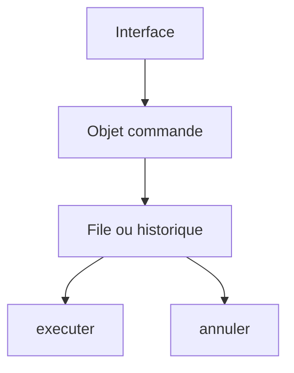

# Patron Commande (Command)

> [!info] En une phrase
> La commande transforme une action en objet : on peut alors la mettre en file d'attente, la journaliser, la rejouer ou l'annuler.

```dataviewjs
await dv.view("10 — Templates/Scripts/learning", { view: "concept" })
```

## 1 · Comprendre
### Définition
**Famille :** comportemental

**Le problème typique :** des actions doivent être exécutées plus tard, ailleurs, en série, ou annulées (Ctrl+Z).

**L'idée :** un objet qui contient tout ce qu'il faut pour exécuter l'action (`executer()`), et éventuellement pour l'annuler (`annuler()`).

### Pourquoi ça existe
Sans ce patron : l'action n'existe que comme un appel de fonction immédiat : impossible de la stocker, de la transmettre ou de la défaire.

### Quand l'utiliser
**Quand l'utiliser :** une action doit être différée, mise en file, tracée ou annulable.

**Quand ne pas l'utiliser :** une action simple, immédiate et définitive.

## 2 · Explorer
### Comment ça fonctionne


### Exemple concret
```python
@dataclass
class RenommerTache:
    depot: DepotTaches
    tache_id: int
    nouveau: str
    ancien: str = ""
    def executer(self):
        t = self.depot.trouver(self.tache_id)
        self.ancien, t.nom = t.nom, self.nouveau
        self.depot.enregistrer(t)
    def annuler(self):
        t = self.depot.trouver(self.tache_id)
        t.nom = self.ancien
        self.depot.enregistrer(t)

historique = []
cmd = RenommerTache(depot, 12, "Chantier nord"); cmd.executer(); historique.append(cmd)
historique.pop().annuler()          # Ctrl+Z
```
Au niveau système, c'est l'idée des **files de tâches** : une demande d'export devient un message (une commande sérialisée en JSON) placé dans Redis, qu'un worker exécute plus tard. CVAT fonctionne ainsi pour ses traitements longs.

### Cas d'utilisation
- Annuler et refaire
- Files de tâches (Redis, RQ, Celery)
- Journal des actions, rejouer des opérations
- Les migrations de base de données (chacune a son `up` et son `down`)

> [!warning] À ne pas confondre
> Une commande qui ne garde pas assez d'informations pour s'annuler (ici `ancien`) : l'annulation devient impossible ou fausse.

## 3 · Pratiquer
- Ajoute à une liste de tâches les commandes `Ajouter`, `Supprimer`, `Renommer` avec annulation, et un historique

## 4 · Expliquer
> [!quote] Mon résumé, avec mes mots
> _À écrire sans regarder la fiche. Si je bloque, je ne l'ai pas encore compris._

## 5 · Relier
- **Prérequis** : [[Interface et polymorphisme]]
- **Complémentaires** : [[Pile et file]] · [[Architecture événementielle]]

## 6 · Réviser
> [!question] Me faire interroger
> Je demande à Claude de m'interroger sur cette notion pour vérifier que je l'ai comprise.

### Validation de la maîtrise
La notion est maîtrisée quand j'ai réussi **tous les exercices** qui l'utilisent (statut `reussi` dans l'exercice).

```dataviewjs
await dv.view("10 — Templates/Scripts/learning", { view: "maitrise" })
```
