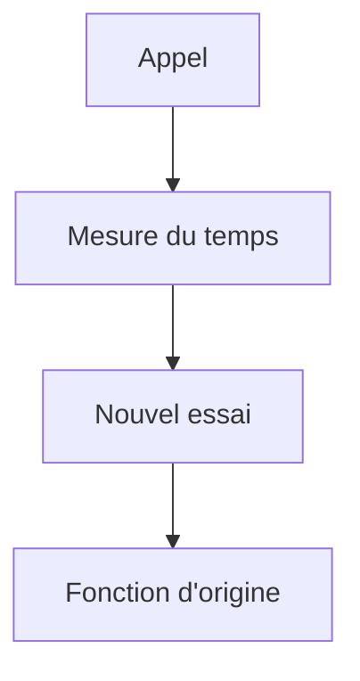

# Patron Décorateur (Decorator)

> [!info] En une phrase
> Le décorateur enveloppe un objet ou une fonction pour lui ajouter un comportement (journalisation, cache, nouvel essai, mesure du temps) sans modifier son code.

```dataviewjs
await dv.view("10 — Templates/Scripts/learning", { view: "concept" })
```

## 1 · Comprendre
### Définition
**Famille :** structurel

**Le problème typique :** il faut ajouter le même comportement transversal à beaucoup de fonctions : journaliser, mesurer, réessayer, vérifier un droit.

**L'idée :** une enveloppe qui a **la même interface** que l'objet d'origine, fait son travail en plus, et appelle l'original.

### Pourquoi ça existe
Sans ce patron : on copie les mêmes lignes au début et à la fin de chaque fonction, ou on crée une sous-classe par combinaison d'options.

### Quand l'utiliser
**Quand l'utiliser :** un comportement transversal à ajouter à plusieurs fonctions ou objets, ou à combiner librement.

**Quand ne pas l'utiliser :** un comportement propre à une seule fonction : écris-le dedans.

## 2 · Explorer
### Comment ça fonctionne


### Exemple concret
En Python, la syntaxe `@` est faite pour ça :
```python
import functools, time, logging

def reessayer(fois=3, attente=1.0):
    def decorateur(fonction):
        @functools.wraps(fonction)
        def enveloppe(*args, **kwargs):
            for essai in range(1, fois + 1):
                try:
                    return fonction(*args, **kwargs)
                except ConnectionError as e:
                    logging.warning("essai %s/%s échoué : %s", essai, fois, e)
                    if essai == fois:
                        raise
                    time.sleep(attente)
        return enveloppe
    return decorateur

@reessayer(fois=3)
def recuperer_annotations(tache_id): ...
```
Décorateurs que tu croiseras : `@functools.cache`, `@property`, `@app.get("/")` (FastAPI, Flask), `@pytest.fixture`, `@Component` et `@Injectable` en Angular. Les **middlewares** d'Express sont aussi des décorateurs de requêtes.

### Cas d'utilisation
- Cache, nouveaux essais, mesure de temps
- Contrôle d'accès sur des routes
- Les décorateurs Python et Angular

> [!warning] À ne pas confondre
> Empiler beaucoup de décorateurs rend le débogage difficile (la trace d'erreur traverse toutes les enveloppes) ; et sans `functools.wraps`, la fonction décorée perd son nom et sa documentation.

## 3 · Pratiquer
- Écris un décorateur `@chronometre` qui affiche la durée d'une fonction, puis un `@reessayer` ; applique les deux à une fonction qui échoue au hasard

## 4 · Expliquer
> [!quote] Mon résumé, avec mes mots
> _À écrire sans regarder la fiche. Si je bloque, je ne l'ai pas encore compris._

## 5 · Relier
- **Prérequis** : [[Fonction]] · [[Portée et closure]]
- **Complémentaires** : [[Middleware]] · [[Patron Proxy]]

## 6 · Réviser
> [!question] Me faire interroger
> Je demande à Claude de m'interroger sur cette notion pour vérifier que je l'ai comprise.

### Validation de la maîtrise
La notion est maîtrisée quand j'ai réussi **tous les exercices** qui l'utilisent (statut `reussi` dans l'exercice).

```dataviewjs
await dv.view("10 — Templates/Scripts/learning", { view: "maitrise" })
```
