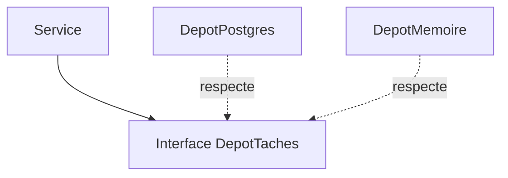

# Patron Dépôt (Repository)

> [!info] En une phrase
> Le dépôt regroupe tout l'accès aux données d'un type d'objet (lire, chercher, enregistrer, supprimer) derrière une interface, pour que le code métier ignore la base de données.

```dataviewjs
await dv.view("10 — Templates/Scripts/learning", { view: "concept" })
```

## 1 · Comprendre
### Définition
**Famille :** structurel et architectural

**Le problème typique :** les requêtes SQL ou les appels à l'ORM sont dispersés dans les routes et les règles métier.

**L'idée :** une classe par type de donnée, avec des méthodes au vocabulaire métier (`trouver(id)`, `non_terminees()`, `enregistrer(tache)`), et une implémentation par technologie.

### Pourquoi ça existe
Sans ce patron : impossible de tester les règles sans base, et changer de base ou de schéma oblige à fouiller tout le code.

### Quand l'utiliser
**Quand l'utiliser :** une application avec de vraies règles métier, à tester sans base.

**Quand ne pas l'utiliser :** un petit script ou une API très simple : l'ORM joue déjà ce rôle.

## 2 · Explorer
### Comment ça fonctionne


### Exemple concret
```python
class DepotTaches(Protocol):
    def trouver(self, id: int) -> Tache | None: ...
    def enregistrer(self, t: Tache) -> None: ...

class DepotTachesPostgres:
    def __init__(self, conn): self.conn = conn
    def trouver(self, id):
        ligne = self.conn.execute("SELECT id, nom, fini FROM tache WHERE id = %s", (id,)).fetchone()
        return Tache(*ligne) if ligne else None
    def enregistrer(self, t):
        self.conn.execute("UPDATE tache SET nom = %s, fini = %s WHERE id = %s", (t.nom, t.fini, t.id))

class DepotTachesMemoire:                    # pour les tests : aucune base nécessaire
    def __init__(self): self.donnees = {}
    def trouver(self, id): return self.donnees.get(id)
    def enregistrer(self, t): self.donnees[t.id] = t
```

### Cas d'utilisation
- La couche d'accès aux données d'une API
- Tester les services avec un dépôt en mémoire
- Les « managers » de Django (`Tache.objects`)

> [!warning] À ne pas confondre
> Un dépôt qui renvoie des objets de l'ORM ou des curseurs SQL ne cache rien : il doit renvoyer des objets métier simples.

## 3 · Pratiquer

### Exercice visuel

Sur Excalidraw, **sans regarder la fiche**. Puis je compare avec la fiche, je corrige en rouge ce qui était faux, et j'explique mon dessin à voix haute ou à Claude dans le chat.

> [!example] 🧠 Dessine de mémoire
> Dessine `DepensesDepot` entre les routes et la base : les méthodes qu'il offre, ce qu'il cache.

> [!example] ⚖️ Avant / après
> Avant / après : des routes qui font du SQL directement, puis avec un dépôt. Dessine ce qui change quand tu passes de SQLite à PostgreSQL.

### Mon schéma

> [!tip] Mon dessin Excalidraw
> _Je crée le dessin « Schéma - Patron Dépôt (Repository) » et je l'intègre ici avec `![[Schéma - Patron Dépôt (Repository).excalidraw]]`, puis je coche `schema`._

### Appliquer dans le fil rouge
- Pas encore d'étape du fil rouge pour cette notion : elle sera pratiquée dans le fil rouge de son niveau (voir [[Niveaux]]).

## 4 · Relier
- **Prérequis** : [[Interface et polymorphisme]]
- **Complémentaires** : [[Architecture en couches]] · [[ORM]] · [[Doublure de test (mock)]]

## 5 · Réviser
> [!question] Me faire interroger
> Je demande à Claude de m'interroger sur cette notion pour vérifier que je l'ai comprise.

### Validation de la maîtrise
Trois cases à cocher dans les propriétés de la fiche :
- `schema` : mon dessin du concept est dans « Mon schéma » ;
- `exercice_visuel` : j'ai fait et corrigé les exercices visuels de la section 3 ;
- `fil_rouge` : je l'ai appliqué dans le fil rouge (coché tout seul quand une étape qui l'utilise est réussie).

Les trois cochées : la notion compte comme **comprise**. **Maîtrisé** : c'est moi qui le mets dans `status`, quand je le sens.

```dataviewjs
await dv.view("10 — Templates/Scripts/learning", { view: "maitrise" })
```
