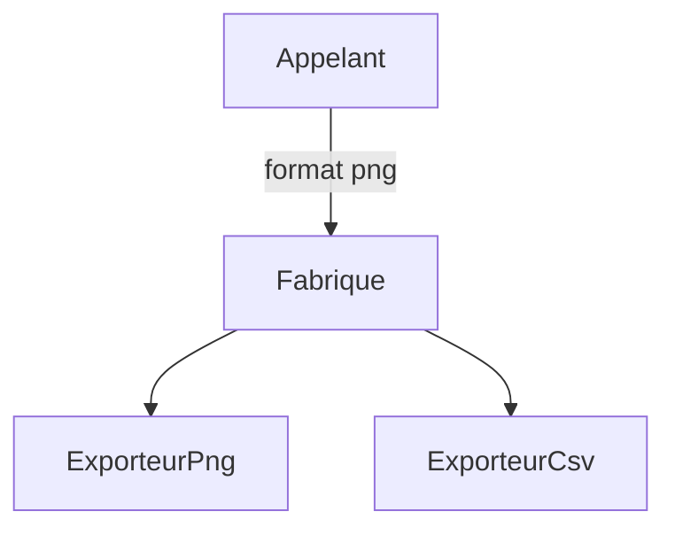

# Patron Fabrique (Factory)

> [!info] En une phrase
> La fabrique est une fonction ou une méthode qui crée le bon objet à ta place selon un paramètre, pour que le reste du code n'ait pas à connaître les classes concrètes.

```dataviewjs
await dv.view("10 — Templates/Scripts/learning", { view: "concept" })
```

## 1 · Comprendre
### Définition
**Famille :** créationnel (comment créer les objets)

**Le problème typique :** le code doit créer un objet dont la classe dépend d'une donnée (un format, une configuration, un environnement).

**L'idée :** rassembler la décision « quelle classe créer ? » en un seul endroit qui renvoie un objet respectant l'interface attendue.

### Pourquoi ça existe
Sans ce patron : des `if … elif …` de création dispersés partout, à modifier à chaque nouveau type.

### Quand l'utiliser
**Quand l'utiliser :** plusieurs classes concrètes possibles, choisies à l'exécution, ou une création compliquée à cacher.

**Quand ne pas l'utiliser :** une seule classe possible : un simple appel au constructeur suffit.

## 2 · Explorer
### Comment ça fonctionne


### Exemple concret
```python
EXPORTEURS = {"png": ExporteurPng, "csv": ExporteurCsv, "json": ExporteurJson}

def creer_exporteur(format: str, **options) -> Exporteur:
    try:
        return EXPORTEURS[format](**options)
    except KeyError:
        raise ValueError(f"format inconnu : {format} (possibles : {', '.join(EXPORTEURS)})")

exp = creer_exporteur(requete["format"], legende=True)   # l'appelant ne connaît que l'interface
```
Variante : une fabrique qui choisit selon l'environnement :
```python
def creer_stockage():
    return StockageS3(os.environ["BUCKET"]) if os.environ.get("ENV") == "prod" else StockageLocal("/tmp/exports")
```

### Cas d'utilisation
- `creer_exporteur(format)` dans ta fonction Nuclio
- `logging.getLogger(nom)`
- `document.createElement("li")`
- Les fabriques de clients des SDK (`make_client(...)` dans le SDK de CVAT)

> [!warning] À ne pas confondre
> La **Fabrique** (choisir **quelle** classe créer) n'est pas le **Monteur** (construire **pas à pas** un objet compliqué).

## 3 · Pratiquer

### Exercice visuel

Sur Excalidraw, **sans regarder la fiche**. Puis je compare avec la fiche, je corrige en rouge ce qui était faux, et j'explique mon dessin à voix haute ou à Claude dans le chat.

> [!example] 🛣️ Suis le trajet
> Dessine une fabrique qui reçoit « png », « json » ou « xml » et renvoie le bon exporteur. Suis les trois cas.

> [!example] 🔄 Change de contexte
> Redessine-la pour la création de formes selon leur type (rectangle, ligne, point).

### Mon schéma

> [!tip] Mon dessin Excalidraw
> _Je crée le dessin « Schéma - Patron Fabrique (Factory) » et je l'intègre ici avec `![[Schéma - Patron Fabrique (Factory).excalidraw]]`, puis je coche `schema`._

### Appliquer dans le fil rouge
- Pas encore d'étape du fil rouge pour cette notion : elle sera pratiquée dans le fil rouge de son niveau (voir [[Niveaux]]).

## 4 · Relier
- **Prérequis** : [[Interface et polymorphisme]]
- **Complémentaires** : [[Patron Stratégie (Strategy)]] · [[Patron Monteur (Builder)]]

## 5 · Réviser
> [!question] Me faire interroger
> Je demande à Claude de m'interroger sur cette notion pour vérifier que je l'ai comprise.

### Validation de la maîtrise
Trois cases à cocher dans les propriétés de la fiche :
- `schema` : mon dessin du concept est dans « Mon schéma » ;
- `exercice_visuel` : j'ai fait et corrigé les exercices visuels de la section 3 ;
- `fil_rouge` : je l'ai appliqué dans le fil rouge (coché tout seul quand une étape qui l'utilise est réussie).

Les trois cochées : la notion compte comme **comprise**. **Maîtrisé** : c'est moi qui le mets dans `status`, quand je le sens.

```dataviewjs
await dv.view("10 — Templates/Scripts/learning", { view: "maitrise" })
```
