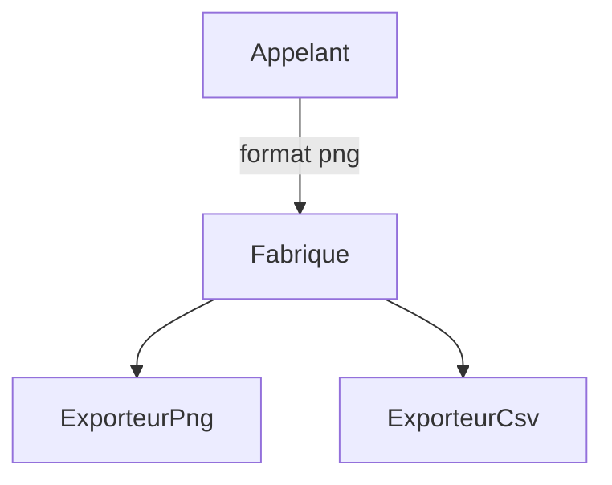

# Patron Fabrique (Factory)

> [!info] En une phrase
> La fabrique est une fonction ou une méthode qui crée le bon objet à ta place selon un paramètre, pour que le reste du code n'ait pas à connaître les classes concrètes.

```dataviewjs
await dv.view("10 — Templates/Scripts/learning", { view: "concept" })
```

## 1 · Comprendre
### Définition
**Famille :** créationnel (comment créer les objets)

**Le problème typique :** le code doit créer un objet dont la classe dépend d'une donnée (un format, une configuration, un environnement).

**L'idée :** rassembler la décision « quelle classe créer ? » en un seul endroit qui renvoie un objet respectant l'interface attendue.

### Pourquoi ça existe
Sans ce patron : des `if … elif …` de création dispersés partout, à modifier à chaque nouveau type.

### Quand l'utiliser
**Quand l'utiliser :** plusieurs classes concrètes possibles, choisies à l'exécution, ou une création compliquée à cacher.

**Quand ne pas l'utiliser :** une seule classe possible : un simple appel au constructeur suffit.

## 2 · Explorer
### Comment ça fonctionne


### Exemple concret
```python
EXPORTEURS = {"png": ExporteurPng, "csv": ExporteurCsv, "json": ExporteurJson}

def creer_exporteur(format: str, **options) -> Exporteur:
    try:
        return EXPORTEURS[format](**options)
    except KeyError:
        raise ValueError(f"format inconnu : {format} (possibles : {', '.join(EXPORTEURS)})")

exp = creer_exporteur(requete["format"], legende=True)   # l'appelant ne connaît que l'interface
```
Variante : une fabrique qui choisit selon l'environnement :
```python
def creer_stockage():
    return StockageS3(os.environ["BUCKET"]) if os.environ.get("ENV") == "prod" else StockageLocal("/tmp/exports")
```

### Cas d'utilisation
- `creer_exporteur(format)` dans ta fonction Nuclio
- `logging.getLogger(nom)`
- `document.createElement("li")`
- Les fabriques de clients des SDK (`make_client(...)` dans le SDK de CVAT)

> [!warning] À ne pas confondre
> La **Fabrique** (choisir **quelle** classe créer) n'est pas le **Monteur** (construire **pas à pas** un objet compliqué).

## 3 · Pratiquer
- Écris une fabrique `creer_archiveur(format)` pour zip et tar.gz, qui lève une erreur claire pour un format inconnu

## 4 · Expliquer
> [!quote] Mon résumé, avec mes mots
> _À écrire sans regarder la fiche. Si je bloque, je ne l'ai pas encore compris._

## 5 · Relier
- **Prérequis** : [[Interface et polymorphisme]]
- **Complémentaires** : [[Patron Stratégie (Strategy)]] · [[Patron Monteur (Builder)]]

## 6 · Réviser
> [!question] Me faire interroger
> Je demande à Claude de m'interroger sur cette notion pour vérifier que je l'ai comprise.

### Validation de la maîtrise
La notion est maîtrisée quand j'ai réussi **tous les exercices** qui l'utilisent (statut `reussi` dans l'exercice).

```dataviewjs
await dv.view("10 — Templates/Scripts/learning", { view: "maitrise" })
```
