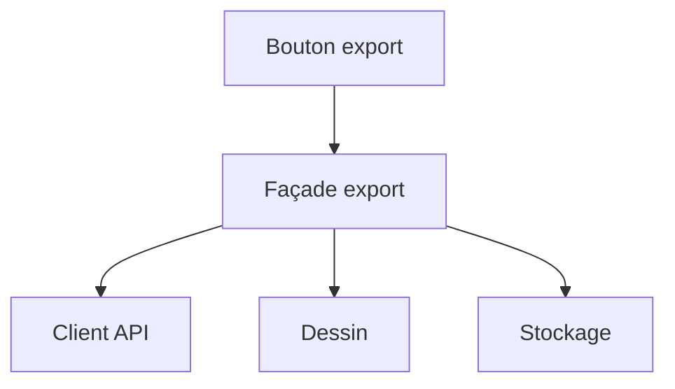

# Patron Façade (Facade)

> [!info] En une phrase
> La façade offre une interface simple qui cache un ensemble compliqué de classes ou d'appels derrière quelques méthodes claires.

```dataviewjs
await dv.view("10 — Templates/Scripts/learning", { view: "concept" })
```

## 1 · Comprendre
### Définition
**Famille :** structurel

**Le problème typique :** pour faire une action, il faut enchaîner beaucoup d'appels à plusieurs objets dans le bon ordre.

**L'idée :** une classe ou un module qui expose une méthode par besoin réel (`exporter_tache_en_png(12)`) et orchestre les sous-systèmes à l'intérieur.

### Pourquoi ça existe
Sans ce patron : chaque partie du code répète le même enchaînement compliqué, et un changement interne oblige à tout modifier.

### Quand l'utiliser
**Quand l'utiliser :** un enchaînement compliqué est répété, ou il faut protéger le reste du code des détails internes.

**Quand ne pas l'utiliser :** la façade devient une énorme classe qui fait tout (« objet dieu ») : découpe-la par besoin.

## 2 · Explorer
### Comment ça fonctionne


### Exemple concret
```python
class ServiceExportPng:                     # la façade
    def __init__(self, source, dessinateur, stockage):
        self._source, self._dessin, self._stockage = source, dessinateur, stockage

    def exporter(self, tache_id: int) -> str:
        annotations = self._source.annotations(tache_id)
        image = self._dessin.dessiner(annotations, taille=(2000, 1500))
        chemin = self._stockage.enregistrer(f"tache-{tache_id}.png", image)
        return chemin

# le handler ne voit que la façade
def handler(context, event):
    return service.exporter(event.body["tache_id"])
```
Exemples connus : le module `shutil` (une ligne pour `make_archive` au lieu de manipuler `zipfile` et `os`), `requests` par rapport à `http.client`, la commande `docker compose up` par rapport à une suite de `docker network create`, `docker run`…

### Cas d'utilisation
- Un service qui orchestre plusieurs appels
- Une bibliothèque qui simplifie une autre

> [!warning] À ne pas confondre
> La **façade** (simplifie et orchestre plusieurs objets) n'est pas l'**adaptateur** (traduit l'interface d'un seul objet).

## 3 · Pratiquer

### Exercice visuel

Sur Excalidraw, **sans regarder la fiche**. Puis je compare avec la fiche, je corrige en rouge ce qui était faux, et j'explique mon dessin à voix haute ou à Claude dans le chat.

> [!example] ⚖️ Avant / après
> Avant / après : un script qui appelle cinq fonctions d'une bibliothèque dans l'ordre, puis une façade `importer(fichier)`. Dessine ce que voit le code appelant.

> [!example] 🧠 Dessine de mémoire
> Dessine une façade comme l'accueil d'un hôtel : le client, l'accueil, les services cachés derrière.

### Mon schéma

> [!tip] Mon dessin Excalidraw
> _Je crée le dessin « Schéma - Patron Façade (Facade) » et je l'intègre ici avec `![[Schéma - Patron Façade (Facade).excalidraw]]`, puis je coche `schema`._

### Appliquer dans le fil rouge
- Pas encore d'étape du fil rouge pour cette notion : elle sera pratiquée dans le fil rouge de son niveau (voir [[Niveaux]]).

## 4 · Relier
- **Au travail** : [Patron Façade (Facade) au travail](obsidian://open?vault=Travail&file=Patron%20Fa%C3%A7ade%20%28Facade%29%20au%20travail)
- **Prérequis** : [[Interface et polymorphisme]]
- **Complémentaires** : [[Patron Adaptateur (Adapter)]] · [[Architecture en couches]]

## 5 · Réviser
> [!question] Me faire interroger
> Je demande à Claude de m'interroger sur cette notion pour vérifier que je l'ai comprise.

### Validation (compris, puis maîtrisé)
Trois cases à cocher dans les propriétés de la fiche :
- `schema` : mon dessin du concept est dans « Mon schéma » ;
- `exercice_visuel` : j'ai fait et corrigé les exercices visuels de la section 3 ;
- `fil_rouge` : je l'ai appliqué dans le fil rouge (coché tout seul quand une étape qui l'utilise est réussie).

Les trois cochées : la notion compte comme **comprise**. **Maîtrisé** : c'est moi qui le mets dans `status`, quand je le sens.

```dataviewjs
await dv.view("10 — Templates/Scripts/learning", { view: "maitrise" })
```
