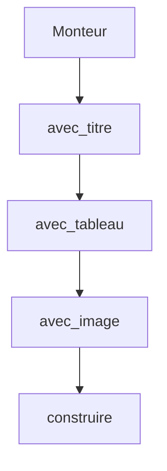

# Patron Monteur (Builder)

> [!info] En une phrase
> Le monteur construit un objet compliqué étape par étape, avec des méthodes lisibles enchaînées, au lieu d'un constructeur à quinze paramètres.

```dataviewjs
await dv.view("10 — Templates/Scripts/learning", { view: "concept" })
```

## 1 · Comprendre
### Définition
**Famille :** créationnel

**Le problème typique :** un objet a beaucoup d'options, la plupart facultatives (une requête, une configuration, un rapport).

**L'idée :** un objet « monteur » qui reçoit les options une à une, puis une méthode finale (`build`, `construire`) qui crée l'objet terminé et vérifie qu'il est valide.

### Pourquoi ça existe
Sans ce patron : des constructeurs illisibles : `Requete("GET", url, None, None, 30, True, False, {...})`, où l'on ne sait plus quel paramètre est lequel.

### Quand l'utiliser
**Quand l'utiliser :** un objet a de nombreuses options et une construction en plusieurs étapes.

**Quand ne pas l'utiliser :** un objet a deux ou trois paramètres : en Python, les **paramètres nommés avec valeurs par défaut** font déjà le travail (`Requete(url, timeout=30)`).

## 2 · Explorer
### Comment ça fonctionne


### Exemple concret
```python
class RapportBuilder:
    def __init__(self, titre: str):
        self._titre, self._sections, self._images = titre, [], []
    def section(self, texte: str) -> "RapportBuilder":
        self._sections.append(texte); return self        # renvoie self pour enchaîner
    def image(self, chemin: str) -> "RapportBuilder":
        self._images.append(chemin); return self
    def construire(self) -> "Rapport":
        if not self._sections:
            raise ValueError("un rapport a au moins une section")
        return Rapport(self._titre, tuple(self._sections), tuple(self._images))

rapport = (RapportBuilder("Export tâche 12")
           .section("12 images annotées")
           .image("plan.png")
           .construire())
```
Tu l'utilises déjà sans le savoir : le constructeur de requêtes de SQLAlchemy (`select(Tache).where(...).order_by(...)`), Prisma, le `QueryBuilder` de TypeORM, `new URL()` + `searchParams.append()`.

### Cas d'utilisation
- Constructeurs de requêtes SQL (ORM)
- Configuration d'un client HTTP
- Construire un document, un e-mail, une image

> [!warning] À ne pas confondre
> En Python et en TypeScript, les paramètres nommés et les objets d'options (`{ timeout: 30 }`) remplacent souvent le monteur : ne l'écris que si la construction a vraiment des étapes ou des vérifications.

## 3 · Pratiquer
- Écris un monteur de requête SQL simple : `Requete("tache").ou("fini = false").trier("nom").limite(10).sql()`

## 4 · Expliquer
> [!quote] Mon résumé, avec mes mots
> _À écrire sans regarder la fiche. Si je bloque, je ne l'ai pas encore compris._

## 5 · Relier
- **Prérequis** : [[Interface et polymorphisme]]
- **Complémentaires** : [[Patron Fabrique (Factory)]] · [[ORM]]

## 6 · Réviser
> [!question] Me faire interroger
> Je demande à Claude de m'interroger sur cette notion pour vérifier que je l'ai comprise.

### Validation de la maîtrise
La notion est maîtrisée quand j'ai réussi **tous les exercices** qui l'utilisent (statut `reussi` dans l'exercice).

```dataviewjs
await dv.view("10 — Templates/Scripts/learning", { view: "maitrise" })
```
