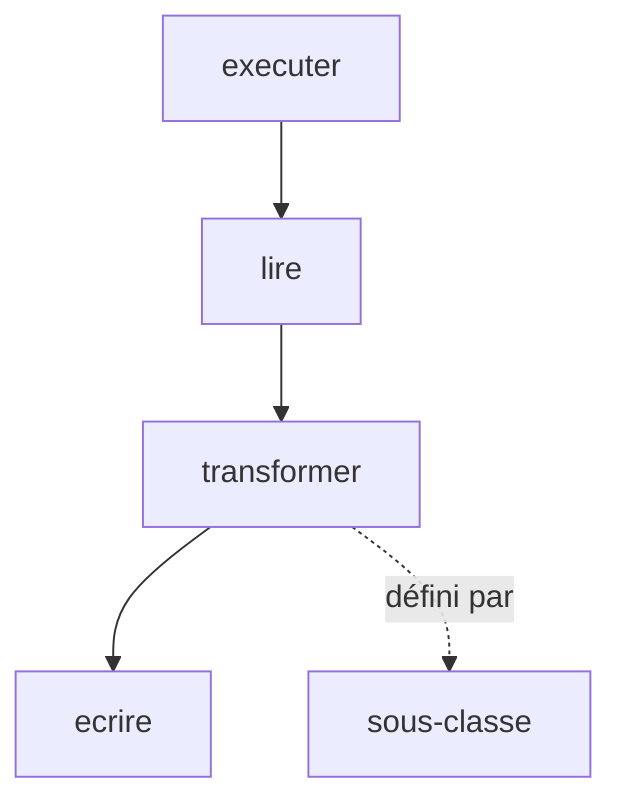

# Patron Méthode modèle (Template Method)

> [!info] En une phrase
> La méthode modèle fixe les grandes étapes d'un traitement dans une classe de base, et laisse les sous-classes remplir certaines étapes.

```dataviewjs
await dv.view("10 — Templates/Scripts/learning", { view: "concept" })
```

## 1 · Comprendre
### Définition
**Famille :** comportemental

**Le problème typique :** plusieurs traitements suivent le même déroulé (lire, transformer, écrire) et ne diffèrent que sur une ou deux étapes.

**L'idée :** une méthode de la classe de base qui appelle les étapes dans l'ordre ; les étapes variables sont des méthodes que chaque sous-classe définit.

### Pourquoi ça existe
Sans ce patron : le même squelette est recopié dans chaque variante, avec des différences subtiles et des oublis.

### Quand l'utiliser
**Quand l'utiliser :** plusieurs variantes partagent un déroulé fixe.

**Quand ne pas l'utiliser :** les variantes diffèrent beaucoup : la composition (une stratégie par étape) est plus souple que l'héritage.

## 2 · Explorer
### Comment ça fonctionne


### Exemple concret
```python
class Import:
    def executer(self, chemin):             # la méthode modèle : l'ordre est fixe
        donnees = self.lire(chemin)
        propres = [self.transformer(d) for d in donnees if self.garder(d)]
        self.ecrire(propres)
        return len(propres)
    def garder(self, d): return True        # étape facultative, valeur par défaut
    def lire(self, chemin): raise NotImplementedError
    def transformer(self, d): raise NotImplementedError
    def ecrire(self, lignes): print(f"{len(lignes)} lignes importées")

class ImportCsv(Import):
    def lire(self, chemin): return list(csv.DictReader(open(chemin, encoding="utf-8")))
    def transformer(self, d): return {**d, "label": d["label"].lower()}
```
Les frameworks en sont pleins : en Angular tu remplis `ngOnInit`, en Django tu redéfinis `get_queryset` dans une vue, `unittest.TestCase` appelle `setUp`, ton test, puis `tearDown`.

### Cas d'utilisation
- Cycles de vie des frameworks
- Imports et exports de données
- Tests (`setUp` / `tearDown`)

> [!warning] À ne pas confondre
> Ce patron repose sur l'**héritage** : s'il faut combiner les variantes (lire en CSV mais écrire en JSON), passe aux stratégies.

## 3 · Pratiquer
- Écris une méthode modèle d'export avec deux sous-classes (CSV et JSON) qui ne redéfinissent que l'étape de mise en forme

## 4 · Expliquer
> [!quote] Mon résumé, avec mes mots
> _À écrire sans regarder la fiche. Si je bloque, je ne l'ai pas encore compris._

## 5 · Relier
- **Prérequis** : [[Héritage et composition]]
- **Complémentaires** : [[Héritage et composition]] · [[Patron Stratégie (Strategy)]]

## 6 · Réviser
> [!question] Me faire interroger
> Je demande à Claude de m'interroger sur cette notion pour vérifier que je l'ai comprise.

### Validation de la maîtrise
La notion est maîtrisée quand j'ai réussi **tous les exercices** qui l'utilisent (statut `reussi` dans l'exercice).

```dataviewjs
await dv.view("10 — Templates/Scripts/learning", { view: "maitrise" })
```
