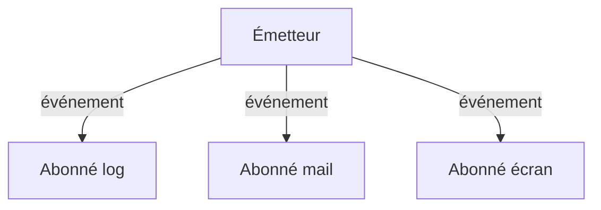

# Patron Observateur (Observer)

> [!info] En une phrase
> L'observateur permet à des objets de s'abonner à un autre pour être prévenus automatiquement quand quelque chose s'y passe, sans que l'émetteur les connaisse.

```dataviewjs
await dv.view("10 — Templates/Scripts/learning", { view: "concept" })
```

## 1 · Comprendre
### Définition
**Famille :** comportemental

**Le problème typique :** plusieurs parties du programme doivent réagir à un même événement (un export terminé, un clic, une donnée modifiée).

**L'idée :** l'émetteur garde une liste d'abonnés et les prévient tous ; chacun s'abonne et se désabonne librement.

### Pourquoi ça existe
Sans ce patron : l'émetteur appelle directement chaque intéressé : il doit les connaître tous, et ajouter un nouvel intéressé oblige à le modifier.

### Quand l'utiliser
**Quand l'utiliser :** un événement intéresse plusieurs parties qui ne doivent pas dépendre les unes des autres.

**Quand ne pas l'utiliser :** un seul destinataire connu : un appel direct est plus clair.

## 2 · Explorer
### Comment ça fonctionne


### Exemple concret
```python
from collections import defaultdict
class Evenements:
    def __init__(self): self._abonnes = defaultdict(list)
    def abonner(self, nom, fonction): self._abonnes[nom].append(fonction)
    def emettre(self, nom, **donnees):
        for f in self._abonnes[nom]:
            f(**donnees)

bus = Evenements()
bus.abonner("export_termine", lambda chemin, **_: logging.info("export : %s", chemin))
bus.abonner("export_termine", lambda chemin, **_: notifier_equipe(chemin))
bus.emettre("export_termine", chemin="tache-12.png", tache=12)
```
Tu l'utilises tout le temps : `addEventListener` dans le navigateur, les Observables de RxJS (`subscribe`), `watch` en Vue, les **webhooks** de GitLab (GitLab prévient ton serveur quand une pipeline finit), les signaux de Django.

### Cas d'utilisation
- Événements du navigateur
- RxJS et réactivité des frameworks
- Webhooks
- Architecture événementielle

> [!warning] À ne pas confondre
> Oublier de se désabonner : fuites de mémoire et réactions fantômes (d'où le pipe `async` d'Angular, le nettoyage de `useEffect`). Et l'enchaînement devient difficile à suivre quand des abonnés émettent à leur tour des événements.

## 3 · Pratiquer
- Écris un petit bus d'événements et branche-y trois abonnés à un événement « fichier zippé »

## 4 · Expliquer
> [!quote] Mon résumé, avec mes mots
> _À écrire sans regarder la fiche. Si je bloque, je ne l'ai pas encore compris._

## 5 · Relier
- **Prérequis** : [[Interface et polymorphisme]]
- **Complémentaires** : [[Événement JavaScript]] · [[Observable et RxJS]] · [[Architecture événementielle]]

## 6 · Réviser
> [!question] Me faire interroger
> Je demande à Claude de m'interroger sur cette notion pour vérifier que je l'ai comprise.

### Validation de la maîtrise
La notion est maîtrisée quand j'ai réussi **tous les exercices** qui l'utilisent (statut `reussi` dans l'exercice).

```dataviewjs
await dv.view("10 — Templates/Scripts/learning", { view: "maitrise" })
```
