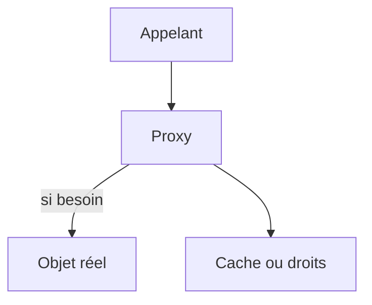

# Patron Proxy

> [!info] En une phrase
> Le proxy est un objet intermédiaire qui a la même interface que l'objet réel et contrôle l'accès à celui-ci : chargement différé, cache, droits, appel à distance.

```dataviewjs
await dv.view("10 — Templates/Scripts/learning", { view: "concept" })
```

## 1 · Comprendre
### Définition
**Famille :** structurel

**Le problème typique :** l'accès à un objet doit être contrôlé : il est coûteux à créer, distant, ou protégé.

**L'idée :** un remplaçant qui se fait passer pour l'objet réel et décide quand et comment le solliciter.

### Pourquoi ça existe
Sans ce patron : chaque appelant doit gérer lui-même le cache, le chargement ou la vérification des droits.

### Quand l'utiliser
**Quand l'utiliser :** il faut contrôler, retarder ou mettre en cache l'accès à un objet sans changer les appelants.

**Quand ne pas l'utiliser :** le contrôle peut se faire simplement à l'appel ; un proxy caché rend le comportement surprenant (« pourquoi la valeur n'a pas changé ? » : le cache).

## 2 · Explorer
### Comment ça fonctionne


### Exemple concret
```python
class SourceAvecCache:                       # proxy de cache, même interface que la source
    def __init__(self, source, duree=60):
        self._source, self._duree, self._cache = source, duree, {}
    def annotations(self, tache_id):
        valeur, quand = self._cache.get(tache_id, (None, 0))
        if time.time() - quand > self._duree:
            valeur = self._source.annotations(tache_id)
            self._cache[tache_id] = (valeur, time.time())
        return valeur
```
Proxies que tu connais déjà, au niveau réseau : le [[Proxy]] d'entreprise et le [[Reverse proxy]] (Traefik devant CVAT) font la même chose pour des requêtes HTTP. Les ORM utilisent des proxys pour charger une relation seulement quand on y accède (*lazy loading*).

### Cas d'utilisation
- Cache devant une API lente
- Chargement différé (ORM)
- Contrôle d'accès
- Objets distants (clients RPC)

> [!warning] À ne pas confondre
> Le **proxy** (contrôle l'accès, souvent sans que l'appelant le sache) et le **décorateur** (ajoute un comportement) se ressemblent beaucoup ; la différence est l'intention. Et ce patron n'est pas le **proxy réseau**, même si l'idée est la même.

## 3 · Pratiquer
- Ajoute un proxy de cache devant une fonction qui appelle jsonplaceholder et mesure le gain

## 4 · Expliquer
> [!quote] Mon résumé, avec mes mots
> _À écrire sans regarder la fiche. Si je bloque, je ne l'ai pas encore compris._

## 5 · Relier
- **Prérequis** : [[Interface et polymorphisme]]
- **Complémentaires** : [[Patron Décorateur (Decorator)]] · [[Proxy]] · [[Reverse proxy]]

## 6 · Réviser
> [!question] Me faire interroger
> Je demande à Claude de m'interroger sur cette notion pour vérifier que je l'ai comprise.

### Validation de la maîtrise
La notion est maîtrisée quand j'ai réussi **tous les exercices** qui l'utilisent (statut `reussi` dans l'exercice).

```dataviewjs
await dv.view("10 — Templates/Scripts/learning", { view: "maitrise" })
```
