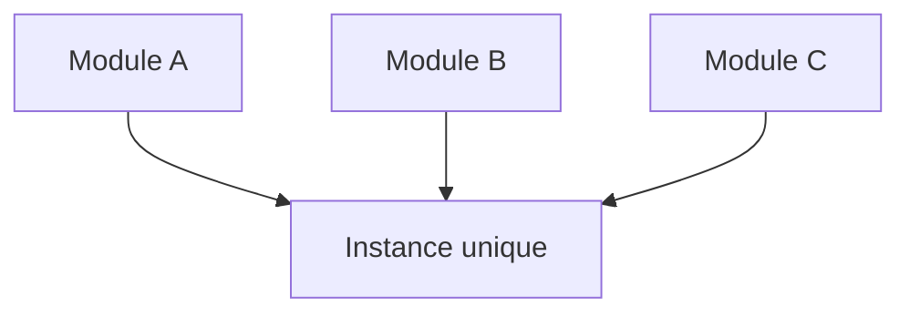

# Patron Singleton

> [!info] En une phrase
> Le singleton garantit qu'une classe n'a qu'une seule instance partagée par tout le programme, comme une connexion à la base ou une configuration.

```dataviewjs
await dv.view("10 — Templates/Scripts/learning", { view: "concept" })
```

## 1 · Comprendre
### Définition
**Famille :** créationnel

**Le problème typique :** certaines ressources doivent exister une seule fois : configuration, pool de connexions, cache, journal.

**L'idée :** créer l'objet une fois, et que tout le monde reçoive le même.

### Pourquoi ça existe
Sans ce patron : plusieurs connexions ouvertes par erreur, plusieurs configurations qui divergent.

### Quand l'utiliser
**Quand l'utiliser :** une ressource vraiment unique et coûteuse à créer.

**Quand ne pas l'utiliser :** pour éviter de passer des paramètres : c'est alors une **variable globale déguisée**.

## 2 · Explorer
### Comment ça fonctionne


### Exemple concret
En Python, **un module est déjà un singleton** : il n'est exécuté qu'une fois, à la première importation.
```python
# config.py
import os
API_URL = os.environ["CVAT_URL"]
TIMEOUT = int(os.environ.get("TIMEOUT", "30"))

# ailleurs
from config import API_URL      # toujours la même valeur
```
Ou une fonction mise en cache :
```python
from functools import cache
@cache
def client_cvat():
    return make_client(host=API_URL, credentials=(USER, MDP))   # créé une seule fois
```
En Angular : `@Injectable({ providedIn: "root" })` ; en Node, un module exporte une instance : `export const db = new Pool(...)`.

### Cas d'utilisation
- Configuration
- Pool de connexions à la base
- Journaliseur (`logging.getLogger`)
- Services Angular `providedIn: "root"`

> [!warning] À ne pas confondre
> C'est le patron le plus critiqué : un singleton qu'on modifie partout cache des dépendances et rend les tests difficiles (l'état fuit d'un test à l'autre). Préfère créer l'objet une fois au démarrage et le **passer** à ceux qui en ont besoin (injection de dépendances).

## 3 · Pratiquer
- Écris `client_cvat()` avec `@cache` et vérifie que deux appels renvoient le même objet (`is`)

## 4 · Expliquer
> [!quote] Mon résumé, avec mes mots
> _À écrire sans regarder la fiche. Si je bloque, je ne l'ai pas encore compris._

## 5 · Relier
- **Prérequis** : [[Classe et objet]]
- **Complémentaires** : [[Service et injection de dépendances]]

## 6 · Réviser
> [!question] Me faire interroger
> Je demande à Claude de m'interroger sur cette notion pour vérifier que je l'ai comprise.

### Validation de la maîtrise
La notion est maîtrisée quand j'ai réussi **tous les exercices** qui l'utilisent (statut `reussi` dans l'exercice).

```dataviewjs
await dv.view("10 — Templates/Scripts/learning", { view: "maitrise" })
```
