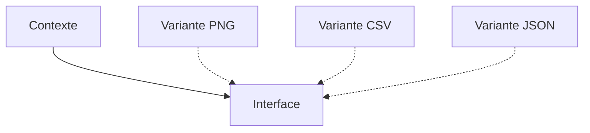

# Patron Stratégie (Strategy)

> [!info] En une phrase
> La stratégie met chaque variante d'un algorithme (un format, un calcul, une règle) dans son propre objet ou sa propre fonction, interchangeable à l'exécution.

```dataviewjs
await dv.view("10 — Templates/Scripts/learning", { view: "concept" })
```

## 1 · Comprendre
### Définition
**Famille :** comportemental (comment les objets collaborent)

**Le problème typique :** un même traitement existe en plusieurs variantes (export PNG, CSV, JSON ; tri par date ou par taille ; tarif normal ou réduit).

**L'idée :** une interface commune, une classe (ou une simple fonction) par variante, et le code principal reçoit la variante à utiliser.

### Pourquoi ça existe
Sans ce patron : un long `if … elif …` qui grossit à chaque variante, dans une fonction que tout le monde modifie.

### Quand l'utiliser
**Quand l'utiliser :** plusieurs variantes d'un traitement, choisies à l'exécution, et d'autres viendront.

**Quand ne pas l'utiliser :** deux cas stables : un `if` est plus simple.

## 2 · Explorer
### Comment ça fonctionne


### Exemple concret
Avant :
```python
def exporter(annotations, format):
    if format == "csv": ...
    elif format == "json": ...
    elif format == "png": ...      # chaque nouveau format modifie cette fonction
```
Après :
```python
STRATEGIES: dict[str, Callable[[list[dict]], bytes]] = {
    "csv":  exporter_csv,
    "json": exporter_json,
    "png":  exporter_png,
}
def exporter(annotations, format):
    return STRATEGIES[format](annotations)
```
En Python et en JavaScript, une **fonction** suffit souvent comme stratégie ; une classe quand la variante a de la configuration ou plusieurs méthodes. `sorted(liste, key=…)` est une stratégie : tu donnes la règle de tri.

### Cas d'utilisation
- Formats d'export de ta fonction Nuclio
- `sorted(key=…)`, `Array.sort(comparateur)`
- Stratégies d'authentification (Passport.js), de nouvel essai, de tarification

> [!warning] À ne pas confondre
> La **stratégie** (le client choisit la variante) n'est pas l'**état** (l'objet change lui-même de comportement quand son état change).

## 3 · Pratiquer
- Remplace par des stratégies un `if/elif` qui calcule le nom d'archive selon trois conventions

## 4 · Expliquer
> [!quote] Mon résumé, avec mes mots
> _À écrire sans regarder la fiche. Si je bloque, je ne l'ai pas encore compris._

## 5 · Relier
- **Prérequis** : [[Interface et polymorphisme]]
- **Complémentaires** : [[Patron Fabrique (Factory)]] · [[Patron État (State)]] · [[Principes SOLID]]

## 6 · Réviser
> [!question] Me faire interroger
> Je demande à Claude de m'interroger sur cette notion pour vérifier que je l'ai comprise.

### Validation de la maîtrise
La notion est maîtrisée quand j'ai réussi **tous les exercices** qui l'utilisent (statut `reussi` dans l'exercice).

```dataviewjs
await dv.view("10 — Templates/Scripts/learning", { view: "maitrise" })
```
