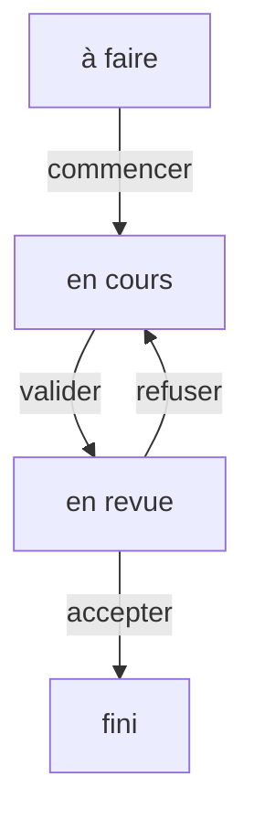

# Patron État (State)

> [!info] En une phrase
> Le patron État donne à un objet un comportement différent selon l'état où il se trouve, en représentant chaque état et ses transitions autorisées explicitement.

```dataviewjs
await dv.view("10 — Templates/Scripts/learning", { view: "concept" })
```

## 1 · Comprendre
### Définition
**Famille :** comportemental

**Le problème typique :** un objet passe par des étapes (brouillon, en revue, publié ; à faire, en cours, fini) et ce qu'il peut faire dépend de l'étape.

**L'idée :** décrire les états et les transitions permises au même endroit (une **machine à états**), et refuser toute transition non prévue.

### Pourquoi ça existe
Sans ce patron : des `if statut == …` partout, et des transitions interdites qui passent quand même (une tâche « finie » repasse « à faire » sans raison).

### Quand l'utiliser
**Quand l'utiliser :** un objet a des étapes avec des règles de passage.

**Quand ne pas l'utiliser :** deux états simples (actif / inactif) : un booléen suffit.

## 2 · Explorer
### Comment ça fonctionne


### Exemple concret
Version simple et suffisante dans la plupart des cas : une table des transitions.
```python
TRANSITIONS = {
    ("a-faire", "commencer"): "en-cours",
    ("en-cours", "valider"):  "en-revue",
    ("en-revue", "accepter"): "fini",
    ("en-revue", "refuser"):  "en-cours",
}
class Job:
    def __init__(self): self.etat = "a-faire"
    def faire(self, action: str):
        try:
            self.etat = TRANSITIONS[(self.etat, action)]
        except KeyError:
            raise ValueError(f"« {action} » impossible depuis l'état « {self.etat} »")
```
Les jobs de CVAT ont exactement ce genre d'états (*annotation*, *validation*, *acceptance*) ; les jobs de pipeline aussi (*created*, *pending*, *running*, *success*, *failed*).

### Cas d'utilisation
- Statuts de tâches, de commandes, de jobs
- Formulaires en plusieurs étapes
- États d'un chargement (chargement, ok, erreur)

> [!warning] À ne pas confondre
> La **stratégie** est choisie de l'extérieur ; l'**état** change de l'intérieur, au fil des actions. Les [[Union et type littéral|unions discriminées]] de TypeScript sont un très bon moyen de modéliser des états.

## 3 · Pratiquer
- Modélise les états d'une merge request (brouillon, ouverte, approuvée, fusionnée, fermée) et teste chaque transition interdite

## 4 · Expliquer
> [!quote] Mon résumé, avec mes mots
> _À écrire sans regarder la fiche. Si je bloque, je ne l'ai pas encore compris._

## 5 · Relier
- **Prérequis** : [[Classe et objet]]
- **Complémentaires** : [[Patron Stratégie (Strategy)]] · [[Union et type littéral]]

## 6 · Réviser
> [!question] Me faire interroger
> Je demande à Claude de m'interroger sur cette notion pour vérifier que je l'ai comprise.

### Validation de la maîtrise
La notion est maîtrisée quand j'ai réussi **tous les exercices** qui l'utilisent (statut `reussi` dans l'exercice).

```dataviewjs
await dv.view("10 — Templates/Scripts/learning", { view: "maitrise" })
```
