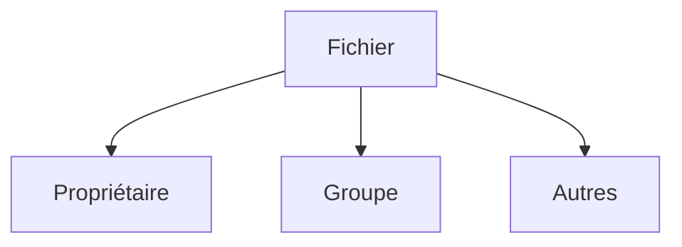

# Permissions Linux

> [!info] En une phrase
> Sous Linux, chaque fichier appartient à un utilisateur et dit qui peut le lire (r), l'écrire (w) ou l'exécuter (x) ; root peut tout, sudo permet d'agir en root.

```dataviewjs
await dv.view("10 — Templates/Scripts/learning", { view: "concept" })
```

## 1 · Comprendre
### Définition
Chaque fichier a un **propriétaire**, un **groupe**, et trois séries de droits : pour le propriétaire, le groupe, les autres. Chaque série combine `r` (lire), `w` (écrire), `x` (exécuter ; pour un dossier : y entrer).

**root** est l'administrateur, qui a tous les droits. `sudo commande` lance **une** commande en root, après ton mot de passe.

### Pourquoi ça existe
Plusieurs utilisateurs et services partagent la machine : chacun ne doit toucher que ce qui le regarde.

### Le problème résolu
N'importe quel programme pouvait modifier les fichiers du système ou d'un autre utilisateur.

## 2 · Explorer
### Comment ça fonctionne

```text
-rwxr-xr--  1 oumar oumar  512 nov.  6 21:30 entrypoint.sh
│└┬┘└┬┘└┬┘    └─┬─┘ └─┬─┘
│ │  │  └ autres : r--  (lire)
│ │  └─── groupe : r-x  (lire, exécuter)
│ └────── propriétaire : rwx (tout)
└──────── - = fichier, d = dossier
```
En chiffres : r = 4, w = 2, x = 1. `755` = `rwxr-xr-x`, `644` = `rw-r--r--`.

### Exemple concret
```bash
ls -l script.sh
chmod +x script.sh          # rendre exécutable
./script.sh                 # le lancer (./ = dans le dossier courant)
chmod 644 config.yml
sudo apt install tree       # installer un paquet demande root
sudo chown oumar:oumar fichier   # changer le propriétaire
whoami                      # qui suis-je ?
```

### Cas d'utilisation
- `Permission denied` en lançant un script : il manque `x` (voir [[Fichiers entre Windows et Linux]] pour Git)
- Fichiers créés par un conteneur qui appartiennent à `root` dans un dossier monté
- Installer des paquets avec [[Gestionnaire de paquets|apt]]

> [!warning] À ne pas confondre
> `sudo` pour **une** commande d'administration, et tout faire en `sudo` « pour que ça marche » : les fichiers créés appartiennent alors à root et tu ne peux plus les modifier normalement. Et `chmod 777` (tout le monde peut tout) n'est jamais une vraie solution.

## 3 · Pratiquer
- Crée un script `bonjour.sh`, essaie de le lancer avec `./bonjour.sh`, lis l'erreur, puis corrige avec `chmod`.
- Lis les droits de `/etc/passwd` et de ton dossier `~` et explique-les.

## 4 · Expliquer
> [!quote] Mon résumé, avec mes mots
> _À écrire sans regarder la fiche. Si je bloque, je ne l'ai pas encore compris._

## 5 · Relier
- **Prérequis** : [[Bash]] · [[Système de fichiers]]
- **Complémentaires** : [[Fichiers entre Windows et Linux]] · [[Script shell]]
- **Commandes** : [[chmod]] · [[sudo]]

## 6 · Réviser
> [!question] Me faire interroger
> Je demande à Claude de m'interroger sur cette notion pour vérifier que je l'ai comprise.

### Validation de la maîtrise
La notion est maîtrisée quand j'ai réussi **tous les exercices** qui l'utilisent (statut `reussi` dans l'exercice).

```dataviewjs
await dv.view("10 — Templates/Scripts/learning", { view: "maitrise" })
```
