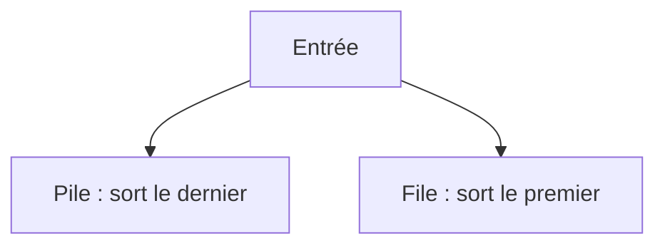

# Pile et file

> [!info] En une phrase
> Une pile (stack) sort en premier le dernier élément entré, comme une pile d'assiettes ; une file (queue) sort en premier le premier entré, comme une file d'attente.

```dataviewjs
await dv.view("10 — Templates/Scripts/learning", { view: "concept" })
```

## 1 · Comprendre
### Définition
| | Pile (LIFO) | File (FIFO) |
| --- | --- | --- |
| Règle | dernier entré, premier sorti | premier entré, premier sorti |
| Ajouter | `push` (empiler) | `enqueue` (enfiler) |
| Retirer | `pop` (dépiler, le dessus) | `dequeue` (défiler, le début) |
| Python | `liste.append(x)` / `liste.pop()` | `collections.deque` : `append(x)` / `popleft()` |
| JavaScript | `push` / `pop` | `push` / `shift` (lent sur de grosses files) |
Où tu les rencontres :
- **Pile** : la pile d'appels des fonctions (et les traces d'erreur, *stack trace*), annuler/refaire (Ctrl+Z), le bouton Précédent du navigateur, vérifier des parenthèses.
- **File** : les tâches en attente (les jobs d'une pipeline, les files Redis de CVAT), les impressions, le [[Parcours en largeur et en profondeur|parcours en largeur]].

### Pourquoi ça existe
Beaucoup de problèmes demandent de traiter des éléments dans un ordre précis : le plus récent d'abord, ou le plus ancien d'abord.

### Le problème résolu
Choisir la bonne structure rend certains algorithmes évidents.

## 2 · Explorer
### Comment ça fonctionne


### Exemple concret
Vérifier que des parenthèses sont bien fermées (un classique, utile pour comprendre les erreurs de syntaxe) :
```python
def equilibre(texte):
    paires = {")": "(", "]": "[", "}": "{"}
    pile = []
    for c in texte:
        if c in "([{":
            pile.append(c)
        elif c in paires:
            if not pile or pile.pop() != paires[c]:
                return False
    return not pile          # tout a été refermé
equilibre("f(a[1], {b: 2})")   # True
equilibre("f(a[1)]")           # False
```
```python
from collections import deque
file = deque(["job-lint", "job-test"])
file.append("job-build")
file.popleft()     # "job-lint" sort en premier
```

### Cas d'utilisation
- Comprendre une stack trace
- Files de tâches (Redis, CI)
- Algorithmes de parcours

> [!warning] À ne pas confondre
> Utiliser une liste Python comme file avec `pop(0)` : chaque retrait décale tous les éléments (O(n)). Utilise `deque`.

## 3 · Pratiquer
- Écris la vérification des parenthèses et teste-la sur dix chaînes, dont des cas limites (vide, seulement des fermantes)

## 4 · Expliquer
> [!quote] Mon résumé, avec mes mots
> _À écrire sans regarder la fiche. Si je bloque, je ne l'ai pas encore compris._

## 5 · Relier
- **Prérequis** : [[Liste et dictionnaire]]
- **Complémentaires** : [[Récursivité]] · [[Parcours en largeur et en profondeur]]

## 6 · Réviser
> [!question] Me faire interroger
> Je demande à Claude de m'interroger sur cette notion pour vérifier que je l'ai comprise.

### Validation de la maîtrise
La notion est maîtrisée quand j'ai réussi **tous les exercices** qui l'utilisent (statut `reussi` dans l'exercice).

```dataviewjs
await dv.view("10 — Templates/Scripts/learning", { view: "maitrise" })
```
