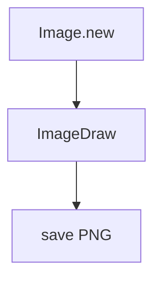

# Pillow

> [!info] En une phrase
> La bibliothèque Python pour ouvrir, créer, dessiner sur et enregistrer des images (PNG, JPEG…).

```dataviewjs
await dv.view("10 — Templates/Scripts/learning", { view: "concept" })
```

## 1 · Comprendre
### Définition
**Pillow** (on l'importe sous le nom `PIL`) manipule des images : créer une image vide, en ouvrir une, dessiner des lignes, des rectangles et des polygones avec `ImageDraw`, redimensionner, convertir, enregistrer.

### Pourquoi ça existe
Générer ou transformer des images depuis un programme, sans logiciel de dessin.

### Le problème résolu
Produire automatiquement des centaines d'images (aperçus, tracés d'annotations) au lieu de les faire à la main.

## 2 · Explorer
### Comment ça fonctionne

L'origine `(0, 0)` est **en haut à gauche** ; `y` grandit vers le bas.

### Exemple concret
```python
from PIL import Image, ImageDraw

img = Image.new("RGB", (400, 300), "white")      # largeur, hauteur, fond
draw = ImageDraw.Draw(img)
draw.rectangle([(50, 50), (200, 150)], outline="red", width=3)
draw.polygon([(250, 50), (350, 80), (300, 200)], outline="blue")
draw.line([(0, 299), (399, 0)], fill="black", width=2)
img.save("trace.png")
```
Pour renvoyer l'image sans fichier (dans une fonction Nuclio, par exemple) :
```python
import io
tampon = io.BytesIO()
img.save(tampon, format="PNG")
octets = tampon.getvalue()
```

### Cas d'utilisation
- Projet CVAT : tracer les annotations (rectangles, polygones) et produire un PNG
- Redimensionner des images avant de les zipper

> [!warning] À ne pas confondre
> On installe `pip install Pillow` mais on importe `from PIL import Image`. Et les coordonnées des annotations CVAT sont en pixels **de l'image d'origine** : l'image créée doit avoir la même taille.

## 3 · Pratiquer
- Crée une image blanche de 400×300 avec un rectangle et un polygone, puis ouvre le PNG.
- Ouvre une photo existante, dessine un cadre dessus, et enregistre une copie.

## 4 · Expliquer
> [!quote] Mon résumé, avec mes mots
> _À écrire sans regarder la fiche. Si je bloque, je ne l'ai pas encore compris._

## 5 · Relier
- **Prérequis** : [[pip]] · [[Lire et écrire un fichier]]
- **Complémentaires** : [[SDK]]
- **Utilisé par** : projet CVAT (fonction annotations → PNG)

## 6 · Réviser
> [!question] Me faire interroger
> Je demande à Claude de m'interroger sur cette notion pour vérifier que je l'ai comprise.

### Validation de la maîtrise
La notion est maîtrisée quand j'ai réussi **tous les exercices** qui l'utilisent (statut `reussi` dans l'exercice).

```dataviewjs
await dv.view("10 — Templates/Scripts/learning", { view: "maitrise" })
```
