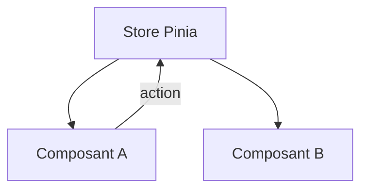

# Pinia

> [!info] En une phrase
> Pinia est le store officiel de Vue : un endroit central qui garde un état partagé par plusieurs composants (utilisateur connecté, panier, filtres), avec ses actions.

```dataviewjs
await dv.view("10 — Templates/Scripts/learning", { view: "concept" })
```

## 1 · Comprendre
### Définition
```ts
// stores/taches.ts
import { defineStore } from "pinia";
import { ref, computed } from "vue";
export const useTachesStore = defineStore("taches", () => {
  const taches = ref<Tache[]>([]);                         // state
  const restantes = computed(() => taches.value.filter((t) => !t.fini).length);   // getter
  async function charger() {                               // action
    const rep = await fetch("/api/taches");
    if (!rep.ok) throw new Error(String(rep.status));
    taches.value = await rep.json();
  }
  return { taches, restantes, charger };
});
```
Dans un composant : `const store = useTachesStore(); store.charger();` puis `{{ store.restantes }}`.
Les Vue DevTools montrent l'état du store et son historique.

### Pourquoi ça existe
Quand plusieurs écrans partagent les mêmes données, se les passer de parent en enfant devient ingérable.

### Le problème résolu
Un seul endroit pour l'état partagé et la logique qui le modifie, facile à suivre et à tester.

## 2 · Explorer
### Comment ça fonctionne


### Exemple concret
```vue
<script setup lang="ts">
import { onMounted } from "vue";
import { storeToRefs } from "pinia";
import { useTachesStore } from "@/stores/taches";
const store = useTachesStore();
const { taches, restantes } = storeToRefs(store);   // garde la réactivité
onMounted(store.charger);
</script>
<template><p>{{ restantes }} restantes</p><TacheItem v-for="t in taches" :key="t.id" :tache="t" /></template>
```
Équivalents : **Vuex** (ancien, Vue 2), **Redux** ou **Zustand** (React), **services** et **NgRx** (Angular).

### Cas d'utilisation
- Utilisateur connecté et son jeton
- Données utilisées par plusieurs pages
- Panier, préférences

> [!warning] À ne pas confondre
> Tout mettre dans le store : l'état propre à un seul composant (un champ saisi, une fenêtre ouverte) reste local. Et déstructurer le store sans `storeToRefs` casse la réactivité.

## 3 · Pratiquer

### Exercice visuel

Sur Excalidraw, **sans regarder la fiche**. Puis je compare avec la fiche, je corrige en rouge ce qui était faux, et j'explique mon dessin à voix haute ou à Claude dans le chat.

> [!example] ⚖️ Avant / après
> Avant / après : trois composants qui se passent la liste des dépenses de parent en enfant, puis un store Pinia. Dessine le chemin de la donnée dans chaque cas.

> [!example] 🛣️ Suis le trajet
> Dessine ce qui se passe quand un composant ajoute une dépense dans le store : l'action, l'état, les autres composants qui se mettent à jour.

### Mon schéma

> [!tip] Mon dessin Excalidraw
> _Je crée le dessin « Schéma - Pinia » et je l'intègre ici avec `![[Schéma - Pinia.excalidraw]]`, puis je coche `schema`._

### Appliquer dans le fil rouge
- Pas encore d'étape du fil rouge pour cette notion : elle sera pratiquée dans le fil rouge de son niveau (voir [[Niveaux]]).

## 4 · Relier
- **Prérequis** : [[État et réactivité]]
- **Complémentaires** : [[Application monopage et routage]] · [[Service et injection de dépendances]]

## 5 · Réviser
> [!question] Me faire interroger
> Je demande à Claude de m'interroger sur cette notion pour vérifier que je l'ai comprise.

### Validation (compris, puis maîtrisé)
Trois cases à cocher dans les propriétés de la fiche :
- `schema` : mon dessin du concept est dans « Mon schéma » ;
- `exercice_visuel` : j'ai fait et corrigé les exercices visuels de la section 3 ;
- `fil_rouge` : je l'ai appliqué dans le fil rouge (coché tout seul quand une étape qui l'utilise est réussie).

Les trois cochées : la notion compte comme **comprise**. **Maîtrisé** : c'est moi qui le mets dans `status`, quand je le sens.

```dataviewjs
await dv.view("10 — Templates/Scripts/learning", { view: "maitrise" })
```
