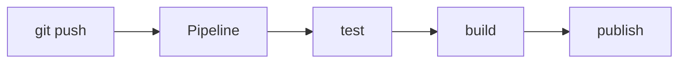
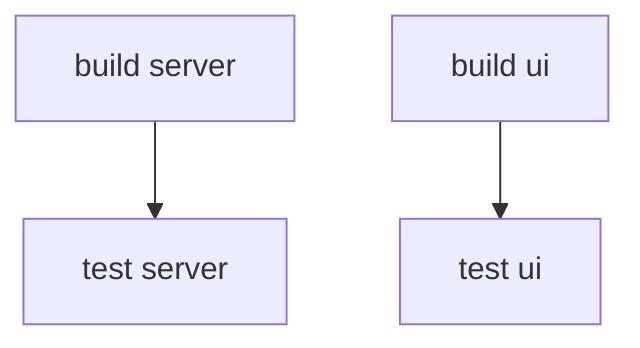

# Pipeline GitLab CI

> [!info] En une phrase
> Une suite de tâches automatiques (tester, construire, publier) que GitLab lance à chaque push, décrite dans .gitlab-ci.yml.

```dataviewjs
await dv.view("10 — Templates/Scripts/learning", { view: "concept" })
```

## 1 · Comprendre
### Définition
Une **pipeline** est l'ensemble des **jobs** que GitLab exécute pour un commit. Tout est décrit dans le fichier `.gitlab-ci.yml`, à la racine du dépôt.

### Pourquoi ça existe
Vérifier et construire chaque modification automatiquement, toujours de la même façon.

### Le problème résolu
Chacun lançait (ou oubliait) les tests et les builds sur son poste : du code cassé arrivait sur `main`.

## 2 · Explorer
### Comment ça fonctionne


### Exemple concret
| Terme | Définition |
| --- | --- |
| **stage** | une étape ; les stages s'exécutent dans l'ordre |
| **job** | une tâche : des commandes shell sous `script:` |
| **runner** | la machine qui exécute les jobs, souvent dans un conteneur choisi par `image:` |
| **rules** | quand lancer un job ; sans `rules`, à chaque push |

```yaml
stages:
  - test
  - build

tests:
  stage: test
  image: python:3.11-slim
  script:
    - pip install -r requirements.txt
    - pytest

premier-job:
  stage: build
  image: docker:24
  script:
    - docker version
  rules:
    - if: $CI_COMMIT_BRANCH == $CI_DEFAULT_BRANCH
```

### Ordre des jobs : stages et needs
Par défaut, un stage attend que **tous** les jobs du stage précédent soient finis. `needs:` permet à un job de démarrer **dès que les jobs qu'il cite** ont réussi, sans attendre le reste du stage.

```yaml
test-server:
  stage: test
  needs: [build-server]     # n'attend pas build-ui
```

### Les états d'un job
| État | Signifie |
| --- | --- |
| `passed` | toutes les commandes ont renvoyé 0 |
| `failed` | une commande a renvoyé autre chose que 0 ([[Code de sortie]]) |
| `skipped` | pas lancé : un job dont il dépend a échoué, ou ses `rules` l'excluent |
| `manual` | attend un clic sur ▶ (voir [[Règles d'un job GitLab (rules)]]) |
| `allowed to fail` (orange) | a échoué, mais `allow_failure: true` laisse la pipeline continuer |

### Cas d'utilisation
- Lancer les tests à chaque push
- Construire et publier des images
- Projet CVAT : partie 1 (reprendre CVAT sur GitLab, construire ses images en CI via le Nexus)

> [!warning] À ne pas confondre
> GitLab CI (`.gitlab-ci.yml`) et GitHub Actions (`.github/workflows/`) : un projet repris de GitHub garde sa CI GitHub, que GitLab **ignore**.

## 3 · Pratiquer
- Écris un `.gitlab-ci.yml` avec un seul job qui affiche `docker version`, et fais-le passer au vert.
- Vérifie la syntaxe dans *Build > Pipeline editor* avant de pousser.

## 4 · Expliquer
> [!quote] Mon résumé, avec mes mots
> _À écrire sans regarder la fiche. Si je bloque, je ne l'ai pas encore compris._

## 5 · Relier
- **Prérequis** : [[Git]]
- **Complémentaires** : [[Variables CI-CD GitLab]] · [[YAML]]
- **Approfondir** : [[Règles d'un job GitLab (rules)]] · [[Artefacts GitLab CI]] · [[extends GitLab CI]]
- **Utilisé par** : [[Construire une image dans la CI]] · [[Kaniko]] · [[Tester l'image, pas le dépôt]]

## 6 · Réviser
> [!question] Me faire interroger
> Je demande à Claude de m'interroger sur cette notion pour vérifier que je l'ai comprise.

### Validation de la maîtrise
- [ ] Je l'explique sans notes, en 3 phrases, à quelqu'un qui ne connaît pas
- [ ] J'ai réussi un exercice qui l'utilise
- [ ] Je l'ai utilisé dans un projet
- [ ] Je sais dire quand ne pas l'utiliser (ou ce qu'il ne faut pas confondre)
