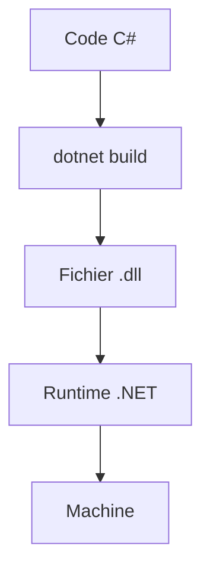

# Plateforme .NET

> [!info] En une phrase
> **.NET** est la plateforme de Microsoft pour écrire et faire tourner des programmes (surtout en **C#**) : un kit pour construire (le SDK), un moteur pour exécuter (le runtime) et une grosse bibliothèque standard.

## 1 · Comprendre
### Définition
Quand on dit « faire du .NET », on parle de trois choses qui vont ensemble :
- **C#** : le **langage** dans lequel on écrit le code (fichiers `.cs`). Il en existe d'autres (F#, VB.NET), mais C# est de loin le plus utilisé.
- **Le SDK .NET** : la boîte à outils du développeur. Il fournit la commande `dotnet` qui crée, compile, teste et publie les projets.
- **Le runtime .NET** : le moteur qui **exécute** le programme compilé. Sur un serveur, on installe seulement le runtime (ou on utilise une image Docker qui le contient).

Plus une très grosse **bibliothèque standard** (fichiers, réseau, JSON, dates, collections…) : comme en Python, l'essentiel est déjà là.

### Pourquoi ça existe
Avoir un seul socle solide pour tous les types de programmes : outils en ligne de commande, API web, services en arrière-plan, applications de bureau. Le typage strict et la compilation attrapent beaucoup d'erreurs avant même de lancer le programme.

### Le problème résolu
Écrire des applications d'entreprise qui vivent longtemps, avec beaucoup de code et beaucoup de développeurs, sans que tout casse à chaque modification. Le compilateur et l'éditeur (complétion, renommage sûr) aident énormément sur un gros code.

## 2 · Explorer
### Comment ça fonctionne

- `dotnet build` **compile** le C# en un langage intermédiaire (IL), rangé dans un fichier `.dll`.
- Au lancement, le runtime traduit cet IL en instructions de la machine, au fur et à mesure (compilation « juste à temps », JIT).
- Le même `.dll` tourne sous Windows, Linux et macOS : .NET est **multiplateforme** depuis .NET Core (2016).

### Exemple concret
```bash
dotnet --version          # la version du SDK installée
dotnet new console -o Bonjour
cd Bonjour
dotnet run                # compile puis lance : « Hello, World! »
```
Le fichier `Program.cs` créé tient en une ligne : `Console.WriteLine("Hello, World!");`.

### Les versions
- Une version par an, en novembre (.NET 8, 9, 10…). Les versions **paires** sont **LTS** (3 ans de support) : c'est elles qu'on choisit pour un projet qui doit durer.
- **.NET Framework** (4.x) est l'ancien .NET, **Windows seulement**. On le croise encore dans de vieux projets ; tout nouveau projet part sur .NET (sans « Framework »).
- La version visée par un projet est écrite dans son `.csproj` : `<TargetFramework>net8.0</TargetFramework>`.

### Cas d'utilisation
- Des API web et des sites (ASP.NET Core, voir [[Framework web]])
- Des services qui tournent en continu (traitement de fichiers, files de messages)
- Des outils en ligne de commande
- Des applications de bureau Windows

> [!warning] À ne pas confondre
> **.NET** (la plateforme) et **C#** (le langage) : on écrit du C#, qui tourne sur .NET. Et **SDK** (pour développer : il contient le compilateur) et **runtime** (pour exécuter seulement). Enfin, **.NET Framework** (ancien, Windows) et **.NET** tout court (moderne, partout).

> [!abstract]- Comment ça s'écrit (référence à chercher, pas à apprendre par cœur)
> ```bash
> dotnet --list-sdks        # les SDK installés
> dotnet --list-runtimes    # les runtimes installés
> dotnet new list           # les modèles de projet disponibles
> ```
> Installer sous Ubuntu : `sudo apt install dotnet-sdk-8.0`. Sous Windows : l'installateur du site officiel, ou avec Visual Studio. Les commandes sont dans **04 — Commandes/dotnet**.

## 3 · Relier
- **Prérequis** : [[Terminal]] · [[Langage compilé et interprété]]
- **Complémentaires** : [[Projet et solution .NET]] · [[Python]] · [[Node.js]]
- **Utilisé par** : [[Framework web]]
- **Commandes** : [[dotnet new]] · [[dotnet run]] · [[dotnet build]]
