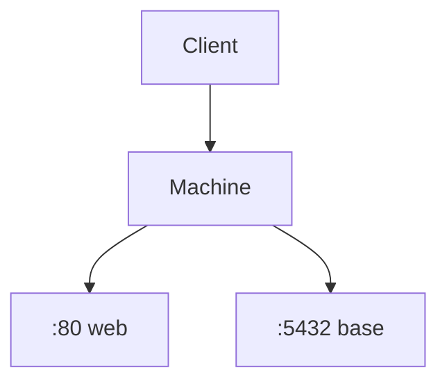

# Port

> [!info] En une phrase
> Un numéro (de 0 à 65535) qui indique à quel programme d'une machine s'adresse une connexion réseau.

```dataviewjs
await dv.view("10 — Templates/Scripts/learning", { view: "concept" })
```

## 1 · Comprendre
### Définition
Une adresse IP désigne **une machine** ; le **port** désigne **un programme** sur cette machine. Un serveur « écoute » sur un port : `localhost:8080` = la machine locale, programme qui écoute sur le port 8080.

| Port | Usage habituel |
| --- | --- |
| 22 | SSH |
| 80 / 443 | HTTP / HTTPS |
| 5432 | PostgreSQL |
| 8080 | serveurs web de développement (une appli en local) |

### Pourquoi ça existe
Une seule machine fait tourner plusieurs services réseau en même temps ; il faut savoir lequel doit recevoir chaque connexion.

### Le problème résolu
Sans ports, une machine ne pourrait offrir qu'un seul service réseau.

## 2 · Explorer
### Comment ça fonctionne

- **Un port = un seul programme** à la fois : sinon `address already in use` ([[Erreur - EADDRINUSE port déjà utilisé]]).
- `localhost` / `127.0.0.1` = **cette machine seulement** ; `0.0.0.0` = « écoute sur toutes les interfaces », nécessaire dans un conteneur.

### Exemple concret
Avec Docker, `-p HÔTE:CONTENEUR` **publie** un port du conteneur sur ta machine :
```bash
docker run -p 8080:80 nginx      # http://localhost:8080 → port 80 du conteneur
```
```yaml
# docker-compose.yml
ports:
  - "8080:8080"
```
```powershell
netstat -ano | findstr :8080     # qui occupe le port 8080 (Windows)
```

### Cas d'utilisation
- Accéder à un service lancé dans un conteneur

> [!warning] À ne pas confondre
> Dans `-p 8080:80`, **gauche = ta machine**, **droite = le conteneur**. Et entre conteneurs d'un même compose, on utilise le port **interne** (`db:5432`), pas le port publié.

## 3 · Pratiquer

### Exercice visuel

Sur Excalidraw, **sans regarder la fiche**. Puis je compare avec la fiche, je corrige en rouge ce qui était faux, et j'explique mon dessin à voix haute ou à Claude dans le chat.

> [!example] 🛣️ Suis le trajet
> Dessine ton PC avec trois programmes qui écoutent : ton API, le front Vue, le front Angular. Écris leur port sur chaque porte et fais arriver une requête sur la bonne.

> [!example] 🔍 Trouve l'erreur
> Ce schéma est faux. Corrige-le en rouge et explique l'erreur.
>
> ```mermaid
> flowchart TD
>   R[Requête :8000] --> P[Ton PC]
>   P --> V[Vue 5173]
>   P --> A[API 8000]
> ```

### Mon schéma

> [!tip] Mon dessin Excalidraw
> _Je crée le dessin « Schéma - Port » et je l'intègre ici avec `![[Schéma - Port.excalidraw]]`, puis je coche `schema`._

### Appliquer dans le fil rouge
- [[MesDépenses 02 - Suivre une requête sur le réseau]]
- [[MesDépenses 04 - L'API dans Docker]]
- [[MesDépenses 12 - Derrière nginx, avec une petite page]]
- [[Fil rouge 03 - Une page web pour le rapport]]

## 4 · Relier
- **Au travail** : [Port au travail](obsidian://open?vault=Travail&file=Port%20au%20travail)
- **Prérequis** : [[Client-serveur]] · [[Internet]]
- **Complémentaires** : [[Proxy]]
- **Utilisé par** : [[Reverse proxy]] · [[Docker Compose]] · [[Conteneur]]

## 5 · Réviser
> [!question] Me faire interroger
> Je demande à Claude de m'interroger sur cette notion pour vérifier que je l'ai comprise.

### Validation (compris, puis maîtrisé)
Trois cases à cocher dans les propriétés de la fiche :
- `schema` : mon dessin du concept est dans « Mon schéma » ;
- `exercice_visuel` : j'ai fait et corrigé les exercices visuels de la section 3 ;
- `fil_rouge` : je l'ai appliqué dans le fil rouge (coché tout seul quand une étape qui l'utilise est réussie).

Les trois cochées : la notion compte comme **comprise**. **Maîtrisé** : c'est moi qui le mets dans `status`, quand je le sens.

```dataviewjs
await dv.view("10 — Templates/Scripts/learning", { view: "maitrise" })
```
