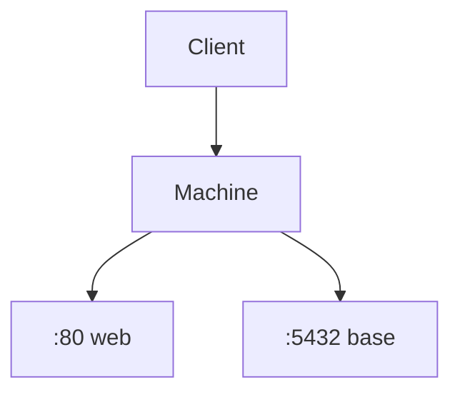

# Port

> [!info] En une phrase
> Un numéro (de 0 à 65535) qui indique à quel programme d'une machine s'adresse une connexion réseau.

```dataviewjs
await dv.view("10 — Templates/Scripts/learning", { view: "concept" })
```

## 1 · Comprendre
### Définition
Une adresse IP désigne **une machine** ; le **port** désigne **un programme** sur cette machine. Un serveur « écoute » sur un port : `localhost:8080` = la machine locale, programme qui écoute sur le port 8080.

| Port | Usage habituel |
| --- | --- |
| 22 | SSH |
| 80 / 443 | HTTP / HTTPS |
| 5432 | PostgreSQL |
| 8080 | serveurs web de développement (CVAT en local) |

### Pourquoi ça existe
Une seule machine fait tourner plusieurs services réseau en même temps ; il faut savoir lequel doit recevoir chaque connexion.

### Le problème résolu
Sans ports, une machine ne pourrait offrir qu'un seul service réseau.

## 2 · Explorer
### Comment ça fonctionne

- **Un port = un seul programme** à la fois : sinon `address already in use` ([[Erreur - EADDRINUSE port déjà utilisé]]).
- `localhost` / `127.0.0.1` = **cette machine seulement** ; `0.0.0.0` = « écoute sur toutes les interfaces », nécessaire dans un conteneur.

### Exemple concret
Avec Docker, `-p HÔTE:CONTENEUR` **publie** un port du conteneur sur ta machine :
```bash
docker run -p 8080:80 nginx      # http://localhost:8080 → port 80 du conteneur
```
```yaml
# docker-compose.yml
ports:
  - "8080:8080"
```
```powershell
netstat -ano | findstr :8080     # qui occupe le port 8080 (Windows)
```

### Cas d'utilisation
- Accéder à un service lancé dans un conteneur
- Comprendre `CVAT_HOST` et les ports publiés par Traefik ([[Reverse proxy]])

> [!warning] À ne pas confondre
> Dans `-p 8080:80`, **gauche = ta machine**, **droite = le conteneur**. Et entre conteneurs d'un même compose, on utilise le port **interne** (`db:5432`), pas le port publié.

## 3 · Pratiquer
- Lance `nginx` publié sur 8080, ouvre-le dans le navigateur, puis essaie de lancer un second conteneur sur le même port.
- Dans le `docker-compose.yml` de CVAT, liste les ports publiés.

## 4 · Expliquer
> [!quote] Mon résumé, avec mes mots
> _À écrire sans regarder la fiche. Si je bloque, je ne l'ai pas encore compris._

## 5 · Relier
- **Prérequis** : [[Client-serveur]] · [[Internet]]
- **Complémentaires** : [[Proxy]]
- **Utilisé par** : [[Reverse proxy]] · [[Docker Compose]] · [[Conteneur]]

## 6 · Réviser
> [!question] Me faire interroger
> Je demande à Claude de m'interroger sur cette notion pour vérifier que je l'ai comprise.

### Validation de la maîtrise
- [ ] Je l'explique sans notes, en 3 phrases, à quelqu'un qui ne connaît pas
- [ ] J'ai réussi un exercice qui l'utilise
- [ ] Je l'ai utilisé dans un projet
- [ ] Je sais dire quand ne pas l'utiliser (ou ce qu'il ne faut pas confondre)
