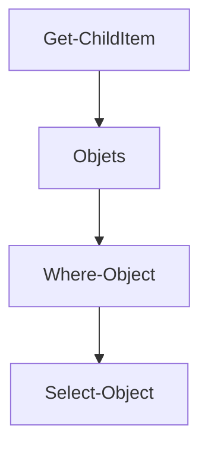

# PowerShell

> [!info] En une phrase
> Le shell moderne de Windows : ses commandes s'écrivent Verbe-Nom et se passent des objets, pas du texte.

```dataviewjs
await dv.view("10 — Templates/Scripts/learning", { view: "concept" })
```

## 1 · Comprendre
### Définition
**PowerShell** est le shell par défaut de Windows. Ses commandes s'appellent des **cmdlets** et suivent la forme `Verbe-Nom` : `Get-ChildItem`, `Copy-Item`, `Remove-Item`, `Get-Process`. Elles se passent des **objets** (avec des propriétés) au lieu de texte.

Pour aider les habitués de Linux, il définit des **alias** : `ls`, `cd`, `cp`, `rm`, `cat` existent… mais ce sont des cmdlets PowerShell déguisées, avec d'**autres options**.

### Pourquoi ça existe
Administrer Windows de façon scriptable, avec des commandes cohérentes et faciles à deviner.

### Le problème résolu
`cmd`, l'ancien shell, était très limité et peu cohérent.

## 2 · Explorer
### Comment ça fonctionne


### Exemple concret
```powershell
Get-ChildItem -Recurse -Filter *.png            # tous les .png
Get-ChildItem | Where-Object Length -gt 1MB     # fichiers de plus d'1 Mo
Get-Command git                                  # où est le programme git
Get-Help Copy-Item -Examples                     # aide avec exemples
$env:PATH -split ";"                             # le PATH, un dossier par ligne
```
| Bash | PowerShell (vrai nom) | Piège |
| --- | --- | --- |
| `ls -la` | `Get-ChildItem -Force` | `ls -la` échoue : l'option `-la` n'existe pas |
| `rm -rf dossier` | `Remove-Item -Recurse -Force dossier` | `rm -rf` échoue |
| `export X=1` | `$env:X = "1"` | — |
| `cmd1 && cmd2` | idem (PowerShell 7) ou `cmd1; if ($?) { cmd2 }` | `&&` n'existe pas dans Windows PowerShell 5 |
| `curl` | `curl.exe` | dans PowerShell 5, `curl` est un alias de `Invoke-WebRequest` |

### Cas d'utilisation
- Travailler sous Windows sans WSL : Git, Python, Docker marchent aussi depuis PowerShell
- Lancer `wsl` pour passer dans Linux

> [!warning] À ne pas confondre
> **Windows PowerShell 5.1** (bleu, installé d'office) et **PowerShell 7** (`pwsh`, à installer, plus moderne). Et l'alias `ls` de PowerShell avec le vrai `ls` de Linux.

## 3 · Pratiquer

### Exercice visuel

Sur Excalidraw, **sans regarder la fiche**. Puis je compare avec la fiche, je corrige en rouge ce qui était faux, et j'explique mon dessin avec mes mots (section 4).

> [!example] ⚖️ Avant / après
> Avant / après : la même tâche « lister les fichiers » en Bash puis en PowerShell. Dessine ce qui passe dans le pipe : du texte d'un côté, des objets de l'autre.

> [!example] 🧠 Dessine de mémoire
> Dessine ton poste : Windows avec PowerShell, et WSL avec Bash. Place chaque outil (git, docker, python) du côté où tu l'utilises.

### Mon schéma

> [!tip] Mon dessin Excalidraw
> _Je crée le dessin « Schéma - PowerShell » et je l'intègre ici avec `![[Schéma - PowerShell.excalidraw]]`._

### Appliquer dans le fil rouge
- Pas encore d'étape du fil rouge pour cette notion : je l'applique dans mon travail (CVAT, Nuclio) ou je demande une étape à Claude.

## 4 · Expliquer
> [!quote] Mon résumé, avec mes mots
> _J'explique mon schéma avec mes mots, sans regarder la fiche. Si je bloque, je ne l'ai pas encore compris._

## 5 · Relier
- **Notion parente** : [[Shell]]
- **Complémentaires** : [[Bash]]
- **Commandes** : [[Get-ChildItem]] · [[wsl.exe]]

## 6 · Réviser
> [!question] Me faire interroger
> Je demande à Claude de m'interroger sur cette notion pour vérifier que je l'ai comprise.

### Validation de la maîtrise
La notion est maîtrisée quand je sais :
1. **l'expliquer** de façon fluide, à partir de mon schéma (section 4) ;
2. **l'adapter** à un autre contexte (consigne « Change de contexte », ou Claude m'interroge sur un autre cas) ;
3. **l'appliquer** pour de vrai dans le fil rouge (section 3).

Réussir un exercice ne suffit pas. C'est moi qui passe le statut en `maitrise`.

```dataviewjs
await dv.view("10 — Templates/Scripts/learning", { view: "maitrise" })
```
