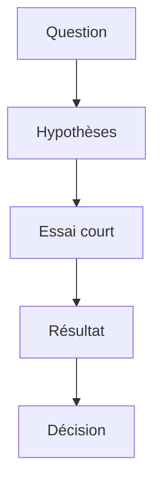

# Preuve de concept (POC)

> [!info] En une phrase
> Une preuve de concept (POC, *proof of concept*) est un petit travail limité dans le temps qui sert à répondre à **une question** : « est-ce que c'est faisable, techniquement, dans nos conditions ? ». Son vrai livrable n'est pas le code, c'est la **réponse** (oui, non, oui mais…).

```dataviewjs
await dv.view("10 — Templates/Scripts/learning", { view: "concept" })
```

## 1 · Comprendre
### Définition
**Une question précise** : « Peut-on déclencher une fonction Nuclio depuis un bouton de CVAT et récupérer un PNG des annotations ? ». Pas « faire l'outil d'export ».

**Des hypothèses** à vérifier : l'API de CVAT donne bien les annotations, Nuclio peut appeler CVAT, les images passent par le Nexus de l'entreprise.

**Des critères de succès** écrits **avant** de commencer : à quoi saura-t-on que la réponse est oui ? (ex. « un clic produit un PNG correct pour une tâche de 50 images, en moins de 10 s »).

**Une durée fixée à l'avance** (*timebox*) : 1 à 3 semaines en général. Quand le temps est écoulé, on conclut, même si tout n'est pas fini.

**Un périmètre réduit** : on prend le chemin le plus court vers la réponse. Pas de gestion fine des erreurs, pas de tests complets, pas d'interface soignée, sauf si c'est justement ce qu'on veut prouver.

**Un compte rendu** à la fin : ce qui marche, ce qui ne marche pas, les limites découvertes, les risques, et la recommandation (continuer, changer d'approche, abandonner).

### Pourquoi ça existe
Avant d'investir des mois dans un développement, une équipe veut savoir si l'idée tient debout. Le POC réduit le **risque** : on dépense peu pour apprendre beaucoup.

### Le problème résolu
Découvrir trop tard qu'une technologie ne fait pas ce qu'on croyait, qu'un réseau d'entreprise bloque un accès, ou que les performances sont inacceptables.

## 2 · Explorer
### Comment ça fonctionne


### Exemple concret
```markdown
# POC - Export PNG depuis CVAT
Question : un bouton dans CVAT peut-il produire un PNG des annotations via Nuclio ?
Durée : 2 semaines (fin le 20/11)
Critères de succès :
- l'image CVAT se construit dans la CI GitLab avec les images du Nexus
- un clic sur le bouton appelle la fonction Nuclio
- la fonction renvoie un PNG lisible pour une tâche réelle
Hors périmètre : droits fins, tests complets, design du bouton
Résultat : (à remplir à la fin)
Recommandation : (continuer / changer d'approche / abandonner)
```

### Cas d'utilisation
- Tester une nouvelle bibliothèque ou un nouveau service avant de l'adopter
- Vérifier qu'un enchaînement de briques fonctionne de bout en bout (ton projet CVAT + Nuclio)
- Mesurer si une approche est assez rapide

> [!warning] À ne pas confondre
> Un POC n'est pas un **prototype** (qui sert à montrer à quoi ressemblera le produit) ni un **MVP** (qui est déjà un vrai produit, livré à de vrais utilisateurs). Et un POC réussi **n'est pas un produit fini** : son code est souvent à réécrire avant la mise en production.

## 3 · Pratiquer
- Écris en 5 lignes la question, les critères de succès et la durée de ton POC CVAT actuel

## 4 · Expliquer
> [!quote] Mon résumé, avec mes mots
> _À écrire sans regarder la fiche. Si je bloque, je ne l'ai pas encore compris._

## 5 · Relier
- **Complémentaires** : [[Prototype]] · [[MVP (produit minimum viable)]] · [[Dette technique]] · [[Décision d'architecture (ADR)]] · [[Critères d'acceptation]]

## 6 · Réviser
> [!question] Me faire interroger
> Je demande à Claude de m'interroger sur cette notion pour vérifier que je l'ai comprise.

### Validation de la maîtrise
La notion est maîtrisée quand j'ai réussi **tous les exercices** qui l'utilisent (statut `reussi` dans l'exercice).

```dataviewjs
await dv.view("10 — Templates/Scripts/learning", { view: "maitrise" })
```
