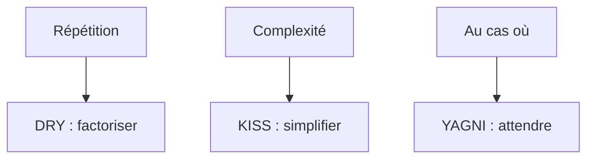

# Principes DRY, KISS et YAGNI

> [!info] En une phrase
> Trois règles de bon sens : ne pas répéter la même connaissance (DRY), garder les choses simples (KISS), et ne pas coder ce dont on n'a pas encore besoin (YAGNI).

```dataviewjs
await dv.view("10 — Templates/Scripts/learning", { view: "concept" })
```

## 1 · Comprendre
### Définition
- **DRY** (*Don't Repeat Yourself*) : une règle ou une donnée doit être écrite **à un seul endroit**. Si l'URL de l'API est copiée dans dix fichiers, un changement en oublie un.
- **KISS** (*Keep It Simple, Stupid*) : la solution la plus simple qui marche est la meilleure ; le code est lu bien plus souvent qu'écrit.
- **YAGNI** (*You Aren't Gonna Need It*) : pas de configuration, d'abstraction ou d'option « au cas où » ; on l'ajoutera le jour où on en aura besoin.
Équilibre : DRY appliqué trop tôt crée des abstractions forcées ; **mieux vaut un peu de duplication qu'une mauvaise abstraction**. Règle pratique : factoriser à la troisième répétition.

### Pourquoi ça existe
Le code se complique tout seul avec le temps : copier-coller, options inutiles, généralisations prématurées.

### Le problème résolu
Un code plus court, plus lisible et plus facile à modifier.

## 2 · Explorer
### Comment ça fonctionne


### Exemple concret
```python
# répété
url = "https://cvat.ex/api/tasks"   # dans 5 fichiers
# DRY
API = os.environ["API_URL"]        # un seul endroit (config.py)

# pas KISS, pas YAGNI
class FabriqueDeCompresseurs:       # pour un seul format utilisé
    def creer(self, format="zip", niveau=6, chiffrement=None, plugins=()): ...
# simple
def zipper(fichiers, sortie): ...
```

### Cas d'utilisation
- Revue de code
- Refactorisation
- Choisir entre deux solutions

> [!warning] À ne pas confondre
> **DRY** concerne la **connaissance**, pas les lignes qui se ressemblent : deux fonctions identiques par hasard mais pour des raisons différentes peuvent rester séparées.

## 3 · Pratiquer

### Exercice visuel

Sur Excalidraw, **sans regarder la fiche**. Puis je compare avec la fiche, je corrige en rouge ce qui était faux, et j'explique mon dessin à voix haute ou à Claude dans le chat.

> [!example] ⚖️ Avant / après
> Avant / après : un morceau de script qui répète trois fois la même chose, puis la version DRY. Dessine où se trouve la connaissance dans chaque cas.

> [!example] 🧠 Dessine de mémoire
> Dessine trois panneaux DRY, KISS, YAGNI avec un exemple de ton application sous chacun.

### Mon schéma

> [!tip] Mon dessin Excalidraw
> _Je crée le dessin « Schéma - Principes DRY, KISS et YAGNI » et je l'intègre ici avec `![[Schéma - Principes DRY, KISS et YAGNI.excalidraw]]`, puis je coche `schema`._

### Appliquer dans le fil rouge
- [[Dépenses 05 - Un module réutilisable]]

## 4 · Relier
- **Prérequis** : [[Fonction]]
- **Complémentaires** : [[Refactorisation]] · [[Principes SOLID]]

## 5 · Réviser
> [!question] Me faire interroger
> Je demande à Claude de m'interroger sur cette notion pour vérifier que je l'ai comprise.

### Validation (compris, puis maîtrisé)
Trois cases à cocher dans les propriétés de la fiche :
- `schema` : mon dessin du concept est dans « Mon schéma » ;
- `exercice_visuel` : j'ai fait et corrigé les exercices visuels de la section 3 ;
- `fil_rouge` : je l'ai appliqué dans le fil rouge (coché tout seul quand une étape qui l'utilise est réussie).

Les trois cochées : la notion compte comme **comprise**. **Maîtrisé** : c'est moi qui le mets dans `status`, quand je le sens.

```dataviewjs
await dv.view("10 — Templates/Scripts/learning", { view: "maitrise" })
```
