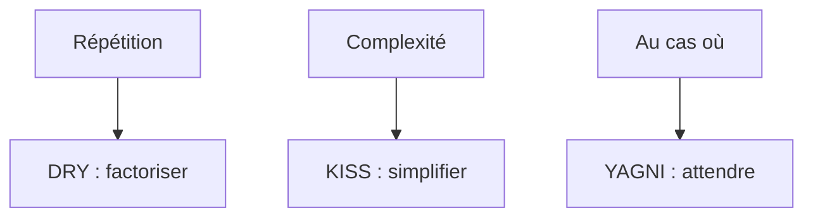

# Principes DRY, KISS et YAGNI

> [!info] En une phrase
> Trois règles de bon sens : ne pas répéter la même connaissance (DRY), garder les choses simples (KISS), et ne pas coder ce dont on n'a pas encore besoin (YAGNI).

```dataviewjs
await dv.view("10 — Templates/Scripts/learning", { view: "concept" })
```

## 1 · Comprendre
### Définition
- **DRY** (*Don't Repeat Yourself*) : une règle ou une donnée doit être écrite **à un seul endroit**. Si l'URL de l'API est copiée dans dix fichiers, un changement en oublie un.
- **KISS** (*Keep It Simple, Stupid*) : la solution la plus simple qui marche est la meilleure ; le code est lu bien plus souvent qu'écrit.
- **YAGNI** (*You Aren't Gonna Need It*) : pas de configuration, d'abstraction ou d'option « au cas où » ; on l'ajoutera le jour où on en aura besoin.
Équilibre : DRY appliqué trop tôt crée des abstractions forcées ; **mieux vaut un peu de duplication qu'une mauvaise abstraction**. Règle pratique : factoriser à la troisième répétition.

### Pourquoi ça existe
Le code se complique tout seul avec le temps : copier-coller, options inutiles, généralisations prématurées.

### Le problème résolu
Un code plus court, plus lisible et plus facile à modifier.

## 2 · Explorer
### Comment ça fonctionne


### Exemple concret
```python
# répété
url = "https://cvat.ex/api/tasks"   # dans 5 fichiers
# DRY
API = os.environ["CVAT_URL"]        # un seul endroit (config.py)

# pas KISS, pas YAGNI
class FabriqueDeCompresseurs:       # pour un seul format utilisé
    def creer(self, format="zip", niveau=6, chiffrement=None, plugins=()): ...
# simple
def zipper(fichiers, sortie): ...
```

### Cas d'utilisation
- Revue de code
- Refactorisation
- Choisir entre deux solutions

> [!warning] À ne pas confondre
> **DRY** concerne la **connaissance**, pas les lignes qui se ressemblent : deux fonctions identiques par hasard mais pour des raisons différentes peuvent rester séparées.

## 3 · Pratiquer
- Relis un de tes scripts et trouve une répétition à factoriser et une complication à supprimer

## 4 · Expliquer
> [!quote] Mon résumé, avec mes mots
> _À écrire sans regarder la fiche. Si je bloque, je ne l'ai pas encore compris._

## 5 · Relier
- **Prérequis** : [[Fonction]]
- **Complémentaires** : [[Refactorisation]] · [[Principes SOLID]]

## 6 · Réviser
> [!question] Me faire interroger
> Je demande à Claude de m'interroger sur cette notion pour vérifier que je l'ai comprise.

### Validation de la maîtrise
La notion est maîtrisée quand j'ai réussi **tous les exercices** qui l'utilisent (statut `reussi` dans l'exercice).

```dataviewjs
await dv.view("10 — Templates/Scripts/learning", { view: "maitrise" })
```
