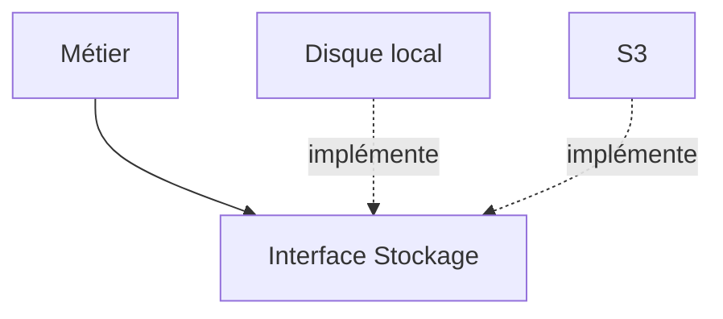

# Principes SOLID

> [!info] En une phrase
> SOLID regroupe cinq principes de conception orientée objet qui rendent le code plus facile à faire évoluer : responsabilité unique, ouvert/fermé, substitution de Liskov, ségrégation des interfaces, inversion des dépendances.

```dataviewjs
await dv.view("10 — Templates/Scripts/learning", { view: "concept" })
```

## 1 · Comprendre
### Définition
| Lettre | Principe | En une phrase |
| --- | --- | --- |
| **S** | Responsabilité unique | une classe ou un module n'a qu'une raison de changer |
| **O** | Ouvert/fermé | on ajoute un comportement en ajoutant du code, pas en modifiant ce qui marche |
| **L** | Substitution de Liskov | une sous-classe doit pouvoir remplacer sa classe mère sans surprise |
| **I** | Ségrégation des interfaces | plusieurs petites interfaces plutôt qu'une énorme |
| **D** | Inversion des dépendances | le métier dépend d'abstractions (une interface), pas des détails (une base précise) |
Le **D** est le plus utile au quotidien : c'est ce qui permet l'[[Service et injection de dépendances|injection de dépendances]] et les [[Doublure de test (mock)|doublures]] dans les tests.

### Pourquoi ça existe
Dans les gros projets, une modification en entraîne dix autres ; ces principes limitent les effets en chaîne.

### Le problème résolu
Ajouter un format d'export, une source de données ou un fournisseur sans réécrire ce qui existe.

## 2 · Explorer
### Comment ça fonctionne


### Exemple concret
```ts
// D et O : le service dépend d'une interface
interface Exporteur { exporter(annotations: Annotation[]): Promise<Buffer>; }
class ExporteurPng implements Exporteur { async exporter(a) { /* dessine */ } }
class ExporteurCsv implements Exporteur { async exporter(a) { /* texte */ } }

class ServiceExport {
  constructor(private exporteurs: Record<string, Exporteur>) {}
  lancer(format: string, a: Annotation[]) { return this.exporteurs[format].exporter(a); }
}
// ajouter un format = ajouter une classe, sans toucher à ServiceExport
```

### Cas d'utilisation
- Concevoir des formats ou des fournisseurs interchangeables
- Rendre le code testable
- Comprendre le code d'Angular ou de NestJS

> [!warning] À ne pas confondre
> Appliquer SOLID mécaniquement à un script de 50 lignes : interfaces et classes partout pour rien. C'est un outil pour du code qui évolue, pas une obligation.

## 3 · Pratiquer
- Réécris un export qui fait `if format == "png" … elif format == "csv" …` avec une interface et deux implémentations

## 4 · Expliquer
> [!quote] Mon résumé, avec mes mots
> _À écrire sans regarder la fiche. Si je bloque, je ne l'ai pas encore compris._

## 5 · Relier
- **Prérequis** : [[Séparation des responsabilités]] · [[Type et interface TypeScript]]
- **Complémentaires** : [[Design pattern]] · [[Service et injection de dépendances]]

## 6 · Réviser
> [!question] Me faire interroger
> Je demande à Claude de m'interroger sur cette notion pour vérifier que je l'ai comprise.

### Validation de la maîtrise
La notion est maîtrisée quand j'ai réussi **tous les exercices** qui l'utilisent (statut `reussi` dans l'exercice).

```dataviewjs
await dv.view("10 — Templates/Scripts/learning", { view: "maitrise" })
```
