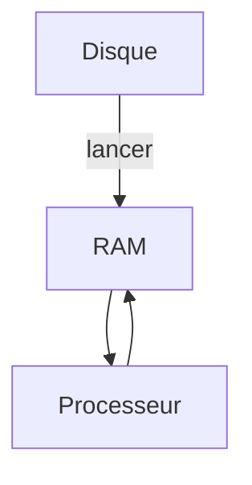

# Processeur, mémoire et disque

> [!info] En une phrase
> Le processeur calcule, la mémoire vive garde ce qui sert maintenant (rapide, effacée à l'arrêt), le disque garde tout durablement (plus lent).

```dataviewjs
await dv.view("10 — Templates/Scripts/learning", { view: "concept" })
```

## 1 · Comprendre
### Définition
| Composant | Rôle | Ordre de grandeur |
| --- | --- | --- |
| **Processeur** (CPU) | exécute les instructions, avec plusieurs **cœurs** en parallèle | milliards d'opérations / seconde |
| **Mémoire vive** (RAM) | données des programmes en cours ; vidée à l'arrêt | 8 à 64 Go, très rapide |
| **Disque** (SSD, HDD) | fichiers, programmes installés ; garde tout | 256 Go à plusieurs To, plus lent |
| **Carte réseau** | communique avec les autres machines | |

### Pourquoi ça existe
La mémoire rapide est chère et volatile ; le stockage durable est lent : on combine les deux.

### Le problème résolu
Comprendre pourquoi une machine « rame » : processeur saturé, mémoire pleine (elle déborde sur le disque, très lent), disque plein.

## 2 · Explorer
### Comment ça fonctionne

Lancer un programme = le copier du disque vers la RAM, puis le processeur l'exécute.

### Exemple concret
```bash
nproc            # nombre de cœurs
free -h          # mémoire
df -h            # disques
top              # qui consomme quoi
```
WSL et Docker Desktop réservent une partie de la RAM et des cœurs de Windows ; un build Docker lourd peut tout saturer.

### Cas d'utilisation
- Comprendre une limite `memory:` dans un conteneur ou un job de CI
- Savoir pourquoi un conteneur est tué (`OOMKilled` : plus de mémoire)

> [!warning] À ne pas confondre
> **Mémoire** (RAM, temporaire) et **stockage** (disque, durable) : « 16 Go de mémoire » et « 512 Go de disque » ne parlent pas de la même chose.

## 3 · Pratiquer
- Relève les cœurs, la RAM et la place disque de ton PC (Gestionnaire des tâches) et de WSL (`nproc`, `free -h`, `df -h`), et explique les différences.

## 4 · Expliquer
> [!quote] Mon résumé, avec mes mots
> _À écrire sans regarder la fiche. Si je bloque, je ne l'ai pas encore compris._

## 5 · Relier
- **Complémentaires** : [[Binaire et octet]] · [[Système d'exploitation et noyau]] · [[Processus]]

## 6 · Réviser
> [!question] Me faire interroger
> Je demande à Claude de m'interroger sur cette notion pour vérifier que je l'ai comprise.

### Validation de la maîtrise
La notion est maîtrisée quand j'ai réussi **tous les exercices** qui l'utilisent (statut `reussi` dans l'exercice).

```dataviewjs
await dv.view("10 — Templates/Scripts/learning", { view: "maitrise" })
```
