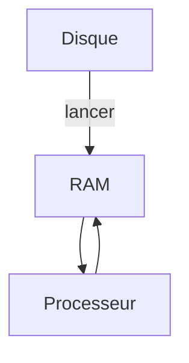

# Processeur, mémoire et disque

> [!info] En une phrase
> Le processeur calcule, la mémoire vive garde ce qui sert maintenant (rapide, effacée à l'arrêt), le disque garde tout durablement (plus lent).

```dataviewjs
await dv.view("10 — Templates/Scripts/learning", { view: "concept" })
```

## 1 · Comprendre
### Définition
| Composant | Rôle | Ordre de grandeur |
| --- | --- | --- |
| **Processeur** (CPU) | exécute les instructions, avec plusieurs **cœurs** en parallèle | milliards d'opérations / seconde |
| **Mémoire vive** (RAM) | données des programmes en cours ; vidée à l'arrêt | 8 à 64 Go, très rapide |
| **Disque** (SSD, HDD) | fichiers, programmes installés ; garde tout | 256 Go à plusieurs To, plus lent |
| **Carte réseau** | communique avec les autres machines | |

### Pourquoi ça existe
La mémoire rapide est chère et volatile ; le stockage durable est lent : on combine les deux.

### Le problème résolu
Comprendre pourquoi une machine « rame » : processeur saturé, mémoire pleine (elle déborde sur le disque, très lent), disque plein.

## 2 · Explorer
### Comment ça fonctionne

Lancer un programme = le copier du disque vers la RAM, puis le processeur l'exécute.

### Exemple concret
```bash
nproc            # nombre de cœurs
free -h          # mémoire
df -h            # disques
top              # qui consomme quoi
```
WSL et Docker Desktop réservent une partie de la RAM et des cœurs de Windows ; un build Docker lourd peut tout saturer.

### Cas d'utilisation
- Comprendre une limite `memory:` dans un conteneur ou un job de CI
- Savoir pourquoi un conteneur est tué (`OOMKilled` : plus de mémoire)

> [!warning] À ne pas confondre
> **Mémoire** (RAM, temporaire) et **stockage** (disque, durable) : « 16 Go de mémoire » et « 512 Go de disque » ne parlent pas de la même chose.

## 3 · Pratiquer

### Exercice visuel

Sur Excalidraw, **sans regarder la fiche**. Puis je compare avec la fiche, je corrige en rouge ce qui était faux, et j'explique mon dessin avec mes mots (section 4).

> [!example] 🧠 Dessine de mémoire
> Dessine le processeur, la mémoire vive et le disque, avec leur vitesse et ce qui reste après avoir éteint la machine.

> [!example] 🛣️ Suis le trajet
> Suis le trajet quand tu lances `python main.py` : où est le fichier au départ, où va-t-il, qui l'exécute ?

### Mon schéma

> [!tip] Mon dessin Excalidraw
> _Je crée le dessin « Schéma - Processeur, mémoire et disque » et je l'intègre ici avec `![[Schéma - Processeur, mémoire et disque.excalidraw]]`._

### Appliquer dans le fil rouge
- Pas encore d'étape du fil rouge pour cette notion : je l'applique dans mon travail (CVAT, Nuclio) ou je demande une étape à Claude.

## 4 · Expliquer
> [!quote] Mon résumé, avec mes mots
> _J'explique mon schéma avec mes mots, sans regarder la fiche. Si je bloque, je ne l'ai pas encore compris._

## 5 · Relier
- **Complémentaires** : [[Binaire et octet]] · [[Système d'exploitation et noyau]] · [[Processus]]

## 6 · Réviser
> [!question] Me faire interroger
> Je demande à Claude de m'interroger sur cette notion pour vérifier que je l'ai comprise.

### Validation de la maîtrise
La notion est maîtrisée quand je sais :
1. **l'expliquer** de façon fluide, à partir de mon schéma (section 4) ;
2. **l'adapter** à un autre contexte (consigne « Change de contexte », ou Claude m'interroge sur un autre cas) ;
3. **l'appliquer** pour de vrai dans le fil rouge (section 3).

Réussir un exercice ne suffit pas. C'est moi qui passe le statut en `maitrise`.

```dataviewjs
await dv.view("10 — Templates/Scripts/learning", { view: "maitrise" })
```
