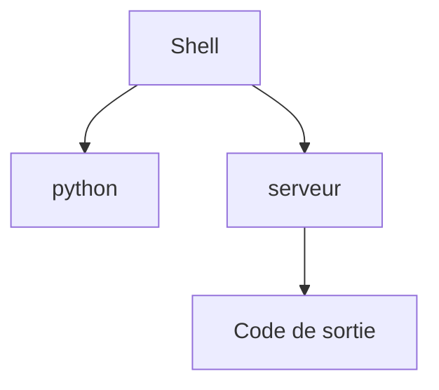

# Processus

> [!info] En une phrase
> Un programme en train de tourner, avec un numéro (PID) ; on peut le lister, l'interrompre ou l'envoyer en arrière-plan.

```dataviewjs
await dv.view("10 — Templates/Scripts/learning", { view: "concept" })
```

## 1 · Comprendre
### Définition
Lancer un programme crée un **processus**, identifié par un **PID**. Un processus a un parent (celui qui l'a lancé, souvent le shell), hérite de ses [[Variable d'environnement|variables d'environnement]] et finit par renvoyer un [[Code de sortie]].

### Pourquoi ça existe
Faire tourner plusieurs programmes en même temps, chacun isolé, et pouvoir les surveiller ou les arrêter.

### Le problème résolu
Un serveur bloqué ou un script qui tourne à l'infini : il faut pouvoir le trouver et l'arrêter.

## 2 · Explorer
### Comment ça fonctionne


### Exemple concret
```bash
python serveur.py              # au premier plan : le terminal est occupé
# Ctrl+C                       # l'interrompre
python serveur.py &            # en arrière-plan : le terminal reste libre
jobs                           # mes tâches en arrière-plan
ps aux | grep python           # trouver un processus et son PID
kill 1234                      # lui demander de s'arrêter
kill -9 1234                   # le forcer (dernier recours)
top                            # ou htop : qui consomme le processeur (q pour quitter)
```
```powershell
Get-Process python
Stop-Process -Id 1234
```

### Cas d'utilisation
- Libérer un [[Port]] occupé par un serveur oublié
- Comprendre un conteneur : son processus principal **est** le conteneur ([[Conteneur]])

> [!warning] À ne pas confondre
> **Ctrl+C** (interrompt le programme) et **Ctrl+Z** (le **suspend** seulement : il existe encore, `fg` pour le reprendre). Et fermer le terminal tue en général les processus lancés dedans.

## 3 · Pratiquer
- Lance `sleep 300 &`, retrouve son PID avec `ps`, puis arrête-le avec `kill`.
- Lance un petit serveur Python (`python -m http.server 8000`), trouve-le avec `ps`, arrête-le.

## 4 · Expliquer
> [!quote] Mon résumé, avec mes mots
> _À écrire sans regarder la fiche. Si je bloque, je ne l'ai pas encore compris._

## 5 · Relier
- **Prérequis** : [[Bash]]
- **Complémentaires** : [[Code de sortie]] · [[Port]]
- **Utilisé par** : [[Conteneur]]

## 6 · Réviser
> [!question] Me faire interroger
> Je demande à Claude de m'interroger sur cette notion pour vérifier que je l'ai comprise.

### Validation de la maîtrise
- [ ] Je l'explique sans notes, en 3 phrases, à quelqu'un qui ne connaît pas
- [ ] J'ai réussi un exercice qui l'utilise
- [ ] Je l'ai utilisé dans un projet
- [ ] Je sais dire quand ne pas l'utiliser (ou ce qu'il ne faut pas confondre)
