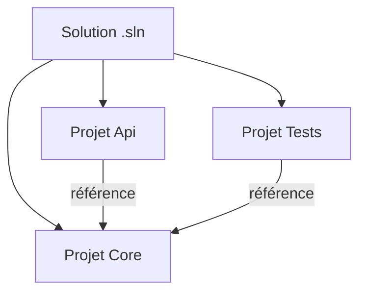

# Projet et solution .NET

> [!info] En une phrase
> En .NET, un **projet** (fichier `.csproj`) produit un programme ou une bibliothèque ; une **solution** (fichier `.sln`) regroupe plusieurs projets qui travaillent ensemble.

## 1 · Comprendre
### Définition
- **Projet** : un dossier avec un fichier `.csproj` et des fichiers `.cs`. Le `.csproj` dit **quoi** construire (une application qu'on lance, ou une **bibliothèque** que d'autres projets utilisent), pour **quelle version** de .NET, et avec **quels paquets** NuGet.
- **Solution** : un fichier `.sln` qui liste des projets. Elle ne contient pas de code ; elle sert à tout construire et tout tester en une commande, et à ouvrir l'ensemble dans l'éditeur.
- **Référence de projet** : le projet A déclare qu'il utilise le projet B. A peut alors appeler les classes publiques de B.

### Pourquoi ça existe
Séparer le code en morceaux qui ont chacun un rôle : le cœur métier dans une bibliothèque, l'API dans un projet web, les tests dans un projet de tests. Chaque morceau se compile et se teste à part.

### Le problème résolu
Éviter le « gros projet unique » où tout dépend de tout. Une référence ne va que dans un sens : si la bibliothèque n'a pas de référence vers l'API, elle ne **peut pas** en dépendre, et le compilateur le garantit.

## 2 · Explorer
### Comment ça fonctionne


### Exemple concret
Une solution typique :
```text
MesDepenses/
├── MesDepenses.sln
├── src/
│   ├── MesDepenses.Core/        bibliothèque : les classes et les règles
│   │   ├── MesDepenses.Core.csproj
│   │   └── Depense.cs
│   └── MesDepenses.Api/         application web
│       ├── MesDepenses.Api.csproj
│       ├── Program.cs           point d'entrée
│       └── appsettings.json     configuration
└── tests/
    └── MesDepenses.Core.Tests/
```
Un `.csproj` minimal :
```xml
<Project Sdk="Microsoft.NET.Sdk">
  <PropertyGroup>
    <TargetFramework>net8.0</TargetFramework>
    <Nullable>enable</Nullable>
  </PropertyGroup>
  <ItemGroup>
    <PackageReference Include="Serilog" Version="4.0.0" />
    <ProjectReference Include="..\MesDepenses.Core\MesDepenses.Core.csproj" />
  </ItemGroup>
</Project>
```
- `bin/` et `obj/` : produits par la compilation, à mettre dans `.gitignore` (`dotnet new gitignore` le crée).
- `Program.cs` : là où le programme démarre.

### Cas d'utilisation
- Une API + sa bibliothèque métier + ses tests
- Partager du code entre une API et un outil en ligne de commande

> [!warning] À ne pas confondre
> La **solution** (`.sln`, juste une liste) et le **projet** (`.csproj`, ce qui se compile). Et la **référence de projet** (vers un projet de la même solution) et la **référence de paquet** (vers un paquet NuGet téléchargé, voir [[Gestionnaire de paquets]]).

> [!abstract]- Comment ça s'écrit (référence à chercher, pas à apprendre par cœur)
> ```bash
> dotnet new sln -n MesDepenses
> dotnet new classlib -o src/MesDepenses.Core
> dotnet new webapi   -o src/MesDepenses.Api
> dotnet sln add src/MesDepenses.Core src/MesDepenses.Api
> dotnet add src/MesDepenses.Api reference src/MesDepenses.Core
> dotnet build          # à la racine : construit toute la solution
> ```
> Depuis .NET 9, la solution peut aussi être au format `.slnx` (plus court, en XML) ; les commandes sont les mêmes.

## 3 · Relier
- **Prérequis** : [[Plateforme .NET]] · [[Module et import]]
- **Complémentaires** : [[Gestionnaire de paquets]] · [[Séparation des responsabilités]]
- **Commandes** : [[dotnet new]] · [[dotnet add]] · [[dotnet build]]
