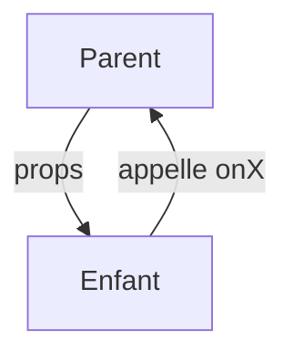

# Props React

> [!info] En une phrase
> Les props sont les paramètres d'un composant : le parent les passe comme des attributs, l'enfant les lit sans jamais les modifier.

```dataviewjs
await dv.view("10 — Templates/Scripts/learning", { view: "concept" })
```

## 1 · Comprendre
### Définition
```tsx
interface BoutonProps {
  texte: string;
  variante?: "primaire" | "secondaire";
  onClick: () => void;
  children?: React.ReactNode;     // le contenu entre les balises
}
function Bouton({ texte, variante = "primaire", onClick }: BoutonProps) {
  return <button className={variante} onClick={onClick}>{texte}</button>;
}
<Bouton texte="Exporter" onClick={() => exporter(12)} />
```
- Les données **descendent** (parent → enfant).
- Pour remonter une information, le parent passe une **fonction** en prop (`onClick`, `onChange`), que l'enfant appelle.
- Les props sont **en lecture seule** : un composant ne modifie jamais ses props.

### Pourquoi ça existe
Un composant réutilisable doit pouvoir afficher des données différentes à chaque usage.

### Le problème résolu
Rendre les composants configurables et garder un sens unique et prévisible pour les données.

## 2 · Explorer
### Comment ça fonctionne


### Exemple concret
```tsx
function Filtre({ valeur, onChange }: { valeur: string; onChange: (v: string) => void }) {
  return <input value={valeur} onChange={(e) => onChange(e.target.value)} />;
}
function Page() {
  const [q, setQ] = useState("");
  return <Filtre valeur={q} onChange={setQ} />;    // l'état vit dans le parent
}
```

### Cas d'utilisation
- Configurer un composant réutilisable
- Remonter un clic au parent
- Composer des composants avec `children`

> [!warning] À ne pas confondre
> **Props** (données reçues, lecture seule) et **état** (données propres au composant, qui changent). Et passer des props sur cinq niveaux (*prop drilling*) signale qu'il faut un contexte ou un store.

## 3 · Pratiquer
- Écris un composant `Bouton` avec trois variantes et un `onClick`, et utilise-le trois fois

## 4 · Expliquer
> [!quote] Mon résumé, avec mes mots
> _À écrire sans regarder la fiche. Si je bloque, je ne l'ai pas encore compris._

## 5 · Relier
- **Prérequis** : [[Composant React]] · [[Type et interface TypeScript]]
- **Complémentaires** : [[État React (useState)]]

## 6 · Réviser
> [!question] Me faire interroger
> Je demande à Claude de m'interroger sur cette notion pour vérifier que je l'ai comprise.

### Validation de la maîtrise
La notion est maîtrisée quand j'ai réussi **tous les exercices** qui l'utilisent (statut `reussi` dans l'exercice).

```dataviewjs
await dv.view("10 — Templates/Scripts/learning", { view: "maitrise" })
```
