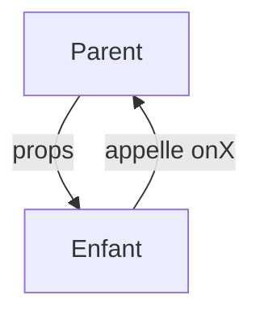

# Props React

> [!info] En une phrase
> Les props sont les paramètres d'un composant : le parent les passe comme des attributs, l'enfant les lit sans jamais les modifier.

```dataviewjs
await dv.view("10 — Templates/Scripts/learning", { view: "concept" })
```

## 1 · Comprendre
### Définition
```tsx
interface BoutonProps {
  texte: string;
  variante?: "primaire" | "secondaire";
  onClick: () => void;
  children?: React.ReactNode;     // le contenu entre les balises
}
function Bouton({ texte, variante = "primaire", onClick }: BoutonProps) {
  return <button className={variante} onClick={onClick}>{texte}</button>;
}
<Bouton texte="Exporter" onClick={() => exporter(12)} />
```
- Les données **descendent** (parent → enfant).
- Pour remonter une information, le parent passe une **fonction** en prop (`onClick`, `onChange`), que l'enfant appelle.
- Les props sont **en lecture seule** : un composant ne modifie jamais ses props.

### Pourquoi ça existe
Un composant réutilisable doit pouvoir afficher des données différentes à chaque usage.

### Le problème résolu
Rendre les composants configurables et garder un sens unique et prévisible pour les données.

## 2 · Explorer
### Comment ça fonctionne


### Exemple concret
```tsx
function Filtre({ valeur, onChange }: { valeur: string; onChange: (v: string) => void }) {
  return <input value={valeur} onChange={(e) => onChange(e.target.value)} />;
}
function Page() {
  const [q, setQ] = useState("");
  return <Filtre valeur={q} onChange={setQ} />;    // l'état vit dans le parent
}
```

### Cas d'utilisation
- Configurer un composant réutilisable
- Remonter un clic au parent
- Composer des composants avec `children`

> [!warning] À ne pas confondre
> **Props** (données reçues, lecture seule) et **état** (données propres au composant, qui changent). Et passer des props sur cinq niveaux (*prop drilling*) signale qu'il faut un contexte ou un store.

## 3 · Pratiquer

### Exercice visuel

Sur Excalidraw, **sans regarder la fiche**. Puis je compare avec la fiche, je corrige en rouge ce qui était faux, et j'explique mon dessin à voix haute ou à Claude dans le chat.

> [!example] 🧠 Dessine de mémoire
> Dessine un parent qui passe une dépense à un enfant par une prop, et l'enfant qui prévient le parent par une fonction.

> [!example] 🔍 Trouve l'erreur
> Ce schéma est faux. Corrige-le en rouge et explique l'erreur.
>
> ```mermaid
> flowchart TD
>   P[Parent] --> E[Enfant]
>   E --> M[Modifie la prop]
>   M --> P
> ```

### Mon schéma

> [!tip] Mon dessin Excalidraw
> _Je crée le dessin « Schéma - Props React » et je l'intègre ici avec `![[Schéma - Props React.excalidraw]]`, puis je coche `schema`._

### Appliquer dans le fil rouge
- Pas encore d'étape du fil rouge pour cette notion : elle sera pratiquée dans le fil rouge de son niveau (voir [[Niveaux]]).

## 4 · Relier
- **Prérequis** : [[Composant d'interface]] · [[Type et interface TypeScript]]
- **Complémentaires** : [[État et réactivité]]

## 5 · Réviser
> [!question] Me faire interroger
> Je demande à Claude de m'interroger sur cette notion pour vérifier que je l'ai comprise.

### Validation (compris, puis maîtrisé)
Trois cases à cocher dans les propriétés de la fiche :
- `schema` : mon dessin du concept est dans « Mon schéma » ;
- `exercice_visuel` : j'ai fait et corrigé les exercices visuels de la section 3 ;
- `fil_rouge` : je l'ai appliqué dans le fil rouge (coché tout seul quand une étape qui l'utilise est réussie).

Les trois cochées : la notion compte comme **comprise**. **Maîtrisé** : c'est moi qui le mets dans `status`, quand je le sens.

```dataviewjs
await dv.view("10 — Templates/Scripts/learning", { view: "maitrise" })
```
