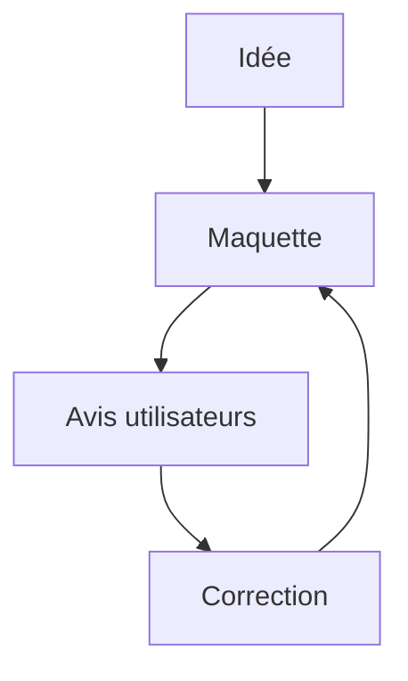

# Prototype

> [!info] En une phrase
> Un prototype est une version **simulée ou partielle** d'un produit, faite pour **montrer** à quoi il ressemblera et comment on s'en servira, afin de recueillir des avis avant de le construire vraiment.

```dataviewjs
await dv.view("10 — Templates/Scripts/learning", { view: "concept" })
```

## 1 · Comprendre
### Définition
**Il répond à « est-ce que c'est ce qu'il faut ? »**, là où le POC répond à « est-ce que c'est faisable ? ».

**Plusieurs niveaux de fidélité** :
- *basse* : un croquis sur papier, une maquette en boîtes grises (*wireframe*) ;
- *moyenne* : une maquette cliquable (Figma, Penpot) ;
- *haute* : une interface qui marche en partie, avec de fausses données.

**On le montre** aux utilisateurs ou au client, on observe ce qui les gêne, on corrige. C'est rapide et peu cher à jeter.

### Pourquoi ça existe
Les utilisateurs savent rarement dire ce qu'ils veulent, mais ils savent très bien réagir devant quelque chose de concret.

### Le problème résolu
Construire une interface pendant des semaines et découvrir à la démonstration que ce n'est pas du tout ce qui était attendu.

## 2 · Explorer
### Comment ça fonctionne


### Exemple concret
```text
Prototype du bouton d'export CVAT (basse fidélité)
+--------------------------------------+
| Tâche 42      [Enregistrer] [Export PNG] |
|                                      |
|   (image annotée)                    |
+--------------------------------------+
Question posée aux annotateurs :
« Où vous attendez-vous à trouver ce bouton ? Que doit-il se passer après le clic ? »
```

### Cas d'utilisation
- Valider l'emplacement et le comportement du bouton d'export avec l'équipe avant de modifier le front React
- Présenter une idée à un client
- Comparer deux parcours d'utilisation

> [!warning] À ne pas confondre
> Un prototype n'a pas à fonctionner vraiment. Le danger est qu'il ait l'air fini : le client croit que le produit est presque prêt alors que rien derrière n'existe.

## 3 · Pratiquer

### Exercice visuel

Sur Excalidraw, **sans regarder la fiche**. Puis je compare avec la fiche, je corrige en rouge ce qui était faux, et j'explique mon dessin avec mes mots (section 4).

> [!example] 🔄 Change de contexte
> Dessine la même idée en prototype puis en POC : l'écran de MesDépenses simulé d'un côté, la question technique de l'autre. Qui regarde chaque version ?

> [!example] 🧠 Dessine de mémoire
> Dessine un prototype papier de l'écran principal de MesDépenses, avec ce qui est vrai et ce qui est simulé.

### Mon schéma

> [!tip] Mon dessin Excalidraw
> _Je crée le dessin « Schéma - Prototype » et je l'intègre ici avec `![[Schéma - Prototype.excalidraw]]`._

### Appliquer dans le fil rouge
- Pas encore d'étape du fil rouge pour cette notion : je l'applique dans mon travail (CVAT, Nuclio) ou je demande une étape à Claude.

## 4 · Expliquer
> [!quote] Mon résumé, avec mes mots
> _J'explique mon schéma avec mes mots, sans regarder la fiche. Si je bloque, je ne l'ai pas encore compris._

## 5 · Relier
- **Complémentaires** : [[Preuve de concept (POC)]] · [[MVP (produit minimum viable)]] · [[User story]]

## 6 · Réviser
> [!question] Me faire interroger
> Je demande à Claude de m'interroger sur cette notion pour vérifier que je l'ai comprise.

### Validation de la maîtrise
La notion est maîtrisée quand je sais :
1. **l'expliquer** de façon fluide, à partir de mon schéma (section 4) ;
2. **l'adapter** à un autre contexte (consigne « Change de contexte », ou Claude m'interroge sur un autre cas) ;
3. **l'appliquer** pour de vrai dans le fil rouge (section 3).

Réussir un exercice ne suffit pas. C'est moi qui passe le statut en `maitrise`.

```dataviewjs
await dv.view("10 — Templates/Scripts/learning", { view: "maitrise" })
```
