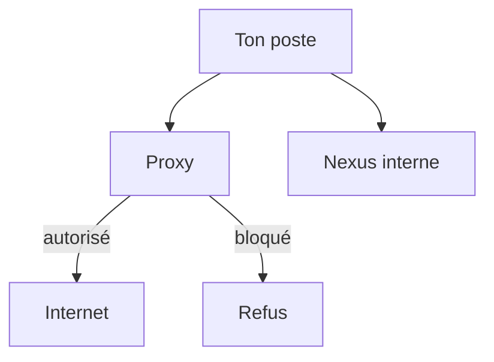

# Proxy

> [!info] En une phrase
> Un serveur placé **entre les postes de l'entreprise et Internet**, qui fait les requêtes **à leur place** et peut les filtrer, les journaliser et les mettre en cache.

```dataviewjs
await dv.view("10 — Templates/Scripts/learning", { view: "concept" })
```

## 1 · Comprendre
### Définition
Un **proxy** (on dit aussi proxy *sortant* ou *forward proxy*) est un **programme qui tourne sur un serveur** : Squid, ou un service en ligne comme Zscaler. Ton poste ne parle pas directement au site : il envoie sa requête au proxy, et c'est **le proxy qui va chercher la page** sur Internet, puis te la renvoie. Pour le site, c'est le proxy qui l'a appelé, pas toi.

Au passage, le proxy peut :
| Rôle | Exemple |
| --- | --- |
| **Filtrer** | bloquer Docker Hub, les réseaux sociaux, les sites dangereux |
| **Journaliser** | garder la trace de qui a appelé quel site, et quand |
| **Mettre en cache** | garder une copie d'un fichier souvent téléchargé |
| **Authentifier** | exiger ton identité : sinon, erreur `407 Proxy Authentication Required` |

### Comment le poste sait qu'il doit passer par lui
| Méthode | Comment ça marche |
| --- | --- |
| **Réglage manuel** | l'adresse est écrite dans Windows, ou dans `HTTP_PROXY` / `HTTPS_PROXY` pour les outils en ligne de commande |
| **Fichier PAC** | un petit script (souvent `proxy.pac`) que Windows et le navigateur téléchargent ; il dit, pour chaque adresse, quel proxy utiliser ou s'il faut y aller directement |
| **Transparent** | rien n'est réglé sur le poste : le réseau détourne lui-même le trafic vers le proxy |
| **Agent** | un logiciel installé sur le poste (ex. Zscaler Client Connector) envoie le trafic au proxy |

Pour les outils en ligne de commande (pip, curl, apt), on utilise ces variables :
| Variable | Rôle |
| --- | --- |
| `HTTP_PROXY` / `HTTPS_PROXY` | adresse du proxy, ex. `http://proxy.entreprise:3128` |
| `NO_PROXY` | adresses à joindre **sans** proxy (internes) : `localhost,127.0.0.1,.entreprise.local` |

> [!tip] Le navigateur et le terminal ne lisent pas le même réglage
> Le navigateur suit le réglage de Windows (souvent le fichier PAC). pip, curl ou Docker ne lisent pas le PAC : ils ne connaissent que leurs variables ou leur propre réglage. C'est pour ça qu'un site s'ouvre dans le navigateur alors que `pip install` échoue.

### Pourquoi ça existe
L'entreprise veut un **point de passage unique** vers Internet, pour contrôler ce qui sort et ce qui entre.

### Le problème résolu
Sans lui, chaque machine sortirait librement sur Internet, sans filtre ni trace.

## 2 · Explorer
### Comment ça fonctionne


### Exemple concret
```bash
export HTTPS_PROXY=http://proxy.entreprise:3128
export NO_PROXY=localhost,127.0.0.1,vortex-nexus.assystem.com
pip install requests        # pip passe par le proxy
curl -I https://vortex-nexus.assystem.com:5000/v2/   # interne : sans proxy grâce à NO_PROXY
```
Pour Docker, il y a **trois endroits** différents :
1. le [[Démon Docker]] (pour `docker pull`) : réglage du démon ou de Docker Desktop ;
2. le **build** : `docker build --build-arg HTTPS_PROXY=...` (pour les `RUN pip install`) ;
3. le **conteneur** : `docker run -e HTTPS_PROXY=...`.

Symptômes typiques :
- `407 Proxy Authentication Required` : le proxy veut savoir qui tu es (c'est ce que Docker Hub t'a répondu au travail) ;
- délai dépassé (*timeout*) ou `Could not resolve host` : l'outil ne connaît pas le proxy et essaie de sortir seul ;
- erreur de certificat SSL : le proxy **inspecte le HTTPS** (Zscaler le fait) et présente son propre [[Certificat]], que l'outil ne connaît pas.

### Cas d'utilisation
- pip, apt, npm ou Docker qui doivent télécharger depuis Internet en entreprise
- Souvent, le [[Nexus]] évite le proxy : il est interne, il télécharge pour toi et garde une copie

> [!warning] À ne pas confondre
> - **Proxy** (côté clients, vers Internet) et [[Reverse proxy]] (côté serveurs, reçoit les visiteurs et les envoie au bon service).
> - Un proxy **n'est pas une API**. Une API, c'est un programme qui **offre un service** (des données, une action) et décide de la réponse. Le proxy, lui, ne produit rien : il **fait passer** des requêtes destinées à d'autres, en les contrôlant au passage.
> - Oublier `NO_PROXY` fait passer les adresses internes par le proxy, qui les refuse ou ne les connaît pas.

## 3 · Pratiquer
- [[Exercice - Le proxy de l'entreprise]] : trouver comment ton poste passe par le proxy, et expliquer pourquoi Docker Hub est bloqué alors que le Nexus répond.

## 4 · Expliquer
> [!quote] Mon résumé, avec mes mots
> _À écrire sans regarder la fiche. Si je bloque, je ne l'ai pas encore compris._

## 5 · Relier
- **Prérequis** : [[Variable d'environnement]] · [[HTTP]]
- **Complémentaires** : [[Nexus]] · [[Port]] · [[Certificat]] · [[Reverse proxy]]
- **Utilisé par** : [[pip]] · [[Démon Docker]]
- **Même idée en code** : [[Patron Proxy]]

## 6 · Réviser
> [!question] Me faire interroger
> Je demande à Claude de m'interroger sur cette notion pour vérifier que je l'ai comprise.

### Validation de la maîtrise
La notion est maîtrisée quand j'ai réussi **tous les exercices** qui l'utilisent (statut `reussi` dans l'exercice).

```dataviewjs
await dv.view("10 — Templates/Scripts/learning", { view: "maitrise" })
```
