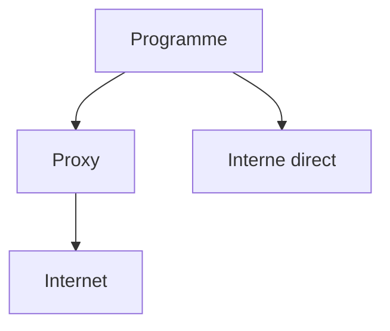

# Proxy

> [!info] En une phrase
> Un intermédiaire par lequel passent les connexions sortantes vers Internet ; en entreprise, souvent obligatoire.

```dataviewjs
await dv.view("10 — Templates/Scripts/learning", { view: "concept" })
```

## 1 · Comprendre
### Définition
Un **proxy** (ou proxy *sortant*, *forward proxy*) reçoit les requêtes des postes et des serveurs de l'entreprise et les fait **à leur place** vers Internet. Les programmes doivent savoir qu'il existe : on le leur dit avec des [[Variable d'environnement|variables d'environnement]].

| Variable | Rôle |
| --- | --- |
| `HTTP_PROXY` / `HTTPS_PROXY` | adresse du proxy, ex. `http://proxy.entreprise:3128` |
| `NO_PROXY` | adresses à joindre **sans** proxy (internes) : `localhost,127.0.0.1,.entreprise.local` |

### Pourquoi ça existe
Contrôler, filtrer et journaliser ce qui sort du réseau de l'entreprise.

### Le problème résolu
Sans point de passage unique, chaque machine sort librement sur Internet, sans contrôle.

## 2 · Explorer
### Comment ça fonctionne


### Exemple concret
```bash
export HTTPS_PROXY=http://proxy.entreprise:3128
export NO_PROXY=localhost,127.0.0.1,nexus.entreprise.local
pip install requests        # pip passe par le proxy
```
Pour Docker, il y a **trois endroits** différents :
1. le [[Démon Docker]] (pour `docker pull`) : réglage du démon ou de Docker Desktop ;
2. le **build** : `docker build --build-arg HTTPS_PROXY=...` (pour les `RUN pip install`) ;
3. le **conteneur** : `docker run -e HTTPS_PROXY=...`.

Symptômes typiques : délais dépassés (*timeout*), `ProxyError`, `Could not resolve host`, ou erreurs de certificat SSL quand le proxy inspecte le trafic.

### Cas d'utilisation
- pip, apt, npm ou Docker qui doivent télécharger depuis Internet en entreprise
- Souvent, le [[Nexus]] évite le proxy : on télécharge depuis lui, qui est interne

> [!warning] À ne pas confondre
> **Proxy** (sortant : protège et contrôle les clients) et [[Reverse proxy]] (entrant : reçoit les visiteurs et les répartit vers les services). Et oublier `NO_PROXY` fait passer les adresses internes par le proxy, qui les refuse.

## 3 · Pratiquer
- Demande à ton équipe l'adresse du proxy et si le Nexus suffit (pas besoin de proxy pour pip et Docker).
- Affiche les variables `*_PROXY` définies dans ton terminal et dans un job de CI (`env | grep -i proxy`).

## 4 · Expliquer
> [!quote] Mon résumé, avec mes mots
> _À écrire sans regarder la fiche. Si je bloque, je ne l'ai pas encore compris._

## 5 · Relier
- **Prérequis** : [[Variable d'environnement]] · [[HTTP]]
- **Complémentaires** : [[Nexus]] · [[Port]]
- **Utilisé par** : [[pip]] · [[Démon Docker]]

## 6 · Réviser
> [!question] Me faire interroger
> Je demande à Claude de m'interroger sur cette notion pour vérifier que je l'ai comprise.

### Validation de la maîtrise
La notion est maîtrisée quand j'ai réussi **tous les exercices** qui l'utilisent (statut `reussi` dans l'exercice).

```dataviewjs
await dv.view("10 — Templates/Scripts/learning", { view: "maitrise" })
```
