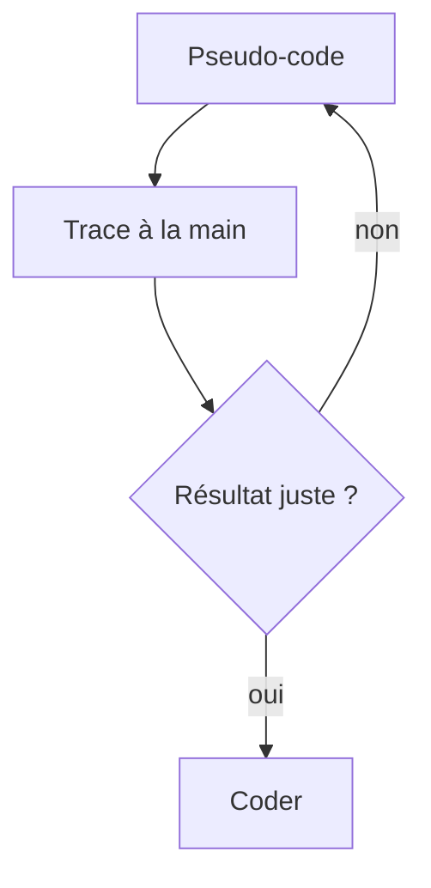

# Pseudo-code et trace d'exécution

> [!info] En une phrase
> Le pseudo-code décrit un algorithme en langage simple, sans se soucier de la syntaxe ; la trace d'exécution consiste à le dérouler à la main, ligne par ligne, en notant la valeur de chaque variable.

```dataviewjs
await dv.view("10 — Templates/Scripts/learning", { view: "concept" })
```

## 1 · Comprendre
### Définition
**Pseudo-code** : on écrit les étapes en français structuré, avec `si`, `tant que`, `pour chaque`, `←` (reçoit). On se concentre sur la **logique**, pas sur les parenthèses ou les deux-points.
**Trace d'exécution** (« faire tourner à la main ») : un tableau, une colonne par variable, une ligne par étape. C'est **la** technique pour :
- comprendre un code qu'on n'a pas écrit ;
- trouver pourquoi son code donne un mauvais résultat ;
- vérifier un algorithme avant de le programmer.
Les **débogueurs** (VS Code, `breakpoint()` en Python, onglet *Sources* du navigateur) font la même chose automatiquement : arrêt sur une ligne, valeurs des variables, pas à pas.

### Pourquoi ça existe
Écrire directement en code mélange deux difficultés : trouver la logique et respecter la syntaxe.

### Le problème résolu
Séparer la réflexion de l'écriture, et voir exactement ce que fait un programme au lieu de deviner.

## 2 · Explorer
### Comment ça fonctionne


### Exemple concret
Algorithme : somme des nombres pairs d'une liste.
```
somme ← 0
pour chaque n de la liste :
    si n est pair :
        somme ← somme + n
renvoyer somme
```
Trace avec la liste `[3, 4, 7, 10]` :
| Étape | n | n pair ? | somme |
| --- | --- | --- | --- |
| départ | – | – | 0 |
| 1 | 3 | non | 0 |
| 2 | 4 | oui | 4 |
| 3 | 7 | non | 4 |
| 4 | 10 | oui | 14 |
Résultat : 14. On vérifie aussi `[]` (résultat 0) et `[1, 3]` (résultat 0).
```python
def somme_pairs(nombres):
    somme = 0
    for n in nombres:
        if n % 2 == 0:
            somme += n
    return somme
```

### Cas d'utilisation
- Préparer un algorithme
- Comprendre du code existant (par exemple celui de CVAT)
- Déboguer sans tâtonner

> [!warning] À ne pas confondre
> Ajouter des `print` au hasard en espérant comprendre : fais d'abord la trace sur papier ou utilise le débogueur, pas à pas.

## 3 · Pratiquer
- Écris le pseudo-code de « compter les voyelles d'un mot », puis fais sa trace sur le mot « ananas »
- Mets un point d'arrêt dans VS Code sur une boucle et avance pas à pas en regardant les variables

## 4 · Expliquer
> [!quote] Mon résumé, avec mes mots
> _À écrire sans regarder la fiche. Si je bloque, je ne l'ai pas encore compris._

## 5 · Relier
- **Prérequis** : [[Algorithme]] · [[Variables et types en Python]]
- **Complémentaires** : [[Motifs de boucle]]

## 6 · Réviser
> [!question] Me faire interroger
> Je demande à Claude de m'interroger sur cette notion pour vérifier que je l'ai comprise.

### Validation de la maîtrise
La notion est maîtrisée quand j'ai réussi **tous les exercices** qui l'utilisent (statut `reussi` dans l'exercice).

```dataviewjs
await dv.view("10 — Templates/Scripts/learning", { view: "maitrise" })
```
