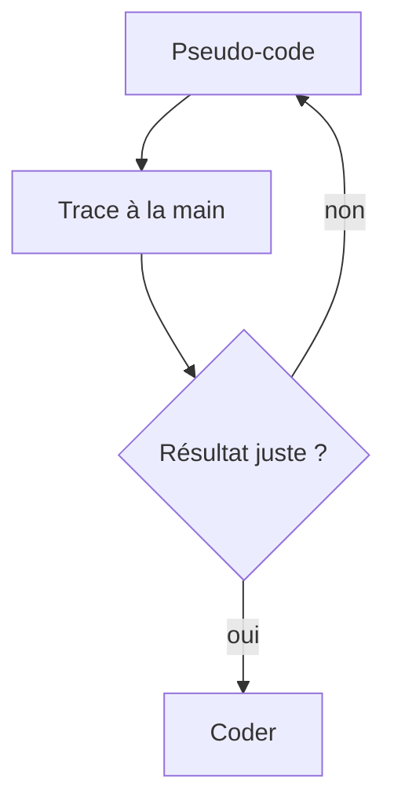

# Pseudo-code et trace d'exécution

> [!info] En une phrase
> Le pseudo-code décrit un algorithme en langage simple, sans se soucier de la syntaxe ; la trace d'exécution consiste à le dérouler à la main, ligne par ligne, en notant la valeur de chaque variable.

```dataviewjs
await dv.view("10 — Templates/Scripts/learning", { view: "concept" })
```

## 1 · Comprendre
### Définition
**Pseudo-code** : on écrit les étapes en français structuré, avec `si`, `tant que`, `pour chaque`, `←` (reçoit). On se concentre sur la **logique**, pas sur les parenthèses ou les deux-points.
**Trace d'exécution** (« faire tourner à la main ») : un tableau, une colonne par variable, une ligne par étape. C'est **la** technique pour :
- comprendre un code qu'on n'a pas écrit ;
- trouver pourquoi son code donne un mauvais résultat ;
- vérifier un algorithme avant de le programmer.
Les **débogueurs** (VS Code, `breakpoint()` en Python, onglet *Sources* du navigateur) font la même chose automatiquement : arrêt sur une ligne, valeurs des variables, pas à pas.

### Pourquoi ça existe
Écrire directement en code mélange deux difficultés : trouver la logique et respecter la syntaxe.

### Le problème résolu
Séparer la réflexion de l'écriture, et voir exactement ce que fait un programme au lieu de deviner.

## 2 · Explorer
### Comment ça fonctionne


### Exemple concret
Algorithme : somme des nombres pairs d'une liste.
```
somme ← 0
pour chaque n de la liste :
    si n est pair :
        somme ← somme + n
renvoyer somme
```
Trace avec la liste `[3, 4, 7, 10]` :
| Étape | n | n pair ? | somme |
| --- | --- | --- | --- |
| départ | – | – | 0 |
| 1 | 3 | non | 0 |
| 2 | 4 | oui | 4 |
| 3 | 7 | non | 4 |
| 4 | 10 | oui | 14 |
Résultat : 14. On vérifie aussi `[]` (résultat 0) et `[1, 3]` (résultat 0).
```python
def somme_pairs(nombres):
    somme = 0
    for n in nombres:
        if n % 2 == 0:
            somme += n
    return somme
```

### Cas d'utilisation
- Préparer un algorithme
- Comprendre du code existant (par exemple celui de CVAT)
- Déboguer sans tâtonner

> [!warning] À ne pas confondre
> Ajouter des `print` au hasard en espérant comprendre : fais d'abord la trace sur papier ou utilise le débogueur, pas à pas.

## 3 · Pratiquer

### Exercice visuel

Sur Excalidraw, **sans regarder la fiche**. Puis je compare avec la fiche, je corrige en rouge ce qui était faux, et j'explique mon dessin à voix haute ou à Claude dans le chat.

> [!example] 🛣️ Suis le trajet
> Écris en pseudo-code « total des courses », puis dessine le tableau de trace (tour, dépense, total) sur 4 dépenses.

> [!example] 🔍 Trouve l'erreur
> Ce schéma est faux. Corrige-le en rouge et explique l'erreur.
>
> ```mermaid
> flowchart TD
>   I[total = 0] --> B[Pour chaque dépense]
>   B --> Z[total = 0]
>   Z --> A[Ajouter montant]
> ```

### Mon schéma

> [!tip] Mon dessin Excalidraw
> _Je crée le dessin « Schéma - Pseudo-code et trace d'exécution » et je l'intègre ici avec `![[Schéma - Pseudo-code et trace d'exécution.excalidraw]]`, puis je coche `schema`._

### Appliquer dans le fil rouge
- [[Dépenses 02 - Classer les dépenses]]

## 4 · Relier
- **Prérequis** : [[Algorithme]] · [[Variables et types en Python]]
- **Complémentaires** : [[Motifs de boucle]]

## 5 · Réviser
> [!question] Me faire interroger
> Je demande à Claude de m'interroger sur cette notion pour vérifier que je l'ai comprise.

### Validation de la maîtrise
Trois cases à cocher dans les propriétés de la fiche :
- `schema` : mon dessin du concept est dans « Mon schéma » ;
- `exercice_visuel` : j'ai fait et corrigé les exercices visuels de la section 3 ;
- `fil_rouge` : je l'ai appliqué dans le fil rouge (coché tout seul quand une étape qui l'utilise est réussie).

Les trois cochées : la notion compte comme **comprise**. **Maîtrisé** : c'est moi qui le mets dans `status`, quand je le sens.

```dataviewjs
await dv.view("10 — Templates/Scripts/learning", { view: "maitrise" })
```
