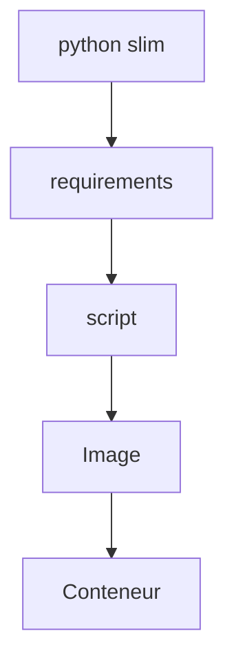

# Python dans Docker

> [!info] En une phrase
> Emballer un script Python et ses dépendances dans une image, puis le lancer dans un conteneur sur des fichiers montés.

```dataviewjs
await dv.view("10 — Templates/Scripts/learning", { view: "concept" })
```

## 1 · Comprendre
### Définition
On part d'une image officielle `python:<version>-slim`, on y installe les dépendances de `requirements.txt`, on copie le script, et on déclare comment le lancer (`ENTRYPOINT` ou `CMD`). Les fichiers à traiter arrivent par un [[Volume Docker]], les paramètres par des arguments ou des [[Variable d'environnement|variables d'environnement]].

### Pourquoi ça existe
Le script tourne avec la même version de Python et les mêmes paquets partout : ton poste, la CI, le serveur, sans venv ni installation.

### Le problème résolu
« Il me manque Pillow », « j'ai Python 3.8 » : l'image embarque tout.

## 2 · Explorer
### Comment ça fonctionne


### Exemple concret
```dockerfile
FROM python:3.12-slim
WORKDIR /app
COPY requirements.txt .
RUN pip install --no-cache-dir -r requirements.txt
COPY zipper.py .
ENTRYPOINT ["python", "zipper.py"]
```
```bash
docker build -t mon-zipper .
docker run --rm -v "$PWD/donnees:/data" mon-zipper /data --sortie /data/export.zip
```
Avec `ENTRYPOINT`, tout ce qui suit le nom de l'image devient **arguments du script**.

| Instruction | Rôle ici |
| --- | --- |
| `ENTRYPOINT` | la commande fixe : `python zipper.py` |
| `CMD` | des arguments par défaut, remplacés par ceux de `docker run` |
| `ENV PYTHONUNBUFFERED=1` | affiche les `print` tout de suite dans les logs |

Ajoute un `.dockerignore` (`.venv`, `__pycache__`, `.git`, données de test) pour ne pas tout copier dans l'image.

### Cas d'utilisation
- Ton script de zip, lancé sur un dossier
- Un job de CI qui utilise `image: python:3.12-slim`
- Une fonction Nuclio (Nuclio construit lui-même une image Python autour de ta fonction)

> [!warning] À ne pas confondre
> `ENTRYPOINT` (ce qu'on lance toujours) et `CMD` (valeurs par défaut, remplaçables). Et les chemins : dans le conteneur, c'est `/data`, pas `C:\...`. Derrière un Nexus, `FROM` et `pip install` doivent passer par lui.

## 3 · Pratiquer
- Écris le Dockerfile de ton script, construis l'image, lance-la sur un dossier de test monté.
- Change une ligne du script et reconstruis : quelles couches viennent du cache ?
- Ajoute un `.dockerignore` et compare la taille du contexte de build (`docker build` l'affiche).

## 4 · Expliquer
> [!quote] Mon résumé, avec mes mots
> _À écrire sans regarder la fiche. Si je bloque, je ne l'ai pas encore compris._

## 5 · Relier
- **Prérequis** : [[Dockerfile]] · [[Volume Docker]] · [[pip]]
- **Complémentaires** : [[Arguments de ligne de commande]]
- **Utilisé par** : [[Tester l'image, pas le dépôt]]
- **Commandes** : [[docker build]] · [[docker run]]

## 6 · Réviser
> [!question] Me faire interroger
> Je demande à Claude de m'interroger sur cette notion pour vérifier que je l'ai comprise.

### Validation de la maîtrise
La notion est maîtrisée quand j'ai réussi **tous les exercices** qui l'utilisent (statut `reussi` dans l'exercice).

```dataviewjs
await dv.view("10 — Templates/Scripts/learning", { view: "maitrise" })
```
