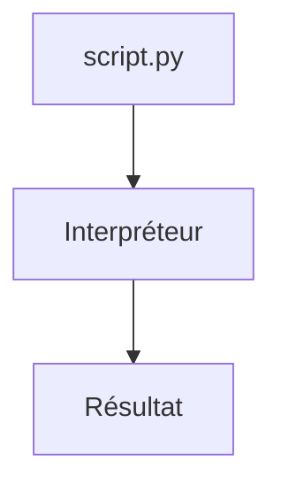

# Python

> [!info] En une phrase
> Un langage de programmation lisible, très utilisé pour les scripts, l'automatisation, les données et l'IA.

```dataviewjs
await dv.view("10 — Templates/Scripts/learning", { view: "concept" })
```

## 1 · Comprendre
### Définition
**Python** est à la fois un **langage** (la façon d'écrire le code) et un **interpréteur** (le programme `python` qui lit ton fichier `.py` et l'exécute ligne par ligne, sans étape de compilation).

### Pourquoi ça existe
Écrire vite des programmes lisibles. Sa grande **bibliothèque standard** (fichiers, zip, réseau, dates…) évite d'installer quoi que ce soit pour les tâches courantes.

### Le problème résolu
Automatiser des tâches répétitives (trier, copier, zipper des fichiers, appeler une API) qu'on faisait à la main ou avec des scripts shell difficiles à lire.

## 2 · Explorer
### Comment ça fonctionne

- **Deux façons de lancer** : `python script.py` (un fichier) ou `python` seul (le mode interactif, `>>>`, pour tester une ligne ; `exit()` pour sortir).
- **L'indentation compte** : 4 espaces délimitent un bloc (après `if`, `for`, `def`). Pas d'accolades comme en JavaScript.
- Sous Windows la commande est parfois `py` ; sous Linux et dans Docker, `python3` ou `python`.

### Exemple concret
```python
# bonjour.py
nom = "Oumar"
print(f"Bonjour {nom} !")
```
```bash
python bonjour.py
# Bonjour Oumar !
```

### Cas d'utilisation
- Scripts d'automatisation (ton script de zip)
- Fonctions Nuclio et traitement d'images ([[Pillow]])
- Le back-end de CVAT est écrit en Python (Django)

> [!warning] À ne pas confondre
> **Python 2** (abandonné en 2020) et **Python 3** : tout ce que tu apprends est Python 3. Et la **bibliothèque standard** (déjà incluse : `pathlib`, `zipfile`) et les **paquets externes** (à installer avec [[pip]] : `Pillow`, `requests`).

## 3 · Pratiquer
- Installe Python 3, puis vérifie avec `python --version` (ou `py --version` sous Windows).
- Ouvre le mode interactif et calcule `7 * 6`, puis quitte avec `exit()`.
- Écris et lance un fichier `bonjour.py`.

## 4 · Expliquer
> [!quote] Mon résumé, avec mes mots
> _À écrire sans regarder la fiche. Si je bloque, je ne l'ai pas encore compris._

## 5 · Relier
- **Prérequis** : [[Terminal]] · [[Système de fichiers]]
- **Complémentaires** : [[Variables et types en Python]]
- **Utilisé par** : [[Fonction]] · [[Module et import Python]] · [[Environnement virtuel Python]]
- **Commandes** : [[python script.py]]

## 6 · Réviser
> [!question] Me faire interroger
> Je demande à Claude de m'interroger sur cette notion pour vérifier que je l'ai comprise.

### Validation de la maîtrise
La notion est maîtrisée quand j'ai réussi **tous les exercices** qui l'utilisent (statut `reussi` dans l'exercice).

```dataviewjs
await dv.view("10 — Templates/Scripts/learning", { view: "maitrise" })
```
