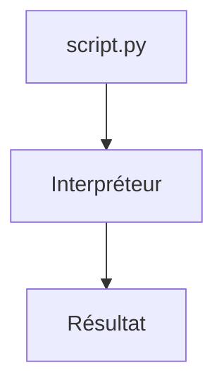

# Python

> [!info] En une phrase
> Un langage de programmation lisible, très utilisé pour les scripts, l'automatisation, les données et l'IA.

```dataviewjs
await dv.view("10 — Templates/Scripts/learning", { view: "concept" })
```

## 1 · Comprendre
### Définition
**Python** est à la fois un **langage** (la façon d'écrire le code) et un **interpréteur** (le programme `python` qui lit ton fichier `.py` et l'exécute ligne par ligne, sans étape de compilation).

### Pourquoi ça existe
Écrire vite des programmes lisibles. Sa grande **bibliothèque standard** (fichiers, zip, réseau, dates…) évite d'installer quoi que ce soit pour les tâches courantes.

### Le problème résolu
Automatiser des tâches répétitives (trier, copier, zipper des fichiers, appeler une API) qu'on faisait à la main ou avec des scripts shell difficiles à lire.

## 2 · Explorer
### Comment ça fonctionne

- **Deux façons de lancer** : `python script.py` (un fichier) ou `python` seul (le mode interactif, `>>>`, pour tester une ligne ; `exit()` pour sortir).
- **L'indentation compte** : 4 espaces délimitent un bloc (après `if`, `for`, `def`). Pas d'accolades comme en JavaScript.
- Sous Windows la commande est parfois `py` ; sous Linux et dans Docker, `python3` ou `python`.

### Exemple concret
```python
# bonjour.py
nom = "Oumar"
print(f"Bonjour {nom} !")
```
```bash
python bonjour.py
# Bonjour Oumar !
```

### Cas d'utilisation
- Scripts d'automatisation (ton script de zip)
- Appeler des API ([[Appeler une API HTTP]]), traiter des données ([[Lire et écrire du CSV]])
- Fonctions serverless (une fonction appelée par une plateforme)
- Des back-ends web (Django, FastAPI)

> [!warning] À ne pas confondre
> **Python 2** (abandonné en 2020) et **Python 3** : tout ce que tu apprends est Python 3. Et la **bibliothèque standard** (déjà incluse : `pathlib`, `zipfile`) et les **paquets externes** (à installer avec [[Gestionnaire de paquets]] : `requests`, `pytest`).

## 3 · Pratiquer

### Exercice visuel

Sur Excalidraw, **sans regarder la fiche**. Puis je compare avec la fiche, je corrige en rouge ce qui était faux, et j'explique mon dessin à voix haute ou à Claude dans le chat.

> [!example] 🧠 Dessine de mémoire
> Dessine les usages de Python : scripts, API web, tests, automatisation. Relie chaque usage aux bibliothèques qu'il utilise.

> [!example] 🛣️ Suis le trajet
> Dessine ce qui se passe entre `python main.py` et le résultat : l'interpréteur, la lecture du fichier, l'exécution ligne par ligne.

### Mon schéma

> [!tip] Mon dessin Excalidraw
> _Je crée le dessin « Schéma - Python » et je l'intègre ici avec `![[Schéma - Python.excalidraw]]`, puis je coche `schema`._

### Appliquer dans le fil rouge
- [[Dépenses 01 - Lire les dépenses]]

## 4 · Relier
- **Prérequis** : [[Terminal]] · [[Système de fichiers]]
- **Complémentaires** : [[Variables et types]]
- **Utilisé par** : [[Fonction]] · [[Module et import]] · [[Environnement virtuel Python]]
- **Commandes** : [[python script.py]]

## 5 · Réviser
> [!question] Me faire interroger
> Je demande à Claude de m'interroger sur cette notion pour vérifier que je l'ai comprise.

### Validation (compris, puis maîtrisé)
Trois cases à cocher dans les propriétés de la fiche :
- `schema` : mon dessin du concept est dans « Mon schéma » ;
- `exercice_visuel` : j'ai fait et corrigé les exercices visuels de la section 3 ;
- `fil_rouge` : je l'ai appliqué dans le fil rouge (coché tout seul quand une étape qui l'utilise est réussie).

Les trois cochées : la notion compte comme **comprise**. **Maîtrisé** : c'est moi qui le mets dans `status`, quand je le sens.

```dataviewjs
await dv.view("10 — Templates/Scripts/learning", { view: "maitrise" })
```
