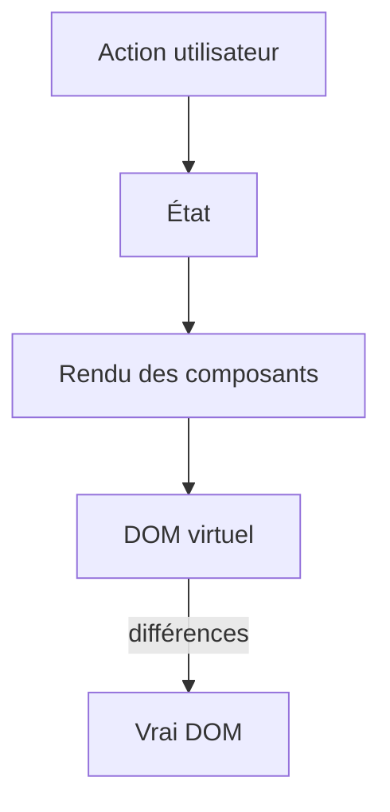

# React

> [!info] En une phrase
> React est une bibliothèque JavaScript pour construire des interfaces en composants : tu décris ce que l'écran doit afficher selon l'état, et React met le DOM à jour quand l'état change.

## 1 · Comprendre
### Définition
Avec le [[DOM]] à la main, tu dis **comment** modifier la page (« ajoute ce `li`, change ce texte »). Avec React, tu dis **quoi** afficher pour un état donné ; React calcule les différences et modifie le DOM pour toi (approche **déclarative**).
- Une interface = un arbre de [[Composant d'interface|composants]].
- Les données descendent par les [[Props React|props]] ; ce qui change vit dans l'[[État et réactivité|état]].
- Écrit en [[JavaScript]] ou [[TypeScript]] avec la syntaxe JSX, construit avec [[Outil de build front (Vite)|Vite]].
Beaucoup d'interfaces connues (Facebook, GitLab en partie, Notion) sont écrites en React.

### Pourquoi ça existe
Les interfaces modernes changent sans arrêt (données qui arrivent, clics, filtres). Mettre à jour le DOM à la main devient vite ingérable et plein de bugs.

### Le problème résolu
Garder l'affichage toujours cohérent avec les données, et découper une grosse interface en morceaux réutilisables.

## 2 · Explorer
### Comment ça fonctionne


### Exemple concret
```jsx
import { useState } from "react";
export default function Compteur() {
  const [n, setN] = useState(0);
  return <button onClick={() => setN(n + 1)}>Cliqué {n} fois</button>;
}
```
Compare avec une page qui modifie le [[DOM]] à la main : ici, aucune manipulation du DOM.

### Cas d'utilisation
- La plupart des frontends d'entreprise
- Applications mobiles avec React Native

> [!warning] À ne pas confondre
> **React** (une bibliothèque pour l'affichage) n'est pas un framework complet comme [[Angular]] : le routage, les appels d'API ou l'état global viennent d'autres bibliothèques. Et **React** n'est pas **Next.js** (un framework construit sur React).

## 3 · Relier
- **Au travail** : [React au travail](obsidian://open?vault=Travail&file=React%20au%20travail)
- **Prérequis** : [[JavaScript]] · [[DOM]] · [[Module et import]]
- **Complémentaires** : [[Vue.js]] · [[Angular]]
- **Utilisé par** : [[Composant d'interface]]
