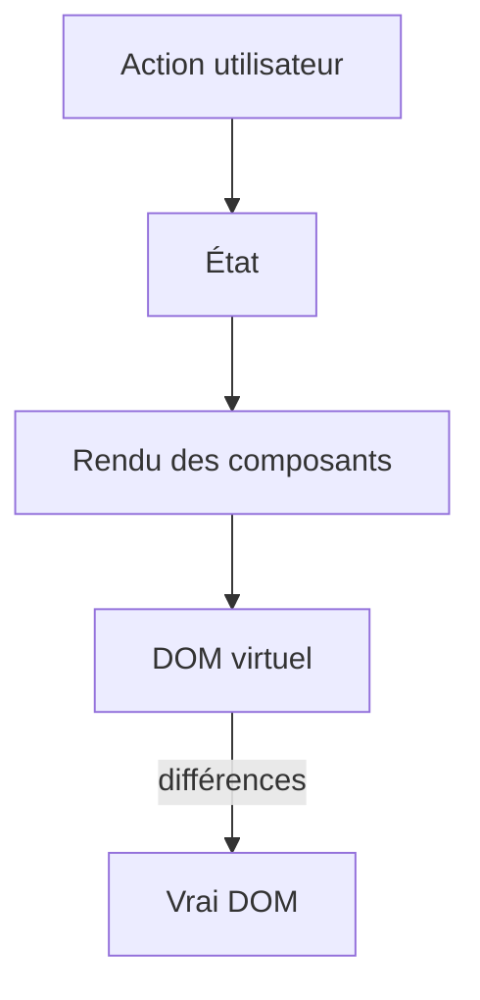

# React

> [!info] En une phrase
> React est une bibliothèque JavaScript pour construire des interfaces en composants : tu décris ce que l'écran doit afficher selon l'état, et React met le DOM à jour quand l'état change.

```dataviewjs
await dv.view("10 — Templates/Scripts/learning", { view: "concept" })
```

## 1 · Comprendre
### Définition
Avec le [[DOM]] à la main, tu dis **comment** modifier la page (« ajoute ce `li`, change ce texte »). Avec React, tu dis **quoi** afficher pour un état donné ; React calcule les différences et modifie le DOM pour toi (approche **déclarative**).
- Une interface = un arbre de [[Composant React|composants]].
- Les données descendent par les [[Props React|props]] ; ce qui change vit dans l'[[État React (useState)|état]].
- Écrit en [[JavaScript]] ou [[TypeScript]] avec la syntaxe JSX, construit avec [[Outil de build front (Vite)|Vite]].
**L'interface de CVAT est une application React** (avec TypeScript) : ton bouton d'export sera un composant React.

### Pourquoi ça existe
Les interfaces modernes changent sans arrêt (données qui arrivent, clics, filtres). Mettre à jour le DOM à la main devient vite ingérable et plein de bugs.

### Le problème résolu
Garder l'affichage toujours cohérent avec les données, et découper une grosse interface en morceaux réutilisables.

## 2 · Explorer
### Comment ça fonctionne


### Exemple concret
```jsx
import { useState } from "react";
export default function Compteur() {
  const [n, setN] = useState(0);
  return <button onClick={() => setN(n + 1)}>Cliqué {n} fois</button>;
}
```
Compare avec l'[[Exercice - Rendre une page interactive avec le DOM]] : ici, aucune manipulation du DOM.

### Cas d'utilisation
- L'interface de CVAT (et le bouton à y ajouter)
- La plupart des frontends d'entreprise
- Applications mobiles avec React Native

> [!warning] À ne pas confondre
> **React** (une bibliothèque pour l'affichage) n'est pas un framework complet comme [[Angular]] : le routage, les appels d'API ou l'état global viennent d'autres bibliothèques. Et **React** n'est pas **Next.js** (un framework construit sur React).

## 3 · Pratiquer

### Exercice visuel

Sur Excalidraw, **sans regarder la fiche**. Puis je compare avec la fiche, je corrige en rouge ce qui était faux, et j'explique mon dessin avec mes mots (section 4).

> [!example] 🧠 Dessine de mémoire
> Dessine la formule « écran = f(état) » : l'état, le composant, l'affichage, et la flèche qui relance quand l'état change.

> [!example] 🔄 Change de contexte
> Place React, Vue et Angular sur un même dessin. Qu'est-ce qu'ils partagent, qu'est-ce qui les distingue ?

### Mon schéma

> [!tip] Mon dessin Excalidraw
> _Je crée le dessin « Schéma - React » et je l'intègre ici avec `![[Schéma - React.excalidraw]]`._

### Appliquer dans le fil rouge
- Pas encore d'étape du fil rouge pour cette notion : je l'applique dans mon travail (CVAT, Nuclio) ou je demande une étape à Claude.

## 4 · Expliquer
> [!quote] Mon résumé, avec mes mots
> _J'explique mon schéma avec mes mots, sans regarder la fiche. Si je bloque, je ne l'ai pas encore compris._

## 5 · Relier
- **Prérequis** : [[JavaScript]] · [[DOM]] · [[Module JavaScript (import et export)]]
- **Complémentaires** : [[Vue.js]] · [[Angular]]
- **Utilisé par** : [[Composant React]]

## 6 · Réviser
> [!question] Me faire interroger
> Je demande à Claude de m'interroger sur cette notion pour vérifier que je l'ai comprise.

### Validation de la maîtrise
La notion est maîtrisée quand je sais :
1. **l'expliquer** de façon fluide, à partir de mon schéma (section 4) ;
2. **l'adapter** à un autre contexte (consigne « Change de contexte », ou Claude m'interroge sur un autre cas) ;
3. **l'appliquer** pour de vrai dans le fil rouge (section 3).

Réussir un exercice ne suffit pas. C'est moi qui passe le statut en `maitrise`.

```dataviewjs
await dv.view("10 — Templates/Scripts/learning", { view: "maitrise" })
```
