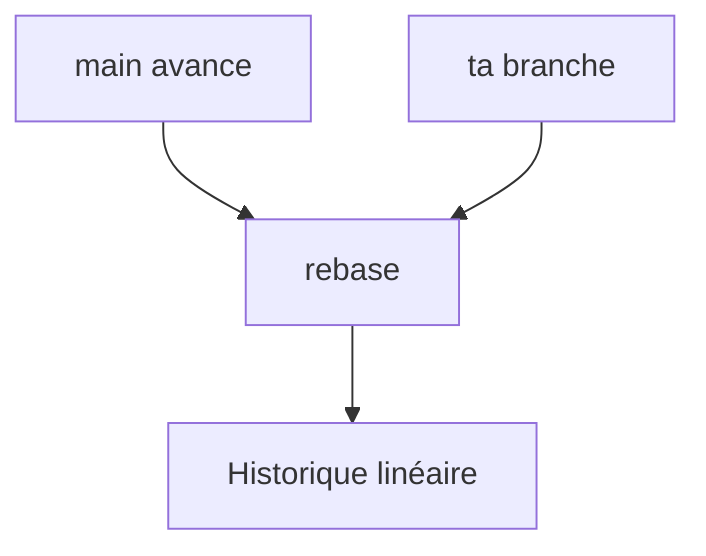

# Rebase

> [!info] En une phrase
> Rejouer ses commits par-dessus la dernière version d'une autre branche, pour obtenir un historique linéaire.

```dataviewjs
await dv.view("10 — Templates/Scripts/learning", { view: "concept" })
```

## 1 · Comprendre
### Définition
`git rebase main` (depuis ta branche) prend tes commits, les met de côté, avance ta branche au bout de `main`, puis rejoue tes commits un par un. Résultat : comme si tu avais commencé ton travail **après** les derniers changements de `main`. Les commits rejoués ont de **nouveaux identifiants**.

### Pourquoi ça existe
Garder un historique lisible, sans commits de fusion à chaque mise à jour.

### Le problème résolu
Une branche en retard sur `main`, avec des « Merge branch main into… » à répétition.

## 2 · Explorer
### Comment ça fonctionne


### Exemple concret
```bash
git switch feat/dry-run
git fetch
git rebase origin/main
# en cas de conflit : corriger, git add fichier, puis
git rebase --continue      # ou git rebase --abort pour tout annuler
git push --force-with-lease   # ta branche a été réécrite
git pull --rebase             # variante de pull qui rebase au lieu de fusionner
```

### Cas d'utilisation
- Mettre à jour sa branche avant une merge request
- `git pull --rebase` pour éviter des commits de fusion inutiles

> [!warning] À ne pas confondre
> **Rebase** (réécrit tes commits) et **merge** (ajoute un commit de fusion, ne réécrit rien). Ne rebase **jamais** une branche sur laquelle d'autres travaillent.

## 3 · Pratiquer

### Exercice visuel

Sur Excalidraw, **sans regarder la fiche**. Puis je compare avec la fiche, je corrige en rouge ce qui était faux, et j'explique mon dessin à voix haute ou à Claude dans le chat.

> [!example] ⚖️ Avant / après
> Avant / après : ta branche partie d'un vieux `main`, puis après `git rebase main`. Dessine où sont tes commits et pourquoi ils ont de nouveaux identifiants.

> [!example] 🔍 Trouve l'erreur
> Ce schéma est faux. Corrige-le en rouge et explique l'erreur.
>
> ```mermaid
> flowchart TD
>   B[Branche partagée] --> R[Rebase]
>   R --> P[Push simple]
>   P --> OK[Collègues tranquilles]
> ```

### Mon schéma

> [!tip] Mon dessin Excalidraw
> _Je crée le dessin « Schéma - Rebase » et je l'intègre ici avec `![[Schéma - Rebase.excalidraw]]`, puis je coche `schema`._

### Appliquer dans le fil rouge
- [[MesDépenses 07 - Travailler en branche]]

## 4 · Relier
- **Prérequis** : [[Merge]] · [[Dépôt distant (remote)]]
- **Complémentaires** : [[Annuler dans Git]] · [[Conflit de merge]]
- **Commandes** : [[git rebase]]

## 5 · Réviser
> [!question] Me faire interroger
> Je demande à Claude de m'interroger sur cette notion pour vérifier que je l'ai comprise.

### Validation (compris, puis maîtrisé)
Trois cases à cocher dans les propriétés de la fiche :
- `schema` : mon dessin du concept est dans « Mon schéma » ;
- `exercice_visuel` : j'ai fait et corrigé les exercices visuels de la section 3 ;
- `fil_rouge` : je l'ai appliqué dans le fil rouge (coché tout seul quand une étape qui l'utilise est réussie).

Les trois cochées : la notion compte comme **comprise**. **Maîtrisé** : c'est moi qui le mets dans `status`, quand je le sens.

```dataviewjs
await dv.view("10 — Templates/Scripts/learning", { view: "maitrise" })
```
