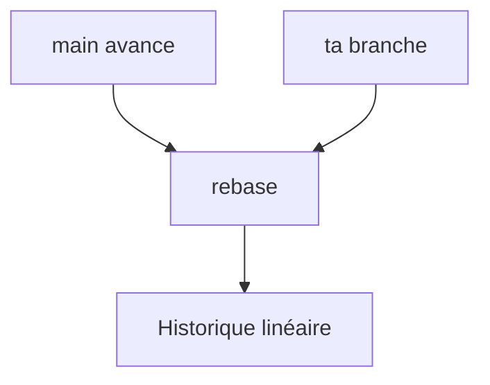

# Rebase

> [!info] En une phrase
> Rejouer ses commits par-dessus la dernière version d'une autre branche, pour obtenir un historique linéaire.

```dataviewjs
await dv.view("10 — Templates/Scripts/learning", { view: "concept" })
```

## 1 · Comprendre
### Définition
`git rebase main` (depuis ta branche) prend tes commits, les met de côté, avance ta branche au bout de `main`, puis rejoue tes commits un par un. Résultat : comme si tu avais commencé ton travail **après** les derniers changements de `main`. Les commits rejoués ont de **nouveaux identifiants**.

### Pourquoi ça existe
Garder un historique lisible, sans commits de fusion à chaque mise à jour.

### Le problème résolu
Une branche en retard sur `main`, avec des « Merge branch main into… » à répétition.

## 2 · Explorer
### Comment ça fonctionne


### Exemple concret
```bash
git switch feat/dry-run
git fetch
git rebase origin/main
# en cas de conflit : corriger, git add fichier, puis
git rebase --continue      # ou git rebase --abort pour tout annuler
git push --force-with-lease   # ta branche a été réécrite
git pull --rebase             # variante de pull qui rebase au lieu de fusionner
```

### Cas d'utilisation
- Mettre à jour sa branche avant une merge request
- `git pull --rebase` pour éviter des commits de fusion inutiles

> [!warning] À ne pas confondre
> **Rebase** (réécrit tes commits) et **merge** (ajoute un commit de fusion, ne réécrit rien). Ne rebase **jamais** une branche sur laquelle d'autres travaillent.

## 3 · Pratiquer
- Crée une branche, fais 2 commits, avance `main` de 2 commits, puis rebase ta branche et compare `git log --graph` avant et après.

## 4 · Expliquer
> [!quote] Mon résumé, avec mes mots
> _À écrire sans regarder la fiche. Si je bloque, je ne l'ai pas encore compris._

## 5 · Relier
- **Prérequis** : [[Merge]] · [[Dépôt distant (remote)]]
- **Complémentaires** : [[Annuler dans Git]] · [[Conflit de merge]]
- **Commandes** : [[git rebase]]

## 6 · Réviser
> [!question] Me faire interroger
> Je demande à Claude de m'interroger sur cette notion pour vérifier que je l'ai comprise.

### Validation de la maîtrise
- [ ] Je l'explique sans notes, en 3 phrases, à quelqu'un qui ne connaît pas
- [ ] J'ai réussi un exercice qui l'utilise
- [ ] Je l'ai utilisé dans un projet
- [ ] Je sais dire quand ne pas l'utiliser (ou ce qu'il ne faut pas confondre)
