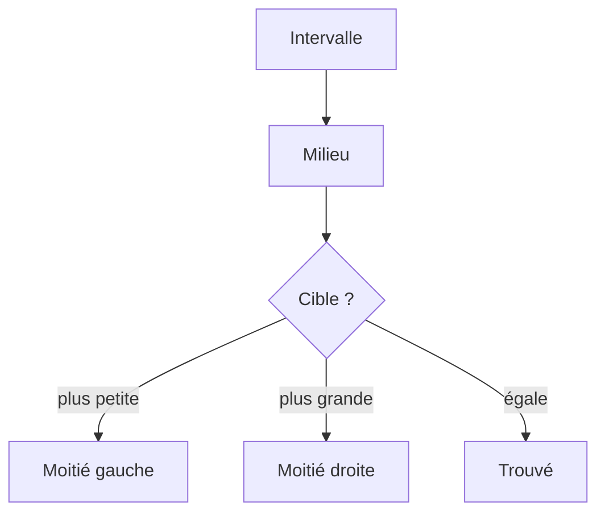

# Recherche linéaire et dichotomique

> [!info] En une phrase
> La recherche linéaire regarde les éléments un par un (O(n)) ; la recherche dichotomique, possible seulement sur des données triées, coupe l'intervalle en deux à chaque étape (O(log n)).

```dataviewjs
await dv.view("10 — Templates/Scripts/learning", { view: "concept" })
```

## 1 · Comprendre
### Définition
**Linéaire** : du premier au dernier, jusqu'à trouver. Marche sur n'importe quelle liste. Jusqu'à n comparaisons.
**Dichotomique** (*binary search*) : comme chercher un mot dans un dictionnaire papier. On ouvre au milieu ; si le mot cherché est avant, on garde la première moitié, sinon la seconde ; et on recommence.
- Condition : les données doivent être **triées**.
- Un million d'éléments : au plus **20** comparaisons.
- C'est aussi ce que fait `git bisect` pour trouver le commit qui a introduit un bug, et ce que fait un index de base de données (en arbre).

### Pourquoi ça existe
Chercher est l'opération la plus fréquente qui soit ; sur de gros volumes, la méthode change tout.

### Le problème résolu
Trouver un élément parmi des millions presque instantanément, à condition d'avoir trié.

## 2 · Explorer
### Comment ça fonctionne


### Exemple concret
```python
def recherche_dichotomique(liste_triee, cible):
    gauche, droite = 0, len(liste_triee) - 1
    while gauche <= droite:
        milieu = (gauche + droite) // 2
        if liste_triee[milieu] == cible:
            return milieu
        if liste_triee[milieu] < cible:
            gauche = milieu + 1
        else:
            droite = milieu - 1
    return -1
```
Trace sur `[2, 5, 8, 12, 16, 23, 38]`, cible 23 : milieu 12 (indice 3) → trop petit → droite ; milieu 23 (indice 5) → trouvé, en 2 étapes.
En pratique : le module `bisect` de Python, ou un `set`/`dict` si on n'a pas besoin de l'ordre.

### Cas d'utilisation
- `git bisect` pour trouver le commit fautif
- Les index de base de données
- Chercher dans une liste triée (dates, identifiants)

> [!warning] À ne pas confondre
> Utiliser la dichotomie sur des données **non triées** : le résultat est faux sans erreur visible. Et les bornes (`<=`, `+ 1`, `- 1`) : une erreur et la boucle ne s'arrête jamais ou rate la cible ; fais la trace.

## 3 · Pratiquer
- Écris la recherche dichotomique, puis trace-la à la main pour une cible présente, une absente, et une liste vide

## 4 · Expliquer
> [!quote] Mon résumé, avec mes mots
> _À écrire sans regarder la fiche. Si je bloque, je ne l'ai pas encore compris._

## 5 · Relier
- **Prérequis** : [[Complexité (notation grand O)]] · [[Motifs de boucle]]
- **Complémentaires** : [[Algorithmes de tri]] · [[Index de base de données]]

## 6 · Réviser
> [!question] Me faire interroger
> Je demande à Claude de m'interroger sur cette notion pour vérifier que je l'ai comprise.

### Validation de la maîtrise
La notion est maîtrisée quand j'ai réussi **tous les exercices** qui l'utilisent (statut `reussi` dans l'exercice).

```dataviewjs
await dv.view("10 — Templates/Scripts/learning", { view: "maitrise" })
```
