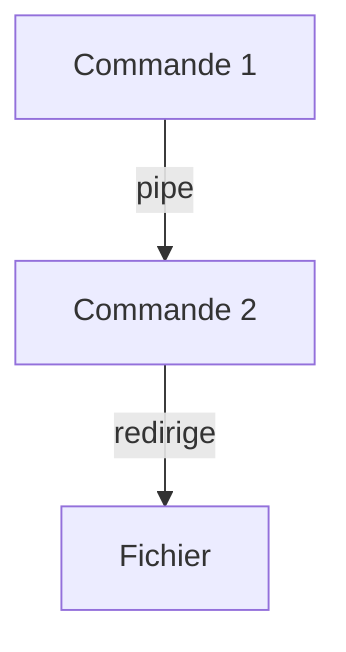

# Redirection et pipe

> [!info] En une phrase
> Envoyer la sortie d'une commande dans un fichier (>) ou dans une autre commande (|), au lieu de l'écran.

```dataviewjs
await dv.view("10 — Templates/Scripts/learning", { view: "concept" })
```

## 1 · Comprendre
### Définition
Chaque programme a trois canaux :
- **stdin** (0) : ce qu'il lit (le clavier par défaut) ;
- **stdout** (1) : sa sortie normale (l'écran) ;
- **stderr** (2) : ses messages d'erreur (l'écran aussi, mais séparé).

On peut les **rediriger** vers un fichier, ou les **brancher** (*pipe*, `|`) sur l'entrée d'une autre commande.

### Pourquoi ça existe
Combiner de petites commandes simples pour faire des choses complexes, et garder des traces dans des fichiers.

### Le problème résolu
Copier à la main le résultat d'une commande pour le donner à une autre.

## 2 · Explorer
### Comment ça fonctionne

| Symbole | Effet |
| --- | --- |
| `cmd > f.txt` | stdout dans un fichier (**écrase**) |
| `cmd >> f.txt` | stdout ajouté à la fin |
| `cmd 2> err.txt` | stderr dans un fichier |
| `cmd > tout.log 2>&1` | stdout **et** stderr dans le même fichier |
| `cmd > /dev/null` | jeter la sortie |
| `cmd1 \| cmd2` | stdout de cmd1 → stdin de cmd2 |

### Exemple concret
```bash
ls -l | wc -l                              # combien de lignes
grep -rn "ERROR" logs/ | head -20          # les 20 premières erreurs
docker logs mon-conteneur 2>&1 | grep -i error
history | grep docker                      # mes commandes docker passées
python zipper.py photos > rapport.txt 2> erreurs.txt
```
Commandes « filtres » utiles derrière un `|` : `grep` (garder les lignes qui contiennent), `head` / `tail` (début / fin), `sort`, `uniq`, `wc -l` (compter), `less` (lire page par page).

### Cas d'utilisation
- Fouiller un long log de CI ou de Docker
- Garder la sortie d'un script dans un fichier

> [!warning] À ne pas confondre
> `>` (écrase le fichier) et `>>` (ajoute). Et un message d'erreur qui « n'est pas redirigé » : il part sur **stderr**, ajoute `2>&1`. En PowerShell, `|` passe des **objets**, pas du texte : les mêmes enchaînements ne marchent pas toujours.

## 3 · Pratiquer
- Compte le nombre de fichiers `.md` de ton coffre avec une seule ligne.
- Lance une commande qui échoue, redirige seulement l'erreur dans un fichier, puis lis-le.

## 4 · Expliquer
> [!quote] Mon résumé, avec mes mots
> _À écrire sans regarder la fiche. Si je bloque, je ne l'ai pas encore compris._

## 5 · Relier
- **Prérequis** : [[Bash]]
- **Complémentaires** : [[Code de sortie]] · [[Processus]]
- **Commandes** : [[grep]] · [[cat]]

## 6 · Réviser
> [!question] Me faire interroger
> Je demande à Claude de m'interroger sur cette notion pour vérifier que je l'ai comprise.

### Validation de la maîtrise
La notion est maîtrisée quand j'ai réussi **tous les exercices** qui l'utilisent (statut `reussi` dans l'exercice).

```dataviewjs
await dv.view("10 — Templates/Scripts/learning", { view: "maitrise" })
```
