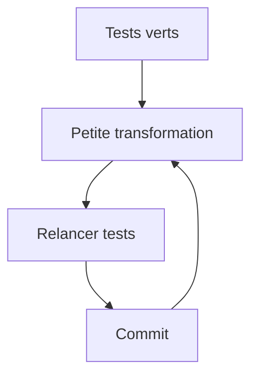

# Refactorisation

> [!info] En une phrase
> Refactoriser, c'est améliorer la structure du code sans changer son comportement, par petites étapes vérifiées par les tests ; c'est ainsi qu'on rembourse la dette technique.

```dataviewjs
await dv.view("10 — Templates/Scripts/learning", { view: "concept" })
```

## 1 · Comprendre
### Définition
**Dette technique** : les raccourcis pris pour aller vite (copier-coller, fonctions géantes, absence de tests) qui rendent chaque modification suivante plus coûteuse.
**Refactoriser** :
1. S'assurer que des **tests** couvrent le comportement actuel (sinon en écrire d'abord).
2. Faire **une petite transformation** : renommer, extraire une fonction, supprimer une duplication, simplifier une condition, déplacer du code.
3. Relancer les tests ; **commit**.
4. Recommencer.
On ne mélange **jamais** refactorisation et nouvelle fonctionnalité dans le même commit : la revue devient impossible.
Les éditeurs (VS Code, PyCharm) font les plus courantes automatiquement : *Rename Symbol* (F2), *Extract Function*.

### Pourquoi ça existe
Le code se dégrade à chaque ajout ; sans entretien, il devient trop risqué à toucher.

### Le problème résolu
Garder le code facile à modifier, en continu, sans grand chantier risqué.

## 2 · Explorer
### Comment ça fonctionne


### Exemple concret
```python
# avant
def traiter(d):
    if d["type"] == "png" and d["taille"] < 10_000_000 and not d["nom"].startswith("."):
        ...
# après : extraire et nommer
def est_image_valide(fichier) -> bool:
    return (fichier["type"] == "png"
            and fichier["taille"] < 10_000_000
            and not fichier["nom"].startswith("."))
def traiter(fichier):
    if est_image_valide(fichier):
        ...
```

### Cas d'utilisation
- Avant d'ajouter une fonctionnalité dans du code confus
- Après une revue de code
- Faire évoluer ton script de zip

> [!warning] À ne pas confondre
> **Refactoriser** (même comportement, meilleure structure) n'est pas **réécrire** (tout jeter et recommencer, très risqué). Et sans tests, ce n'est plus une refactorisation mais un pari.

## 3 · Pratiquer
- Sur un script, fais cinq petites refactorisations, chacune dans son commit, avec les tests verts entre chaque

## 4 · Expliquer
> [!quote] Mon résumé, avec mes mots
> _À écrire sans regarder la fiche. Si je bloque, je ne l'ai pas encore compris._

## 5 · Relier
- **Prérequis** : [[Test unitaire]] · [[Commit]]
- **Complémentaires** : [[Principes DRY, KISS et YAGNI]] · [[Convention de commit]]

## 6 · Réviser
> [!question] Me faire interroger
> Je demande à Claude de m'interroger sur cette notion pour vérifier que je l'ai comprise.

### Validation de la maîtrise
La notion est maîtrisée quand j'ai réussi **tous les exercices** qui l'utilisent (statut `reussi` dans l'exercice).

```dataviewjs
await dv.view("10 — Templates/Scripts/learning", { view: "maitrise" })
```
