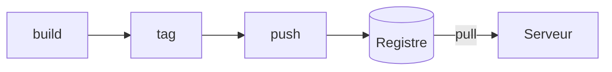

# Registre Docker

> [!info] En une phrase
> Un entrepôt d'images : on y pousse (push) une image construite une fois, et on la récupère (pull) ailleurs.

```dataviewjs
await dv.view("10 — Templates/Scripts/learning", { view: "concept" })
```

## 1 · Comprendre
### Définition
Un **registre** (*registry*) est un serveur qui stocke des [[Image Docker|images]]. Exemples : **Docker Hub** (public), le **registre GitLab** d'un projet, le [[Nexus]] d'une entreprise.

### Pourquoi ça existe
Partager une image entre ton poste, la CI et les serveurs, sans la reconstruire partout.

### Le problème résolu
Chaque machine reconstruisait l'image, avec le risque d'obtenir un résultat différent.

## 2 · Explorer
### Comment ça fonctionne


### Exemple concret
Le nom complet d'une image dit **où elle est rangée** :
```text
registre.exemple.com/equipe/projet/api:1.2.0
└──── registre ────┘└─ chemin ──┘└nom┘└tag┘
```
- **Pas de registre dans le nom** = Docker Hub : `python:3.11-slim` = `docker.io/library/python:3.11-slim`.
- **Le tag** est la version ; sans tag, c'est `latest`.

```bash
docker login registry.gitlab.com
docker build -t registry.gitlab.com/equipe/projet/api:1.2.0 .
docker push registry.gitlab.com/equipe/projet/api:1.2.0
docker pull registry.gitlab.com/equipe/projet/api:1.2.0   # sur une autre machine
```

### Les registres que tu croiseras
| Registre | Préfixe | Exemple |
| --- | --- | --- |
| Docker Hub | rien, ou `docker.io/` | `python:3.12-slim`, `cvat/server` |
| GitHub Container Registry | `ghcr.io/` | `ghcr.io/organisation/image:tag` |
| Registre GitLab | `registry.gitlab.com/` ou celui de ton GitLab | `$CI_REGISTRY_IMAGE` |
| Nexus de l'entreprise | `nexus.mon-entreprise.com:8082/` | voir [[Nexus]] |

### Miroir de registre
Un **miroir** (*mirror*) est un registre qui garde une copie d'un autre (souvent Docker Hub). Deux façons de s'en servir :
- **Écrire son adresse dans le nom** de l'image : `nexus…:8082/library/python:3.12-slim`. Explicite, marche partout.
- **Configurer le démon** (`registry-mirrors` dans `daemon.json`) : `docker pull python` passe par le miroir sans changer les noms. Ne marche que pour Docker Hub, et seulement là où le [[Démon Docker|démon]] est configuré.

Un projet open source peut publier ses images sur **plusieurs** registres (Docker Hub et ghcr.io) : le nom indiqué dans son `docker-compose.yml` dit lequel il utilise.

### Cas d'utilisation
- Publier les images construites par la CI
- Récupérer les images de base d'un Dockerfile
- Projet CVAT : partie 1 (reprendre CVAT sur GitLab, construire ses images en CI via le Nexus)

> [!warning] À ne pas confondre
> `latest` n'est **pas** une version : c'est juste le tag par défaut. Préférer un tag précis (`1.2.0`, ou l'identifiant du commit).

## 3 · Pratiquer
- Décompose le nom `nexus.mon-entreprise.com:8082/library/nginx:1.27` : quel est le registre, le chemin, le nom, le tag ?

## 4 · Expliquer
> [!quote] Mon résumé, avec mes mots
> _À écrire sans regarder la fiche. Si je bloque, je ne l'ai pas encore compris._

## 5 · Relier
- **Prérequis** : [[Image Docker]]
- **Notion parente** : [[Docker]]
- **Complémentaires** : [[Nexus]] · [[Dockerfile]]
- **Utilisé par** : [[Construire une image dans la CI]]
- **Commandes** : [[docker login]] · [[docker tag]] · [[docker push]]

## 6 · Réviser
> [!question] Me faire interroger
> Je demande à Claude de m'interroger sur cette notion pour vérifier que je l'ai comprise.

### Validation de la maîtrise
La notion est maîtrisée quand j'ai réussi **tous les exercices** qui l'utilisent (statut `reussi` dans l'exercice).

```dataviewjs
await dv.view("10 — Templates/Scripts/learning", { view: "maitrise" })
```
