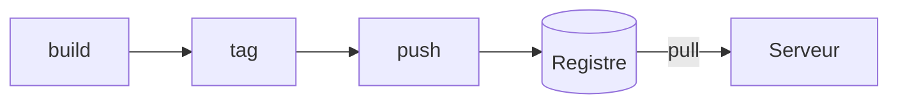

# Registre Docker

> [!info] En une phrase
> Un entrepôt d'images : on y pousse (push) une image construite une fois, et on la récupère (pull) ailleurs.

```dataviewjs
await dv.view("10 — Templates/Scripts/learning", { view: "concept" })
```

## 1 · Comprendre
### Définition
Un **registre** (*registry*) est un serveur qui stocke des [[Image Docker|images]]. Exemples : **Docker Hub** (public), le **registre GitLab** d'un projet, le registre interne d'une entreprise (Nexus, Artifactory).

### Pourquoi ça existe
Partager une image entre ton poste, la CI et les serveurs, sans la reconstruire partout.

### Le problème résolu
Chaque machine reconstruisait l'image, avec le risque d'obtenir un résultat différent.

## 2 · Explorer
### Comment ça fonctionne


### Exemple concret
Le nom complet d'une image dit **où elle est rangée** :
```text
registre.exemple.com/equipe/projet/api:1.2.0
└──── registre ────┘└─ chemin ──┘└nom┘└tag┘
```
- **Pas de registre dans le nom** = Docker Hub : `python:3.11-slim` = `docker.io/library/python:3.11-slim`.
- **Le tag** est la version ; sans tag, c'est `latest`.

```bash
docker login registry.gitlab.com
docker build -t registry.gitlab.com/equipe/projet/api:1.2.0 .
docker push registry.gitlab.com/equipe/projet/api:1.2.0
docker pull registry.gitlab.com/equipe/projet/api:1.2.0   # sur une autre machine
```

### Les registres que tu croiseras
| Registre | Préfixe | Exemple |
| --- | --- | --- |
| Docker Hub | rien, ou `docker.io/` | `python:3.12-slim`, `cvat/server` |
| GitHub Container Registry | `ghcr.io/` | `ghcr.io/organisation/image:tag` |
| Registre GitLab | `registry.gitlab.com/` ou celui de ton GitLab | `$CI_REGISTRY_IMAGE` |
| Registre interne | `registre.interne.exemple.com:8082/` | miroir de Docker Hub |

### Miroir de registre
Un **miroir** (*mirror*) est un registre qui garde une copie d'un autre (souvent Docker Hub). Deux façons de s'en servir :
- **Écrire son adresse dans le nom** de l'image : `nexus…:8082/library/python:3.12-slim`. Explicite, marche partout.
- **Configurer le démon** (`registry-mirrors` dans `daemon.json`) : `docker pull python` passe par le miroir sans changer les noms. Ne marche que pour Docker Hub, et seulement là où le [[Démon Docker|démon]] est configuré.

Un projet open source peut publier ses images sur **plusieurs** registres (Docker Hub et ghcr.io) : le nom indiqué dans son `docker-compose.yml` dit lequel il utilise.

### Cas d'utilisation
- Publier les images construites par la CI
- Récupérer les images de base d'un Dockerfile

> [!warning] À ne pas confondre
> `latest` n'est **pas** une version : c'est juste le tag par défaut. Préférer un tag précis (`1.2.0`, ou l'identifiant du commit).

## 3 · Pratiquer

### Exercice visuel

Sur Excalidraw, **sans regarder la fiche**. Puis je compare avec la fiche, je corrige en rouge ce qui était faux, et j'explique mon dessin à voix haute ou à Claude dans le chat.

> [!example] 🛣️ Suis le trajet
> Dessine le trajet d'une image construite dans la CI : build, tag, push vers le registre, pull sur le serveur.

> [!example] 🧠 Dessine de mémoire
> Dessine Docker Hub, un registre privé (miroir interne) et le registre GitLab. Place qui peut lire et écrire dans chacun.

### Mon schéma

> [!tip] Mon dessin Excalidraw
> _Je crée le dessin « Schéma - Registre Docker » et je l'intègre ici avec `![[Schéma - Registre Docker.excalidraw]]`, puis je coche `schema`._

### Appliquer dans le fil rouge
- [[MesDépenses 10 - Sortir une version]]
- [[Fil rouge 06 - Construire l'image dans la CI]]

## 4 · Relier
- **Au travail** : [Registre Docker au travail](obsidian://open?vault=Travail&file=Registre%20Docker%20au%20travail)
- **Prérequis** : [[Image Docker]]
- **Notion parente** : [[Docker]]
- **Complémentaires** : [[Dockerfile]]
- **Utilisé par** : [[Construire une image dans la CI]]
- **Commandes** : [[docker login]] · [[docker tag]] · [[docker push]]

## 5 · Réviser
> [!question] Me faire interroger
> Je demande à Claude de m'interroger sur cette notion pour vérifier que je l'ai comprise.

### Validation (compris, puis maîtrisé)
Trois cases à cocher dans les propriétés de la fiche :
- `schema` : mon dessin du concept est dans « Mon schéma » ;
- `exercice_visuel` : j'ai fait et corrigé les exercices visuels de la section 3 ;
- `fil_rouge` : je l'ai appliqué dans le fil rouge (coché tout seul quand une étape qui l'utilise est réussie).

Les trois cochées : la notion compte comme **comprise**. **Maîtrisé** : c'est moi qui le mets dans `status`, quand je le sens.

```dataviewjs
await dv.view("10 — Templates/Scripts/learning", { view: "maitrise" })
```
