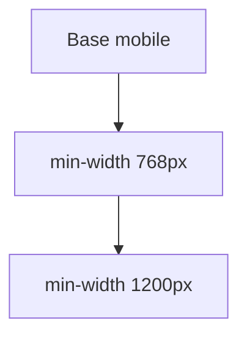

# Responsive design

> [!info] En une phrase
> Une page qui s'adapte à toutes les tailles d'écran, du téléphone au grand écran, grâce aux mises en page fluides et aux media queries.

```dataviewjs
await dv.view("10 — Templates/Scripts/learning", { view: "concept" })
```

## 1 · Comprendre
### Définition
Trois ingrédients :
1. la balise `<meta name="viewport" content="width=device-width, initial-scale=1">` ;
2. des tailles **fluides** (`%`, `fr`, `rem`, `max-width`) plutôt que fixes ;
3. des **media queries** : des règles qui ne s'appliquent qu'à partir d'une certaine largeur.

On écrit souvent **mobile d'abord** : le style de base pour petit écran, puis des ajustements pour les écrans plus larges.

### Pourquoi ça existe
Plus de la moitié des visites se font sur téléphone.

### Le problème résolu
Faire une version séparée du site pour chaque appareil.

## 2 · Explorer
### Comment ça fonctionne


### Exemple concret
```css
.page { display: grid; grid-template-columns: 1fr; gap: 1rem; padding: 1rem; }
img { max-width: 100%; height: auto; }

@media (min-width: 768px) {          /* tablette et plus */
  .page { grid-template-columns: 220px 1fr; }
}
@media (min-width: 1200px) {         /* grand écran */
  .page { max-width: 1100px; margin: 0 auto; }
}
```
Dans F12, le mode « appareil » (Ctrl+Maj+M) simule différentes tailles.

### Cas d'utilisation
- Toute page publique ; les tableaux de bord consultés sur tablette
- Les frameworks CSS (Bootstrap, Tailwind) proposent des points de rupture prêts

> [!warning] À ne pas confondre
> Réduire la fenêtre du navigateur (approximation) et tester sur un vrai téléphone : les tailles de police, le tactile et le zoom diffèrent. Et une largeur fixe en `px` sur un grand bloc provoque un défilement horizontal sur mobile.

## 3 · Pratiquer

### Exercice visuel

Sur Excalidraw, **sans regarder la fiche**. Puis je compare avec la fiche, je corrige en rouge ce qui était faux, et j'explique mon dessin à voix haute ou à Claude dans le chat.

> [!example] ⚖️ Avant / après
> Avant / après : la liste des dépenses sur un écran large, puis sur un téléphone. Dessine ce qui change et à quelle largeur.

> [!example] 🛣️ Suis le trajet
> Dessine comment le navigateur choisit les règles CSS quand la fenêtre passe de 1200 px à 400 px.

### Mon schéma

> [!tip] Mon dessin Excalidraw
> _Je crée le dessin « Schéma - Responsive design » et je l'intègre ici avec `![[Schéma - Responsive design.excalidraw]]`, puis je coche `schema`._

### Appliquer dans le fil rouge
- Pas encore d'étape du fil rouge pour cette notion : elle sera pratiquée dans le fil rouge de son niveau (voir [[Niveaux]]).

## 4 · Relier
- **Prérequis** : [[Flexbox]] · [[Grid CSS]]
- **Complémentaires** : [[Accessibilité web]]

## 5 · Réviser
> [!question] Me faire interroger
> Je demande à Claude de m'interroger sur cette notion pour vérifier que je l'ai comprise.

### Validation (compris, puis maîtrisé)
Trois cases à cocher dans les propriétés de la fiche :
- `schema` : mon dessin du concept est dans « Mon schéma » ;
- `exercice_visuel` : j'ai fait et corrigé les exercices visuels de la section 3 ;
- `fil_rouge` : je l'ai appliqué dans le fil rouge (coché tout seul quand une étape qui l'utilise est réussie).

Les trois cochées : la notion compte comme **comprise**. **Maîtrisé** : c'est moi qui le mets dans `status`, quand je le sens.

```dataviewjs
await dv.view("10 — Templates/Scripts/learning", { view: "maitrise" })
```
